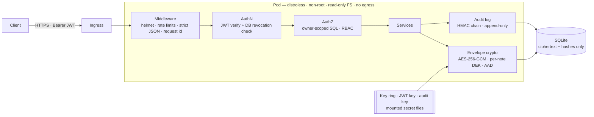

<div align="center">

# 🛡️ Bastion

**A deliberately hardened, envelope-encrypted notes API — and the DevSecOps supply chain that ships it.**

[](https://github.com/Azog1812/bastion-academy/actions/workflows/ci.yml)
[](https://github.com/Azog1812/bastion-academy/actions/workflows/security.yml)
[](https://github.com/Azog1812/bastion-academy/actions/workflows/codeql.yml)
[](https://github.com/Azog1812/bastion-academy/actions/workflows/container.yml)
[](https://github.com/Azog1812/bastion-academy/actions/workflows/dast.yml)
[](https://scorecard.dev/viewer/?uri=github.com/Azog1812/bastion-academy)
[](LICENSE)

[Threat model](docs/threat-model.md) · [Controls ↔ OWASP mapping](docs/security-controls.md) · [Security pipeline](docs/security-pipeline.md) · [ADRs](docs/adr/) · [Runbook](docs/runbook.md) · [API spec](docs/openapi.yaml)

</div>

> 🇫🇷 **En bref** — API de notes chiffrées conçue « security by design » : chiffrement
> enveloppe AES-256-GCM, authentification résistante au brute force et à l'énumération,
> anti-IDOR, journal d'audit infalsifiable, conteneur distroless non-root, et une chaîne
> CI/CD DevSecOps complète (SAST, SCA, secrets, IaC, DAST, SBOM, signature Sigstore,
> provenance SLSA), plus une supervision Prometheus dont les alertes de sécurité sont
> elles-mêmes testées. Chaque contrôle est relié à une menace et prouvé par un test.

## Where this is going: Bastion Academy

Bastion is becoming the core of **Bastion Academy**, a self-hosted cybersecurity
learning platform. Its pedagogy is *break it, then fix it*: each module starts from a
real vulnerability (IDOR, JWT forgery, brute force, SQL injection, token replay…).
The learner first exploits it in a lab and captures a flag. Then they study how
Bastion's own code defeats the attack and run the test that proves it. The path goes
from first principles up to the level expected by major industry certifications.

| Milestone | Scope | Status |
|---|---|---|
| **v3: foundations** | Learning paths → modules → lessons, progress tracking, web front-end, built on Bastion's auth core | ✅ API, web UI, all six levels shipped |
| **v4: challenges** | Per-user HMAC flags (unshareable), scoreboard, anti-cheat, TOTP MFA | ✅ Shipped: 11 challenges (levels 1 to 3), opt-in scoreboard, TOTP + recovery codes · **passkeys** (WebAuthn, [ADR 0016](docs/adr/0016-passkeys.md)) |
| **v5: isolated labs** | One vulnerable container per learner: no egress, TTL, sandboxed runtime, quotas | ✅ Shipped: 10 labs (SQLi, IDOR, mass assignment, JWT `alg:none`, SSRF, path traversal, command injection, stored XSS with a headless-browser victim, a three-flaw chain, a race condition), lab runner + gateway, optional gVisor |
| **v6: blue team** | Level 5 path (logging, SIEM, detection engineering, incident response, forensics) and detection challenges | ✅ Shipped: 6 lessons, 5 detection challenges graded on precision **and** recall · real Wazuh from the UI and 2 Wazuh XML rule challenges ([ADR 0013](docs/adr/0013-shared-environments.md), [0014](docs/adr/0014-wazuh-rule-challenges.md)) · Observability shipped (Prometheus, tested alerts, [ADR 0011](docs/adr/0011-observability.md)) · AI tutor: planned |

The platform is designed to **run locally** (`git clone` + Docker). There is no public
hosted instance yet.

### What's available today

The curriculum spans six levels, from **Fundamentals** to **Expert**, all available
(in French, 50 lessons, 142 quiz questions). Heavy hands-on modules are **optional**:
each learner adds them to their training from the web UI if their machine can run them,
and leaving one out never locks the rest of the path:

- **Level 1, Fundamentals**: security basics, HTTP, sessions and JWT, then a
  *break it, then fix it* IDOR module.
- **Level 2, Web and API security**: SQL injection (with a self-contained local
  mini-lab), XSS, CSRF, JWT attacks, mass assignment and function-level access
  control.
- **Level 3, Systems and networks**: TCP/IP, DNS and TLS, legal port scanning, Linux
  permissions and privilege escalation, container hardening, Windows accounts and
  tokens, Kerberos and Active Directory attacks, network segmentation.
- **Level 4, Penetration testing**: the legal frame and rules of engagement (French
  penal code, PASSI), PTES and OWASP WSTG, reconnaissance, chaining flaws,
  post-exploitation within scope, CVSS 4.0 and writing a report that gets things fixed.
- **Level 5, Defense and detection** (blue team): what to log, SIEM and correlation,
  writing Sigma-style rules, reading web attacks in logs, incident response (NIST SP
  800-61r3, 72-hour GDPR notification), forensics first steps (order of volatility,
  containers); optional **Wazuh** module (architecture, decoders and XML rules,
  file integrity monitoring, CIS configuration assessment, active response and its traps).
- **Level 6, Expert**: race conditions (TOCTOU, single-packet attack) and insecure
  deserialization (gadget chains, prototype pollution); Kerberos delegation, AD CS
  (ESC1, ESC8) and DCSync, then how to detect them (4769, 4662, 4887, honey
  accounts); the certification landscape (OSCP+, CPTS, GIAC, ANSSI qualifications)
  and the method for a 24-hour practical exam.

**5 detection challenges** ([ADR 0010](docs/adr/0010-detection-challenges.md)): the
learner **writes a detection rule** (a JSON subset of Sigma) and the server scores it on
a log dataset generated for them, where attacks hide among benign activity **and
traps** built for naive rules. Solved only with every attack caught **and** zero false
positives, the SOC's daily trade-off.

| Challenge | What the naive rule gets wrong |
|---|---|
| SQL injections in access logs | An apostrophe flags *O'Connor*; the user agent misses the attacker who hides behind a browser |
| Password spraying (Windows 4624/4625) | Counting failures flags a service account with an expired password |
| Living off the land (LOLBins) | Alerting on `certutil` or `rundll32` drowns the SOC in admin activity |
| SSH brute force, fast and slow | A short window misses the patient attacker; a low threshold flags a forgetful user |
| Kerberoasting (Windows 4769) | "RC4 = alert" flags the legacy payroll app and machine accounts; counting services without RC4 flags the inventory account |

The rule language has **no regular expressions on purpose** (a learner regex would run
on the server's event loop: ReDoS), and fields are checked against each dataset.

**2 Wazuh rule challenges** ([ADR 0014](docs/adr/0014-wazuh-rule-challenges.md)), in the
optional Wazuh module: the learner writes **real Wazuh XML rules**, as in
`local_rules.xml`, against alerts shaped like Wazuh's `alerts.json`. Learner XML never
reaches a general-purpose parser: a closed reader refuses DTDs and entities (**XXE**,
*billion laughs*), patterns are OS_Match only (no ReDoS), and the rule tree cannot loop.
The evaluator is **checked against the real Wazuh in CI**: the reference rules are replayed
through `wazuh-logtest` (Wazuh 4.14, no network) and must raise exactly the same alerts.
That check corrected the model: "Failed password" walks 5716 → 5760, `<srcip>!x` does not
exclude x, and `action` is a static field.

| Challenge | What the naive rule gets wrong |
|---|---|
| SSH brute force, in XML | Correlating on 5716 sees nothing (the event goes on to 5760); on 5760 alone, the attacker who only tries non-existent users (5710) slips through; excluding the backup server's whole subnet hides a compromised neighbour |
| Monitoring Bastion itself (its JSON audit log) | `<match>refresh</match>` flags every normal token refresh; without a level 0 child, the CI's nightly DAST scan pages the SOC |

Every *break it, then fix it* module ends in Bastion's own code: the learner
attacks Bastion, then reads the exact lines, lint rules, Semgrep rules and tests
that stop the attack.

**11 challenges**, each one a task from the job, each with a flag unique to the learner:

| Challenge | Level | What the learner does |
|---|---|---|
| Encodage n'est pas chiffrement · La crypto maison | 1 | Peel nested Base64; break single-byte XOR with a known-plaintext attack |
| Un code PIN dans une empreinte rapide | 1 | Brute-force an unsalted SHA-256 PIN hash (10,000 guesses), open the vault |
| Des en-têtes trop bavards · Un jeton qui parle trop | 1 | Spot a debug header in a raw HTTP response; read the claims of a JWT |
| Reconstituer une injection SQL à l'aveugle | 2 | **Forensics**: replay sqlmap's binary search from an access log, using only response sizes |
| Un secret de signature trop faible | 2 | Crack an HS256 JWT secret offline against a wordlist (what `hashcat -m 16500` does) |
| Un mot de passe sur le fil | 3 | Decode a `tcpdump -X` capture layer by layer, recover HTTP Basic credentials |
| Qui peut vraiment lire ce fichier ? | 3 | Apply the kernel's exact owner/group/other rule, traps included, to find readable files |
| La première règle qui gagne | 3 | Evaluate an nftables ruleset (first match, CIDR, protocol, default policy) on real flows |
| Pulvérisation de mots de passe et porte dérobée | 3 | **SOC triage**: spot a password spray in Windows events, decode `-EncodedCommand` |

Puzzles are generated per learner from an HMAC seed (nothing stored), decoys share the
flag's format, and each generator has a test that solves it the way the brief says
([`challenge-generators.test.ts`](test/unit/challenge-generators.test.ts)).

**10 live labs** ([ADR 0009](docs/adr/0009-isolated-labs.md)): a real, intentionally vulnerable
service started for one learner, holding that learner's flag, reachable only from their machine.

| Lab | Level | Attack |
|---|---|---|
| Les factures des autres | 1 | IDOR / BOLA on an invoicing API |
| Entrer sans mot de passe | 2 | SQL injection on a login form (verbose errors as the first clue) |
| Promu administrateur | 2 | Mass assignment on sign-up (`"role": "admin"`) |
| Un jeton sans signature | 2 | Forge a JWT with `"alg": "none"` |
| Un modérateur trop confiant | 2 | Stored XSS against a **real headless Chromium** moderator; exfiltrate its cookie *through the app itself*, since labs have no route out |
| Un aperçu trop curieux | 2 | SSRF: make the server fetch its own loopback admin service |
| Le dossier d'à côté | 3 | Path traversal out of a download folder |
| Trois failles, une chaîne | 4 | **No single flaw is enough**: path traversal → leaked JWT secret → forged admin token (shortcuts like `/proc/self/environ` blocked) |
| Une carte cadeau, plusieurs fois | 6 | Race condition: a single-use gift card redeemed many times by parallel requests (the fix is Bastion's invariant 5: an atomic compare-and-set) |
| Un shell, mais dans une cage | 3 | Command injection → a real shell, then **try to escape and see why you can't** (no route out, read-only, `noexec`, no capabilities) |

The lab is vulnerable, the box around it is not:

```
browser ─► bastion :3000 ──(internal network, token)──► lab-runner ── Docker socket
browser ─► lab-gateway :8088 ──(one internal network per lab)──► lab container
```

- **Only the lab runner touches Docker** (root-equivalent): unreachable except from the
  platform, token-protected, and it never takes an image, mount or option from a request.
- **Each lab** runs non-root, read-only, with no capabilities, capped memory/CPU/PIDs,
  no published port, on its **own network with no route out**: no tool download, no
  reverse shell, no neighbour. Optional **gVisor** (`LAB_RUNTIME=runsc`).
- **Each lab has its own origin** (`l<id>.lab.localhost`): a lab's XSS cannot touch the
  platform session.
- One lab per learner, a TTL enforced by both the platform and the runner, starts
  rate-limited. Isolation was checked live: from a lab, the Internet, the runner and the
  platform are all unreachable.

**Start learning** (Node ≥ 22.13):

```bash
git clone https://github.com/Azog1812/bastion-academy && cd bastion-academy
npm ci --ignore-scripts && npm run build
node dist/cli.js gen-secrets > .env
set -a && . ./.env && set +a && NODE_ENV=development npm start
```

Then open **http://localhost:3000**, create an account and follow the path.

**With the labs** (Docker required), generate `.env` as above, then:

```bash
docker compose --profile labs build   # lab images, once
docker compose up --build             # platform + lab runner + lab gateway, all on 127.0.0.1
```

**With monitoring**: `docker compose --profile observability up -d` adds Prometheus on
**http://127.0.0.1:9090**. Replay a refresh token and watch `BastionRefreshTokenReuse`
fire in the *Alerts* tab ([ADR 0011](docs/adr/0011-observability.md)).

**With a real Wazuh** (optional module, ~4 GiB of RAM): `docker compose --profile wazuh up -d`
once, then learners start and stop it from the module card; dashboard on
**https://localhost:8443**. Setup makes its own CA offline and drops Wazuh's demo accounts
([ADR 0013](docs/adr/0013-shared-environments.md)). The platform's own audit log goes into
it too ([ADR 0015](docs/adr/0015-audit-log-to-siem.md)): replay a refresh token or probe an
admin route, and the alert shows up in the dashboard (`rule.groups: bastion`).

| Endpoint | Purpose |
|---|---|
| `GET /v1/curriculum` | Levels, paths, modules and lessons, with your progress and which modules are unlocked |
| `GET /v1/lessons/{id}` | A lesson (Markdown) and its quiz questions, never their answers |
| `POST /v1/lessons/{id}/complete` | Submit your quiz answers; graded on the server |
| `POST /v1/session/{login,mfa,passkey,refresh,logout}` | Browser sessions: refresh token in an HttpOnly cookie |
| `GET /v1/challenges[/{id}]` · `POST /v1/challenges/{id}/submit` | Challenges: your personal artifact, then your personal flag |
| `GET /v1/scoreboard` · `PUT /v1/me/profile` | Opt-in scoreboard under a pseudonym |
| `POST /v1/me/mfa/{setup,enable,disable}` · `POST /v1/auth/mfa` | TOTP second factor and recovery codes |
| `GET/POST /v1/me/passkeys` · `POST /v1/me/passkeys/options` · `DELETE /v1/me/passkeys/{id}` · `POST /v1/auth/mfa/passkey/options` | Passkeys (WebAuthn) as a phishing-resistant second factor |
| `POST /v1/auth/passkey/options` · `POST /v1/auth/passkey` | Passwordless login with a discoverable, user-verified passkey |

How it is secured ([ADR 0006](docs/adr/0006-curriculum-as-code.md), [ADR 0007](docs/adr/0007-web-front-end.md)):

- **Curriculum as code.** Lessons live in [`content/`](content/) and change only
  through reviewed pull requests. They are validated at boot, and the server refuses
  to start on inconsistent content. There is no CMS to compromise.
- **Server-side gating.** Prerequisites and quizzes are enforced by the API, so editing
  the front-end unlocks nothing. Quiz answers never leave the server.
- **Isolated progress.** Every query is scoped to the authenticated learner. A Semgrep
  rule blocks any regression.
- **A web UI with zero new dependencies.** Plain TypeScript compiled by `tsc`, served
  from the same origin (no CORS). The access token stays in memory; the refresh token
  lives in an `HttpOnly; Secure; SameSite=Strict` `__Host-` cookie that no script can
  read.
- **Unshareable flags** ([ADR 0008](docs/adr/0008-flags-scoreboard-mfa.md)). Each
  flag is `HMAC(key, challenge, learner)`: never stored, never in the repository, and
  useless to anyone else. A learner who submits someone else's flag gets the same answer
  as for a wrong one, and the audit log records whose flag it was.
- **TOTP MFA without a library** (RFC 6238 on `node:crypto`, checked against the RFC test
  vectors). Seeds are encrypted under the KEK ring; a code is never accepted twice; wrong
  codes feed the account lockout; turning MFA off needs the password *and* a code.
- **Passkeys without a library** (WebAuthn on `node:crypto`, [ADR 0016](docs/adr/0016-passkeys.md)):
  the exact origin and the RP ID hash are checked, so a phishing proxy's relayed signature
  is refused, which TOTP cannot do. Single-use challenges bound to their MFA step, a
  bounded CBOR decoder for the attacker-supplied structures, clone detection through the
  signature counter (audited, Wazuh level 12). Tested with a software authenticator playing
  the attacker, and end to end in Chromium with its virtual authenticator. Open the local
  install at `http://localhost:3000` (an IP address cannot be an RP ID).
- **Passwordless login** ([ADR 0017](docs/adr/0017-passwordless-passkey-login.md)): a
  discoverable passkey with user verification replaces password and second factor (AAL2).
  The options name no account (nothing to enumerate), the user handle must own the key,
  failures never feed the lockout (no "lock anyone" button), and recovery never bypasses a
  factor: another passkey, or password plus a code, or the operator CLI on the host.
- **XSS needs two independent failures.** The UI never builds HTML from strings
  (ESLint bans every HTML sink, Markdown is rendered node by node), and the page CSP
  enforces **Trusted Types** with no policy allowed, so any such sink throws in the
  browser.

Quick tour, once the API runs (see [Try to break it](#try-to-break-it) to start it
and get a token):

```bash
curl -s $B/v1/curriculum -H "authorization: Bearer $ALICE" | jq '.paths[].modules[] | {id, unlocked}'
curl -s $B/v1/lessons/cia-et-risque -H "authorization: Bearer $ALICE" | jq -r .body
```

> [!WARNING]
> The labs are **intentionally vulnerable** applications. Run them only on
> your own machine, bound to `127.0.0.1`, and **never expose them to a network you
> don't control**. Only attack targets you own or are explicitly authorised to test.

> 🇫🇷 **Bastion Academy** — Bastion devient le cœur d'une plateforme d'apprentissage
> cyber à installer chez soi, fondée sur le principe « casse-le, puis répare-le » :
> on exploite une faille réelle dans un lab, puis on étudie le code et le test qui la
> neutralisent. Progression des bases jusqu'au niveau des grandes certifications.
> Déjà disponible : une interface web (http://localhost:3000 après installation),
> l'API d'apprentissage (cursus, progression, quiz corrigés côté serveur), six
> parcours en français, des « Fondamentaux » au niveau « Expert » (48 leçons, dont un
> module Wazuh optionnel : chaque élève ajoute les modules lourds selon sa machine), des
> défis à flag personnel, 10 labs isolés, 5 défis de détection, un classement et la
> MFA TOTP. Les labs sont volontairement vulnérables : à lancer uniquement en local.

---

## Why this project exists

This repository started as a 20-line Express "hello world" with a Jenkins pipeline
whose security stages were commented out, a password passed as a build parameter and
a vulnerability scan ending in `|| true`. That version is still in the git history,
on purpose.

v2 asks a different question: **what does it take for a small API to survive a real
attacker, and to prove it?** The answer is not the feature list — it is that every
security claim below is backed by code you can read and a test that tries to break it.

## What's inside



### Application security

| Threat | Control | Proven by |
|---|---|---|
| Database dump / leaked backup | **Envelope encryption**: one AES-256-GCM key per note, wrapped by a rotating KEK that never touches the DB | [`envelope.test.ts`](test/unit/envelope.test.ts) |
| Ciphertext swapped between users by a DB-level attacker | Owner id and note id bound in the **AAD** → decryption fails | [`authorization.test.ts`](test/security/authorization.test.ts) |
| IDOR / BOLA (OWASP API #1) | Owner id inside every SQL query; foreign and missing notes are indistinguishable (404); probing is audited | [`authorization.test.ts`](test/security/authorization.test.ts) |
| Brute force & credential stuffing | Per-IP rate limit, **progressive lockout** with atomic counters, breached-password blocklist | [`authentication.test.ts`](test/security/authentication.test.ts) |
| Account enumeration | Identical response for unknown user / wrong password / locked, and a **dummy scrypt hash** so timing matches | [`authentication.test.ts`](test/security/authentication.test.ts) |
| JWT attacks (`alg:none`, alg confusion, tampering, replay) | Algorithm allow-list, `iss`/`aud`/`typ`/`exp` enforced, claims re-validated | [`tokens.test.ts`](test/unit/tokens.test.ts) |
| Phished or reused password | Optional **TOTP MFA**: replay-proof codes (compare-and-set on the time step), single-use 5-attempt login challenge, encrypted seeds, hashed one-time recovery codes; **passkeys** for phishing resistance (origin and RP ID bound) | [`mfa.test.ts`](test/security/mfa.test.ts), [`totp.test.ts`](test/unit/totp.test.ts) |
| Flag sharing, scoreboard cheating | **Per-learner HMAC flags**, constant-time check, per-account rate limit, shared flags attributed in the audit log | [`challenges.test.ts`](test/security/challenges.test.ts) |
| Escaping a lab (to the host, the platform, other labs, the Internet) | Hardened container, **per-instance internal network**, gateway as the only peer, Docker socket held by the runner only, closed lab catalog | [`lab-runner.test.ts`](test/unit/lab-runner.test.ts), [`labs.test.ts`](test/security/labs.test.ts) |
| SSRF through the lab gateway | Upstream **built** from a 32-hex instance id, never read from the request | [`lab-runner.test.ts`](test/unit/lab-runner.test.ts) |
| Stolen refresh token | Single-use **rotation with reuse detection**: replay kills the whole session family (RFC 9700) | [`authentication.test.ts`](test/security/authentication.test.ts) |
| Race conditions (TOCTOU) on refresh & lockout | Token claimed atomically before any `await`; `UPDATE … RETURNING` counters | parallel-request tests |
| "Stateless" JWT that can't be revoked | `token_version` + role checked on every request → instant logout-everywhere and demotion | [`authorization.test.ts`](test/security/authorization.test.ts) |
| Mass assignment, prototype pollution, HPP | Strict schemas reject unknown keys; simple query parser | [`input-and-transport.test.ts`](test/security/input-and-transport.test.ts) |
| SQL injection | Bound parameters only, enforced by **ESLint and Semgrep rules** | tests + CI |
| Evidence tampering after an intrusion | **Tamper-evident audit log**: HMAC chain + DB triggers; `verify` pinpoints the first altered entry | [`config-and-audit.test.ts`](test/unit/config-and-audit.test.ts) |
| Misconfiguration | **Fail-closed config**: refuses to start with missing, short or placeholder secrets | [`config-and-audit.test.ts`](test/unit/config-and-audit.test.ts) |

Plus: scrypt (N=2¹⁷) with transparent rehash · NIST 800-63B password policy · strict
security headers (CSP `default-src 'none'`, HSTS preload…) · `no-store` caching ·
generic errors with correlation ids · secret redaction in logs · secrets read from
files rather than env vars · socket timeouts · privileged operations only via an
operator CLI, never over HTTP.

**386 tests, ~98 % line coverage** — most of them are *abuse cases*, not happy paths.

### Supply chain & infrastructure

| Stage | What runs |
|---|---|
| Code | ESLint (`strictTypeChecked` + security plugin + custom SQL rules), `tsc --strict` |
| Secrets | gitleaks over the **entire git history** |
| SAST | Semgrep (OWASP Top 10, Node, TS, JWT) + [8 project-specific rules](.semgrep/bastion.yml), CodeQL `security-extended` |
| SCA | `npm audit`, **`npm audit signatures`**, OSV-Scanner, Dependency Review on PRs, Dependabot with a 7-day cooldown |
| IaC | hadolint, Checkov (0 unreviewed findings; risk acceptances documented inline) |
| Container | Distroless, UID 65532, no shell (asserted in CI), smoke-tested with `--read-only --cap-drop ALL`, Trivy gate |
| DAST | OWASP ZAP API scan **authenticated with a real token**, driven by the OpenAPI spec |
| Release | Push of the exact scanned image → **cosign keyless signature** → signed **CycloneDX SBOM** → **SLSA provenance** → self-verification |
| Monitoring | Prometheus metrics on a **separate, token-protected listener**, labels from closed sets only (no personal data, no cardinality DoS), **12 alerts unit-tested with `promtool`** in CI and linked to the [runbook](docs/runbook.md); the audit log itself in **Wazuh**, with rules checked in the real `wazuh-logtest` ([ADR 0015](docs/adr/0015-audit-log-to-siem.md)) |
| Runtime | Kubernetes PSS *restricted*, default-deny NetworkPolicy with **no egress**, no SA token, secrets as 0400 files, **Kyverno rejects unsigned images** |
| Pipeline itself | `permissions: {}`, every action **SHA-pinned**, `--ignore-scripts`, `persist-credentials: false`, harden-runner, OpenSSF Scorecard |

## Try to break it

```bash
git clone https://github.com/Azog1812/bastion-academy && cd bastion-academy
npm ci && npm run build
node dist/cli.js gen-secrets > .env
set -a && . ./.env && set +a && NODE_ENV=development npm start
```

Then, in another terminal:

```bash
B=http://localhost:3000; J='content-type: application/json'
login() { curl -s -X POST $B/v1/auth/register -H "$J" -d "{\"email\":\"$1\",\"password\":\"correct horse battery staple\"}" >/dev/null
          curl -s -X POST $B/v1/auth/login -H "$J" -d "{\"email\":\"$1\",\"password\":\"correct horse battery staple\"}" | jq -r .accessToken; }
ALICE=$(login alice@demo.test); MALLORY=$(login mallory@demo.test)

NOTE=$(curl -s -X POST $B/v1/notes -H "$J" -H "authorization: Bearer $ALICE" -d '{"title":"diary","body":"secret"}' | jq -r .id)

# IDOR: Mallory asks for Alice's note → 404, same as a note that doesn't exist
curl -s $B/v1/notes/$NOTE -H "authorization: Bearer $MALLORY"

# Mass assignment: try to register as admin → 400, unknown field rejected
curl -s -X POST $B/v1/auth/register -H "$J" -d '{"email":"x@demo.test","password":"correct horse battery staple","role":"admin"}'

# alg:none forgery → 401
H=$(printf '{"alg":"none","typ":"at+jwt"}' | base64 | tr -d '=' | tr '/+' '_-')
P=$(printf '{"sub":"x","role":"admin","tv":0}' | base64 | tr -d '=' | tr '/+' '_-')
curl -s $B/v1/me -H "authorization: Bearer $H.$P."

# The database holds no plaintext
sqlite3 data/bastion.db "SELECT hex(ciphertext) FROM notes" | head -c 80; echo
```

Or run the whole battery: `npm test`. With Docker: `docker compose up --build`
(same hardening as production: read-only FS, no capabilities, loopback-only port).

## Repository layout

```
src/
  config.ts            fail-closed configuration (zod), secrets from files
  crypto/              envelope encryption · scrypt · JWT + refresh tokens · TOTP · WebAuthn + CBOR
  services/            auth (lockout, rotation, revocation) · notes (owner-scoped) ·
                       learning (progress, server-side gating) · mfa ·
                       challenges (per-learner flags, scoreboard)
  challenges/          closed set of challenge artifact generators
  labs/                lab catalog · runner (the only Docker client) · gateway (per-lab origin)
  detection/           rule engine (Sigma subset, no regex) · labelled per-learner datasets
  curriculum/          loads and validates content/ at boot (fail closed)
  http/                middleware (authn, RBAC, errors) · strict schemas · routes
  audit.ts             HMAC-chained, append-only audit trail
  cli.ts               operator-only actions: promote, rotate-keys, verify-audit
test/
  unit/                crypto, tokens, config, audit chain
  security/            authentication, authorization/IDOR, injection & transport, learning,
                       MFA, challenges & scoreboard, labs
  labs/                each lab is exploitable as intended, and only that way
labs/                  intentionally vulnerable lab apps (excluded from lint/SAST on purpose)
content/               curriculum as code: levels, paths, quizzes, challenges (JSON), lessons (Markdown)
web/                   front-end: plain TypeScript, no dependency, Markdown → DOM, Trusted Types
deploy/k8s/            hardened manifests (PSS restricted, NetworkPolicy, secrets as files)
deploy/policies/       Kyverno: only signed images may run
.github/workflows/     CI · Security · CodeQL · Container (sign/SBOM/SLSA) · DAST · Scorecard
.semgrep/              project-specific SAST rules
docs/                  threat model · OWASP/ASVS mapping · pipeline · ADRs · runbook · OpenAPI
```

## Design decisions & limits

Every significant choice has an [ADR](docs/adr/) including the alternatives rejected —
e.g. why scrypt instead of Argon2 (no native addon), why SQLite (zero native
dependencies, single replica) and how to move to PostgreSQL. Known, accepted risks
(registration enumeration, lockout-as-DoS, HS256…) are listed in the
[threat model](docs/threat-model.md#5-accepted-risks) rather than hidden.

**Roadmap:** external KMS (Vault Transit) for KEKs · PostgreSQL +
Redis for horizontal scaling · signed commits.

## Security

Found a vulnerability? Please report it privately — see [SECURITY.md](SECURITY.md).

---

<sub>Built by **Florent Roch** — Mastère cybersécurité (ESTIAM). MIT licensed.</sub>
