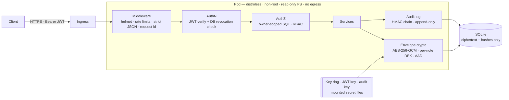

<div align="center">

# 🛡️ Bastion

**A deliberately hardened, envelope-encrypted notes API — and the DevSecOps supply chain that ships it.**

[](https://github.com/Azog1812/bastion-academy/actions/workflows/ci.yml)
[](https://github.com/Azog1812/bastion-academy/actions/workflows/security.yml)
[](https://github.com/Azog1812/bastion-academy/actions/workflows/codeql.yml)
[](https://github.com/Azog1812/bastion-academy/actions/workflows/container.yml)
[](https://github.com/Azog1812/bastion-academy/actions/workflows/dast.yml)
[](https://scorecard.dev/viewer/?uri=github.com/Azog1812/bastion-academy)
[](LICENSE)

[Threat model](docs/threat-model.md) · [Controls ↔ OWASP mapping](docs/security-controls.md) · [Security pipeline](docs/security-pipeline.md) · [ADRs](docs/adr/) · [Runbook](docs/runbook.md) · [API spec](docs/openapi.yaml)

</div>

> 🇫🇷 **En bref** — API de notes chiffrées conçue « security by design » : chiffrement
> enveloppe AES-256-GCM, authentification résistante au brute force et à l'énumération,
> anti-IDOR, journal d'audit infalsifiable, conteneur distroless non-root, et une chaîne
> CI/CD DevSecOps complète (SAST, SCA, secrets, IaC, DAST, SBOM, signature Sigstore,
> provenance SLSA). Chaque contrôle est relié à une menace et prouvé par un test.

## Where this is going: Bastion Academy

Bastion is becoming the core of **Bastion Academy**, a self-hosted cybersecurity
learning platform. Its pedagogy is *break it, then fix it*: each module starts from a
real vulnerability (IDOR, JWT forgery, brute force, SQL injection, token replay…).
The learner first exploits it in a lab and captures a flag. Then they study how
Bastion's own code defeats the attack and run the test that proves it. The path goes
from first principles up to the level expected by major industry certifications.

| Milestone | Scope | Status |
|---|---|---|
| **v3: foundations** | Learning paths → modules → lessons, progress tracking, web front-end, built on Bastion's auth core | ✅ API, web UI, levels 1 to 3 shipped; levels 4 to 6 to come |
| **v4: challenges** | Per-user HMAC flags (unshareable), scoreboard, anti-cheat, TOTP MFA | ✅ Shipped: 4 challenges, opt-in scoreboard, TOTP + recovery codes |
| **v5: isolated labs** | One vulnerable container per learner: no egress, TTL, sandboxed runtime, quotas | Planned |
| **v6: advanced** | Blue-team labs (log analysis, detection), AI tutor, observability | Planned |

The platform is designed to **run locally** (`git clone` + Docker). There is no public
hosted instance yet.

### What's available today

The curriculum spans six levels, from **Fundamentals** to **Expert**. Three paths are
available (in French, 27 lessons, 73 quiz questions):

- **Level 1, Fundamentals**: security basics, HTTP, sessions and JWT, then a
  *break it, then fix it* IDOR module.
- **Level 2, Web and API security**: SQL injection (with a self-contained local
  mini-lab), XSS, CSRF, JWT attacks, mass assignment and function-level access
  control.
- **Level 3, Systems and networks**: TCP/IP, DNS and TLS, legal port scanning, Linux
  permissions and privilege escalation, container hardening, Windows accounts and
  tokens, Kerberos and Active Directory attacks, network segmentation.

Every *break it, then fix it* module ends in Bastion's own code: the learner
attacks Bastion, then reads the exact lines, lint rules, Semgrep rules and tests
that stop the attack.

**Start learning** (Node ≥ 22.13):

```bash
git clone https://github.com/Azog1812/bastion-academy && cd bastion-academy
npm ci --ignore-scripts && npm run build
node dist/cli.js gen-secrets > .env
set -a && . ./.env && set +a && NODE_ENV=development npm start
```

Then open **http://localhost:3000**, create an account and follow the path. With Docker, generate
`.env` as above, then run `docker compose up --build`.

| Endpoint | Purpose |
|---|---|
| `GET /v1/curriculum` | Levels, paths, modules and lessons, with your progress and which modules are unlocked |
| `GET /v1/lessons/{id}` | A lesson (Markdown) and its quiz questions, never their answers |
| `POST /v1/lessons/{id}/complete` | Submit your quiz answers; graded on the server |
| `POST /v1/session/{login,mfa,refresh,logout}` | Browser sessions: refresh token in an HttpOnly cookie |
| `GET /v1/challenges[/{id}]` · `POST /v1/challenges/{id}/submit` | Challenges: your personal artifact, then your personal flag |
| `GET /v1/scoreboard` · `PUT /v1/me/profile` | Opt-in scoreboard under a pseudonym |
| `POST /v1/me/mfa/{setup,enable,disable}` · `POST /v1/auth/mfa` | TOTP second factor and recovery codes |

How it is secured ([ADR 0006](docs/adr/0006-curriculum-as-code.md), [ADR 0007](docs/adr/0007-web-front-end.md)):

- **Curriculum as code.** Lessons live in [`content/`](content/) and change only
  through reviewed pull requests. They are validated at boot, and the server refuses
  to start on inconsistent content. There is no CMS to compromise.
- **Server-side gating.** Prerequisites and quizzes are enforced by the API, so editing
  the front-end unlocks nothing. Quiz answers never leave the server.
- **Isolated progress.** Every query is scoped to the authenticated learner. A Semgrep
  rule blocks any regression.
- **A web UI with zero new dependencies.** Plain TypeScript compiled by `tsc`, served
  from the same origin (no CORS). The access token stays in memory; the refresh token
  lives in an `HttpOnly; Secure; SameSite=Strict` `__Host-` cookie that no script can
  read.
- **Unshareable flags** ([ADR 0008](docs/adr/0008-flags-scoreboard-mfa.md)). Each
  flag is `HMAC(key, challenge, learner)`: never stored, never in the repository, and
  useless to anyone else. A learner who submits someone else's flag gets the same answer
  as for a wrong one, and the audit log records whose flag it was.
- **TOTP MFA without a library** (RFC 6238 on `node:crypto`, checked against the RFC test
  vectors). Seeds are encrypted under the KEK ring; a code is never accepted twice; wrong
  codes feed the account lockout; turning MFA off needs the password *and* a code.
- **XSS needs two independent failures.** The UI never builds HTML from strings
  (ESLint bans every HTML sink, Markdown is rendered node by node), and the page CSP
  enforces **Trusted Types** with no policy allowed, so any such sink throws in the
  browser.

Quick tour, once the API runs (see [Try to break it](#try-to-break-it) to start it
and get a token):

```bash
curl -s $B/v1/curriculum -H "authorization: Bearer $ALICE" | jq '.paths[].modules[] | {id, unlocked}'
curl -s $B/v1/lessons/cia-et-risque -H "authorization: Bearer $ALICE" | jq -r .body
```

> [!WARNING]
> Future labs will ship **intentionally vulnerable** applications. Run them only on
> your own machine, bound to `127.0.0.1`, and **never expose them to a network you
> don't control**. Only attack targets you own or are explicitly authorised to test.

> 🇫🇷 **Bastion Academy** — Bastion devient le cœur d'une plateforme d'apprentissage
> cyber à installer chez soi, fondée sur le principe « casse-le, puis répare-le » :
> on exploite une faille réelle dans un lab, puis on étudie le code et le test qui la
> neutralisent. Progression des bases jusqu'au niveau des grandes certifications.
> Déjà disponible : une interface web (http://localhost:3000 après installation),
> l'API d'apprentissage (cursus, progression, quiz corrigés côté serveur), trois
> parcours en français, « Fondamentaux », « Sécurité web et API » et « Systèmes et
> réseaux » (27 leçons), des défis à flag personnel, un classement et la MFA TOTP.
> Les labs seront volontairement vulnérables : à lancer uniquement en local.

---

## Why this project exists

This repository started as a 20-line Express "hello world" with a Jenkins pipeline
whose security stages were commented out, a password passed as a build parameter and
a vulnerability scan ending in `|| true`. That version is still in the git history,
on purpose.

v2 asks a different question: **what does it take for a small API to survive a real
attacker, and to prove it?** The answer is not the feature list — it is that every
security claim below is backed by code you can read and a test that tries to break it.

## What's inside



### Application security

| Threat | Control | Proven by |
|---|---|---|
| Database dump / leaked backup | **Envelope encryption**: one AES-256-GCM key per note, wrapped by a rotating KEK that never touches the DB | [`envelope.test.ts`](test/unit/envelope.test.ts) |
| Ciphertext swapped between users by a DB-level attacker | Owner id and note id bound in the **AAD** → decryption fails | [`authorization.test.ts`](test/security/authorization.test.ts) |
| IDOR / BOLA (OWASP API #1) | Owner id inside every SQL query; foreign and missing notes are indistinguishable (404); probing is audited | [`authorization.test.ts`](test/security/authorization.test.ts) |
| Brute force & credential stuffing | Per-IP rate limit, **progressive lockout** with atomic counters, breached-password blocklist | [`authentication.test.ts`](test/security/authentication.test.ts) |
| Account enumeration | Identical response for unknown user / wrong password / locked, and a **dummy scrypt hash** so timing matches | [`authentication.test.ts`](test/security/authentication.test.ts) |
| JWT attacks (`alg:none`, alg confusion, tampering, replay) | Algorithm allow-list, `iss`/`aud`/`typ`/`exp` enforced, claims re-validated | [`tokens.test.ts`](test/unit/tokens.test.ts) |
| Phished or reused password | Optional **TOTP MFA**: replay-proof codes (compare-and-set on the time step), single-use 5-attempt login challenge, encrypted seeds, hashed one-time recovery codes | [`mfa.test.ts`](test/security/mfa.test.ts), [`totp.test.ts`](test/unit/totp.test.ts) |
| Flag sharing, scoreboard cheating | **Per-learner HMAC flags**, constant-time check, per-account rate limit, shared flags attributed in the audit log | [`challenges.test.ts`](test/security/challenges.test.ts) |
| Stolen refresh token | Single-use **rotation with reuse detection**: replay kills the whole session family (RFC 9700) | [`authentication.test.ts`](test/security/authentication.test.ts) |
| Race conditions (TOCTOU) on refresh & lockout | Token claimed atomically before any `await`; `UPDATE … RETURNING` counters | parallel-request tests |
| "Stateless" JWT that can't be revoked | `token_version` + role checked on every request → instant logout-everywhere and demotion | [`authorization.test.ts`](test/security/authorization.test.ts) |
| Mass assignment, prototype pollution, HPP | Strict schemas reject unknown keys; simple query parser | [`input-and-transport.test.ts`](test/security/input-and-transport.test.ts) |
| SQL injection | Bound parameters only, enforced by **ESLint and Semgrep rules** | tests + CI |
| Evidence tampering after an intrusion | **Tamper-evident audit log**: HMAC chain + DB triggers; `verify` pinpoints the first altered entry | [`config-and-audit.test.ts`](test/unit/config-and-audit.test.ts) |
| Misconfiguration | **Fail-closed config**: refuses to start with missing, short or placeholder secrets | [`config-and-audit.test.ts`](test/unit/config-and-audit.test.ts) |

Plus: scrypt (N=2¹⁷) with transparent rehash · NIST 800-63B password policy · strict
security headers (CSP `default-src 'none'`, HSTS preload…) · `no-store` caching ·
generic errors with correlation ids · secret redaction in logs · secrets read from
files rather than env vars · socket timeouts · privileged operations only via an
operator CLI, never over HTTP.

**184 tests, ~99 % line coverage** — most of them are *abuse cases*, not happy paths.

### Supply chain & infrastructure

| Stage | What runs |
|---|---|
| Code | ESLint (`strictTypeChecked` + security plugin + custom SQL rules), `tsc --strict` |
| Secrets | gitleaks over the **entire git history** |
| SAST | Semgrep (OWASP Top 10, Node, TS, JWT) + [8 project-specific rules](.semgrep/bastion.yml), CodeQL `security-extended` |
| SCA | `npm audit`, **`npm audit signatures`**, OSV-Scanner, Dependency Review on PRs, Dependabot with a 7-day cooldown |
| IaC | hadolint, Checkov (0 unreviewed findings; risk acceptances documented inline) |
| Container | Distroless, UID 65532, no shell (asserted in CI), smoke-tested with `--read-only --cap-drop ALL`, Trivy gate |
| DAST | OWASP ZAP API scan **authenticated with a real token**, driven by the OpenAPI spec |
| Release | Push of the exact scanned image → **cosign keyless signature** → signed **CycloneDX SBOM** → **SLSA provenance** → self-verification |
| Runtime | Kubernetes PSS *restricted*, default-deny NetworkPolicy with **no egress**, no SA token, secrets as 0400 files, **Kyverno rejects unsigned images** |
| Pipeline itself | `permissions: {}`, every action **SHA-pinned**, `--ignore-scripts`, `persist-credentials: false`, harden-runner, OpenSSF Scorecard |

## Try to break it

```bash
git clone https://github.com/Azog1812/bastion-academy && cd bastion-academy
npm ci && npm run build
node dist/cli.js gen-secrets > .env
set -a && . ./.env && set +a && NODE_ENV=development npm start
```

Then, in another terminal:

```bash
B=http://localhost:3000; J='content-type: application/json'
login() { curl -s -X POST $B/v1/auth/register -H "$J" -d "{\"email\":\"$1\",\"password\":\"correct horse battery staple\"}" >/dev/null
          curl -s -X POST $B/v1/auth/login -H "$J" -d "{\"email\":\"$1\",\"password\":\"correct horse battery staple\"}" | jq -r .accessToken; }
ALICE=$(login alice@demo.test); MALLORY=$(login mallory@demo.test)

NOTE=$(curl -s -X POST $B/v1/notes -H "$J" -H "authorization: Bearer $ALICE" -d '{"title":"diary","body":"secret"}' | jq -r .id)

# IDOR: Mallory asks for Alice's note → 404, same as a note that doesn't exist
curl -s $B/v1/notes/$NOTE -H "authorization: Bearer $MALLORY"

# Mass assignment: try to register as admin → 400, unknown field rejected
curl -s -X POST $B/v1/auth/register -H "$J" -d '{"email":"x@demo.test","password":"correct horse battery staple","role":"admin"}'

# alg:none forgery → 401
H=$(printf '{"alg":"none","typ":"at+jwt"}' | base64 | tr -d '=' | tr '/+' '_-')
P=$(printf '{"sub":"x","role":"admin","tv":0}' | base64 | tr -d '=' | tr '/+' '_-')
curl -s $B/v1/me -H "authorization: Bearer $H.$P."

# The database holds no plaintext
sqlite3 data/bastion.db "SELECT hex(ciphertext) FROM notes" | head -c 80; echo
```

Or run the whole battery: `npm test`. With Docker: `docker compose up --build`
(same hardening as production: read-only FS, no capabilities, loopback-only port).

## Repository layout

```
src/
  config.ts            fail-closed configuration (zod), secrets from files
  crypto/              envelope encryption · scrypt · JWT + refresh tokens · TOTP
  services/            auth (lockout, rotation, revocation) · notes (owner-scoped) ·
                       learning (progress, server-side gating) · mfa ·
                       challenges (per-learner flags, scoreboard)
  challenges/          closed set of challenge artifact generators
  curriculum/          loads and validates content/ at boot (fail closed)
  http/                middleware (authn, RBAC, errors) · strict schemas · routes
  audit.ts             HMAC-chained, append-only audit trail
  cli.ts               operator-only actions: promote, rotate-keys, verify-audit
test/
  unit/                crypto, tokens, config, audit chain
  security/            authentication, authorization/IDOR, injection & transport, learning,
                       MFA, challenges & scoreboard
content/               curriculum as code: levels, paths, quizzes, challenges (JSON), lessons (Markdown)
web/                   front-end: plain TypeScript, no dependency, Markdown → DOM, Trusted Types
deploy/k8s/            hardened manifests (PSS restricted, NetworkPolicy, secrets as files)
deploy/policies/       Kyverno: only signed images may run
.github/workflows/     CI · Security · CodeQL · Container (sign/SBOM/SLSA) · DAST · Scorecard
.semgrep/              project-specific SAST rules
docs/                  threat model · OWASP/ASVS mapping · pipeline · ADRs · runbook · OpenAPI
```

## Design decisions & limits

Every significant choice has an [ADR](docs/adr/) including the alternatives rejected —
e.g. why scrypt instead of Argon2 (no native addon), why SQLite (zero native
dependencies, single replica) and how to move to PostgreSQL. Known, accepted risks
(registration enumeration, lockout-as-DoS, HS256…) are listed in the
[threat model](docs/threat-model.md#5-accepted-risks) rather than hidden.

**Roadmap:** WebAuthn / passkeys · external KMS (Vault Transit) for KEKs · PostgreSQL +
Redis for horizontal scaling · signed commits.

## Security

Found a vulnerability? Please report it privately — see [SECURITY.md](SECURITY.md).

---

<sub>Built by **Florent Roch** — Mastère cybersécurité (ESTIAM). MIT licensed.</sub>
