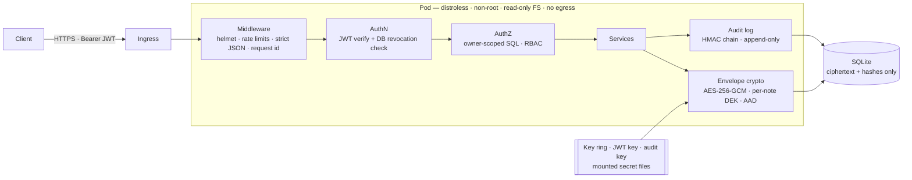

<div align="center">

# 🛡️ Bastion

**A deliberately hardened, envelope-encrypted notes API — and the DevSecOps supply chain that ships it.**

[](https://github.com/Azog1812/web-app/actions/workflows/ci.yml)
[](https://github.com/Azog1812/web-app/actions/workflows/security.yml)
[](https://github.com/Azog1812/web-app/actions/workflows/codeql.yml)
[](https://github.com/Azog1812/web-app/actions/workflows/container.yml)
[](https://github.com/Azog1812/web-app/actions/workflows/dast.yml)
[](https://scorecard.dev/viewer/?uri=github.com/Azog1812/web-app)
[](LICENSE)

[Threat model](docs/threat-model.md) · [Controls ↔ OWASP mapping](docs/security-controls.md) · [Security pipeline](docs/security-pipeline.md) · [ADRs](docs/adr/) · [Runbook](docs/runbook.md) · [API spec](docs/openapi.yaml)

</div>

> 🇫🇷 **En bref** — API de notes chiffrées conçue « security by design » : chiffrement
> enveloppe AES-256-GCM, authentification résistante au brute force et à l'énumération,
> anti-IDOR, journal d'audit infalsifiable, conteneur distroless non-root, et une chaîne
> CI/CD DevSecOps complète (SAST, SCA, secrets, IaC, DAST, SBOM, signature Sigstore,
> provenance SLSA). Chaque contrôle est relié à une menace et prouvé par un test.

---

## Why this project exists

This repository started as a 20-line Express "hello world" with a Jenkins pipeline
whose security stages were commented out, a password passed as a build parameter and
a vulnerability scan ending in `|| true`. That version is still in the git history,
on purpose.

v2 asks a different question: **what does it take for a small API to survive a real
attacker, and to prove it?** The answer is not the feature list — it is that every
security claim below is backed by code you can read and a test that tries to break it.

## What's inside



### Application security

| Threat | Control | Proven by |
|---|---|---|
| Database dump / leaked backup | **Envelope encryption**: one AES-256-GCM key per note, wrapped by a rotating KEK that never touches the DB | [`envelope.test.ts`](test/unit/envelope.test.ts) |
| Ciphertext swapped between users by a DB-level attacker | Owner id and note id bound in the **AAD** → decryption fails | [`authorization.test.ts`](test/security/authorization.test.ts) |
| IDOR / BOLA (OWASP API #1) | Owner id inside every SQL query; foreign and missing notes are indistinguishable (404); probing is audited | [`authorization.test.ts`](test/security/authorization.test.ts) |
| Brute force & credential stuffing | Per-IP rate limit, **progressive lockout** with atomic counters, breached-password blocklist | [`authentication.test.ts`](test/security/authentication.test.ts) |
| Account enumeration | Identical response for unknown user / wrong password / locked, and a **dummy scrypt hash** so timing matches | [`authentication.test.ts`](test/security/authentication.test.ts) |
| JWT attacks (`alg:none`, alg confusion, tampering, replay) | Algorithm allow-list, `iss`/`aud`/`typ`/`exp` enforced, claims re-validated | [`tokens.test.ts`](test/unit/tokens.test.ts) |
| Stolen refresh token | Single-use **rotation with reuse detection**: replay kills the whole session family (RFC 9700) | [`authentication.test.ts`](test/security/authentication.test.ts) |
| Race conditions (TOCTOU) on refresh & lockout | Token claimed atomically before any `await`; `UPDATE … RETURNING` counters | parallel-request tests |
| "Stateless" JWT that can't be revoked | `token_version` + role checked on every request → instant logout-everywhere and demotion | [`authorization.test.ts`](test/security/authorization.test.ts) |
| Mass assignment, prototype pollution, HPP | Strict schemas reject unknown keys; simple query parser | [`input-and-transport.test.ts`](test/security/input-and-transport.test.ts) |
| SQL injection | Bound parameters only, enforced by **ESLint and Semgrep rules** | tests + CI |
| Evidence tampering after an intrusion | **Tamper-evident audit log**: HMAC chain + DB triggers; `verify` pinpoints the first altered entry | [`config-and-audit.test.ts`](test/unit/config-and-audit.test.ts) |
| Misconfiguration | **Fail-closed config**: refuses to start with missing, short or placeholder secrets | [`config-and-audit.test.ts`](test/unit/config-and-audit.test.ts) |

Plus: scrypt (N=2¹⁷) with transparent rehash · NIST 800-63B password policy · strict
security headers (CSP `default-src 'none'`, HSTS preload…) · `no-store` caching ·
generic errors with correlation ids · secret redaction in logs · secrets read from
files rather than env vars · socket timeouts · privileged operations only via an
operator CLI, never over HTTP.

**112 tests, ~98 % line coverage** — most of them are *abuse cases*, not happy paths.

### Supply chain & infrastructure

| Stage | What runs |
|---|---|
| Code | ESLint (`strictTypeChecked` + security plugin + custom SQL rules), `tsc --strict` |
| Secrets | gitleaks over the **entire git history** |
| SAST | Semgrep (OWASP Top 10, Node, TS, JWT) + [7 project-specific rules](.semgrep/bastion.yml), CodeQL `security-extended` |
| SCA | `npm audit`, **`npm audit signatures`**, OSV-Scanner, Dependency Review on PRs, Dependabot |
| IaC | hadolint, Checkov (0 unreviewed findings; risk acceptances documented inline) |
| Container | Distroless, UID 65532, no shell (asserted in CI), smoke-tested with `--read-only --cap-drop ALL`, Trivy gate |
| DAST | OWASP ZAP API scan **authenticated with a real token**, driven by the OpenAPI spec |
| Release | Push of the exact scanned image → **cosign keyless signature** → signed **CycloneDX SBOM** → **SLSA provenance** → self-verification |
| Runtime | Kubernetes PSS *restricted*, default-deny NetworkPolicy with **no egress**, no SA token, secrets as 0400 files, **Kyverno rejects unsigned images** |
| Pipeline itself | `permissions: {}`, every action **SHA-pinned**, `--ignore-scripts`, `persist-credentials: false`, harden-runner, OpenSSF Scorecard |

## Try to break it

```bash
git clone https://github.com/Azog1812/web-app && cd web-app
npm ci && npm run build
node dist/cli.js gen-secrets > .env
set -a && . ./.env && set +a && NODE_ENV=development npm start
```

Then, in another terminal:

```bash
B=http://localhost:3000; J='content-type: application/json'
login() { curl -s -X POST $B/v1/auth/register -H "$J" -d "{\"email\":\"$1\",\"password\":\"correct horse battery staple\"}" >/dev/null
          curl -s -X POST $B/v1/auth/login -H "$J" -d "{\"email\":\"$1\",\"password\":\"correct horse battery staple\"}" | jq -r .accessToken; }
ALICE=$(login alice@demo.test); MALLORY=$(login mallory@demo.test)

NOTE=$(curl -s -X POST $B/v1/notes -H "$J" -H "authorization: Bearer $ALICE" -d '{"title":"diary","body":"secret"}' | jq -r .id)

# IDOR: Mallory asks for Alice's note → 404, same as a note that doesn't exist
curl -s $B/v1/notes/$NOTE -H "authorization: Bearer $MALLORY"

# Mass assignment: try to register as admin → 400, unknown field rejected
curl -s -X POST $B/v1/auth/register -H "$J" -d '{"email":"x@demo.test","password":"correct horse battery staple","role":"admin"}'

# alg:none forgery → 401
H=$(printf '{"alg":"none","typ":"at+jwt"}' | base64 | tr -d '=' | tr '/+' '_-')
P=$(printf '{"sub":"x","role":"admin","tv":0}' | base64 | tr -d '=' | tr '/+' '_-')
curl -s $B/v1/me -H "authorization: Bearer $H.$P."

# The database holds no plaintext
sqlite3 data/bastion.db "SELECT hex(ciphertext) FROM notes" | head -c 80; echo
```

Or run the whole battery: `npm test`. With Docker: `docker compose up --build`
(same hardening as production: read-only FS, no capabilities, loopback-only port).

## Repository layout

```
src/
  config.ts            fail-closed configuration (zod), secrets from files
  crypto/              envelope encryption · scrypt · JWT + refresh tokens
  services/            auth (lockout, rotation, revocation) · notes (owner-scoped)
  http/                middleware (authn, RBAC, errors) · strict schemas · routes
  audit.ts             HMAC-chained, append-only audit trail
  cli.ts               operator-only actions: promote, rotate-keys, verify-audit
test/
  unit/                crypto, tokens, config, audit chain
  security/            authentication, authorization/IDOR, injection & transport
deploy/k8s/            hardened manifests (PSS restricted, NetworkPolicy, secrets as files)
deploy/policies/       Kyverno: only signed images may run
.github/workflows/     CI · Security · CodeQL · Container (sign/SBOM/SLSA) · DAST · Scorecard
.semgrep/              project-specific SAST rules
docs/                  threat model · OWASP/ASVS mapping · pipeline · ADRs · runbook · OpenAPI
```

## Design decisions & limits

Every significant choice has an [ADR](docs/adr/) including the alternatives rejected —
e.g. why scrypt instead of Argon2 (no native addon), why SQLite (zero native
dependencies, single replica) and how to move to PostgreSQL. Known, accepted risks
(registration enumeration, lockout-as-DoS, HS256…) are listed in the
[threat model](docs/threat-model.md#5-accepted-risks) rather than hidden.

**Roadmap:** WebAuthn / TOTP MFA · external KMS (Vault Transit) for KEKs · PostgreSQL +
Redis for horizontal scaling · base images pinned by digest · signed commits.

## Security

Found a vulnerability? Please report it privately — see [SECURITY.md](SECURITY.md).

---

<sub>Built by **Florent Roch** — Mastère cybersécurité (ESTIAM). MIT licensed.</sub>
