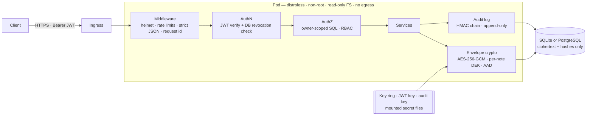

<div align="center">

[English](README.en.md) · [Français](README.fr.md) · [Español](README.es.md) · **Deutsch** · [Português](README.pt-BR.md) · [简体中文](README.zh-CN.md) · [← Start](../../README.md)

# 🛡️ Bastion Academy

**Eine bewusst gehärtete Notiz-API mit Envelope-Verschlüsselung, die DevSecOps-Lieferkette, die sie ausliefert, und eine darauf aufbauende Lernplattform für Cybersicherheit.**

[](https://github.com/Azog1812/bastion-academy/actions/workflows/ci.yml)
[](https://github.com/Azog1812/bastion-academy/actions/workflows/security.yml)
[](https://github.com/Azog1812/bastion-academy/actions/workflows/codeql.yml)
[](https://github.com/Azog1812/bastion-academy/actions/workflows/container.yml)
[](https://github.com/Azog1812/bastion-academy/actions/workflows/dast.yml)
[](https://scorecard.dev/viewer/?uri=github.com/Azog1812/bastion-academy)
[](../../LICENSE)

[Bedrohungsmodell](../threat-model.md) · [Kontrollen ↔ OWASP](../security-controls.md) · [Sicherheits-Pipeline](../security-pipeline.md) · [ADRs](../adr/) · [Runbook](../runbook.md) · [API-Spezifikation](../openapi.yaml)

</div>

> [!NOTE]
> Diese Seite ist eine Übersetzung der [englischen Fassung](README.en.md); bei
> Abweichungen gilt die englische. Die technischen Dokumente (Bedrohungsmodell, ADRs,
> Runbook) gibt es nur auf Englisch. Die Kursinhalte (Lektionen, Quiz, Challenges) sind
> auf Französisch.

## Bastion Academy

Bastion ist der Kern von **Bastion Academy**, einer selbst gehosteten Lernplattform für
Cybersicherheit. Das didaktische Prinzip lautet *erst knacken, dann absichern*: Jedes
Modul beginnt mit einer echten Schwachstelle (IDOR, JWT-Fälschung, Brute Force,
SQL-Injection, Token-Replay…). Die Lernenden nutzen sie zuerst in einem Lab aus und
erbeuten ein Flag. Danach untersuchen sie, wie Bastions eigener Code den Angriff abwehrt,
und führen den Test aus, der das beweist. Der Weg führt von den Grundlagen bis zu dem
Niveau, das die großen Zertifizierungen der Branche verlangen.

| Meilenstein | Umfang | Stand |
|---|---|---|
| **v3: Grundlagen** | Lernpfade → Module → Lektionen, Fortschrittsverfolgung, Web-Oberfläche, auf Bastions Authentifizierungskern | ✅ API, Web-Oberfläche, alle sechs Stufen ausgeliefert |
| **v4: Challenges** | HMAC-Flags pro Nutzer (nicht teilbar), Rangliste, Anti-Cheat, TOTP-MFA | ✅ Ausgeliefert: 11 Challenges (Stufen 1 bis 3), Rangliste auf Wunsch, TOTP + Wiederherstellungscodes · **Passkeys** (WebAuthn, [ADR 0016](../adr/0016-passkeys.md)) |
| **v5: isolierte Labs** | Ein verwundbarer Container pro Lernendem: kein ausgehender Verkehr, TTL, Sandbox-Runtime, Kontingente | ✅ Ausgeliefert: 10 Labs (SQLi, IDOR, Mass Assignment, JWT `alg:none`, SSRF, Path Traversal, Command Injection, Stored XSS mit einem Headless-Browser als Opfer, eine Kette aus drei Schwachstellen, eine Race Condition), Lab-Runner + Gateway, optional gVisor |
| **v6: Blue Team** | Pfad der Stufe 5 (Logging, SIEM, Detection Engineering, Incident Response, Forensik) und Detection-Challenges | ✅ Ausgeliefert: 6 Lektionen, 5 Detection-Challenges, bewertet nach Precision **und** Recall · echtes Wazuh aus der Oberfläche und 2 Challenges mit Wazuh-XML-Regeln ([ADR 0013](../adr/0013-shared-environments.md), [0014](../adr/0014-wazuh-rule-challenges.md)) · Observability ausgeliefert (Prometheus, getestete Alerts, [ADR 0011](../adr/0011-observability.md); Alertmanager-Routing + Grafana, [ADR 0018](../adr/0018-alert-routing-and-dashboards.md)) · KI-Tutor: geplant |

Die Plattform ist für den **lokalen Betrieb** gedacht (`git clone` + Docker). Eine
öffentlich gehostete Instanz gibt es noch nicht.

### Was heute verfügbar ist

Der Lehrplan umfasst sechs Stufen, von **Grundlagen** bis **Experte**, alle verfügbar
(auf Französisch, 50 Lektionen, 143 Quizfragen). Aufwendige Praxismodule sind
**optional**: Jede und jeder Lernende fügt sie in der Web-Oberfläche hinzu, wenn der
eigene Rechner sie bewältigt, und ein ausgelassenes Modul sperrt nie den Rest des Pfads:

- **Stufe 1, Grundlagen**: Sicherheitsgrundlagen, HTTP, Sessions und JWT, dann ein
  IDOR-Modul nach dem Prinzip *erst knacken, dann absichern*.
- **Stufe 2, Web- und API-Sicherheit**: SQL-Injection (mit einem eigenständigen lokalen
  Mini-Lab), XSS, CSRF, JWT-Angriffe, Mass Assignment und Zugriffskontrolle auf
  Funktionsebene.
- **Stufe 3, Systeme und Netzwerke**: TCP/IP, DNS und TLS, legales Port-Scanning,
  Linux-Berechtigungen und Rechteausweitung, Container-Härtung, Windows-Konten und
  -Tokens, Kerberos und Angriffe auf Active Directory, Netzwerksegmentierung.
- **Stufe 4, Penetrationstests**: rechtlicher Rahmen und Rules of Engagement
  (französisches Strafrecht, PASSI), PTES und OWASP WSTG, Aufklärung, Verketten von
  Schwachstellen, Post-Exploitation im vereinbarten Umfang, CVSS 4.0 und ein Bericht,
  der tatsächlich zu Korrekturen führt.
- **Stufe 5, Verteidigung und Erkennung** (Blue Team): was protokolliert werden sollte,
  SIEM und Korrelation, Regeln im Sigma-Stil, Web-Angriffe in Logs lesen, Incident
  Response (NIST SP 800-61r3, DSGVO-Meldung binnen 72 Stunden), erste Schritte in der
  Forensik (Reihenfolge der Flüchtigkeit, Container); optionales **Wazuh**-Modul
  (Architektur, Decoder und XML-Regeln, Integritätsüberwachung von Dateien,
  CIS-Konfigurationsprüfung, Active Response und ihre Fallen).
- **Stufe 6, Experte**: Race Conditions (TOCTOU, Single-Packet-Angriff) und unsichere
  Deserialisierung (Gadget-Ketten, Prototype Pollution); Kerberos-Delegation, AD CS
  (ESC1, ESC8) und DCSync, dann deren Erkennung (4769, 4662, 4887, Honey-Accounts); die
  Zertifizierungslandschaft (OSCP+, CPTS, GIAC, ANSSI-Qualifizierungen) und die Methode
  für eine 24-stündige Praxisprüfung.

**5 Detection-Challenges** ([ADR 0010](../adr/0010-detection-challenges.md)): Die
Lernenden **schreiben eine Erkennungsregel** (eine JSON-Teilmenge von Sigma), und der
Server bewertet sie anhand eines für sie erzeugten Log-Datensatzes, in dem sich Angriffe
zwischen harmloser Aktivität **und Fallen** für naive Regeln verstecken. Gelöst ist die
Challenge nur, wenn jeder Angriff erkannt wird **und** es keinen einzigen Fehlalarm gibt:
der tägliche Zielkonflikt im SOC.

| Challenge | Was die naive Regel falsch macht |
|---|---|
| SQL-Injections in Access-Logs | Ein Apostroph meldet *O'Connor*; der User-Agent übersieht den Angreifer, der sich hinter einem Browser versteckt |
| Password Spraying (Windows 4624/4625) | Fehlversuche zu zählen meldet ein Dienstkonto mit abgelaufenem Passwort |
| Living off the Land (LOLBins) | Alarme auf `certutil` oder `rundll32` ertränken das SOC in Admin-Aktivität |
| SSH-Brute-Force, schnell und langsam | Ein kurzes Zeitfenster übersieht den geduldigen Angreifer; eine niedrige Schwelle meldet den vergesslichen Nutzer |
| Kerberoasting (Windows 4769) | „RC4 = Alarm“ meldet die alte Lohnbuchhaltung und die Computerkonten; Dienste ohne RC4 zu zählen meldet das Inventarkonto |

Die Regelsprache hat **absichtlich keine regulären Ausdrücke** (eine Regex der
Lernenden liefe in der Event-Loop des Servers: ReDoS), und die Felder werden gegen
jeden Datensatz geprüft.

**2 Wazuh-Regel-Challenges** ([ADR 0014](../adr/0014-wazuh-rule-challenges.md)) im
optionalen Wazuh-Modul: Die Lernenden schreiben **echte Wazuh-XML-Regeln** wie in
`local_rules.xml`, gegen Alerts im Format von Wazuhs `alerts.json`. Das XML der
Lernenden erreicht nie einen allgemeinen Parser: Ein geschlossener Leser lehnt DTDs und
Entitäten ab (**XXE**, *Billion Laughs*), Muster sind nur OS_Match (kein ReDoS), und der
Regelbaum kann keine Schleife bilden. Der Evaluator wird **in der CI gegen das echte
Wazuh geprüft**: Die Referenzregeln laufen durch `wazuh-logtest` (Wazuh 4.14, ohne
Netzwerk) und müssen genau dieselben Alerts auslösen. Diese Prüfung hat das Modell
korrigiert: „Failed password“ läuft über 5716 → 5760, `<srcip>!x` schließt x nicht aus,
und `action` ist ein statisches Feld.

| Challenge | Was die naive Regel falsch macht |
|---|---|
| SSH-Brute-Force in XML | Korrelation auf 5716 sieht nichts (das Ereignis geht weiter zu 5760); mit 5760 allein entkommt der Angreifer, der nur nicht existierende Nutzer probiert (5710); das ganze Subnetz des Backup-Servers auszuschließen versteckt einen kompromittierten Nachbarn |
| Bastion selbst überwachen (sein JSON-Audit-Log) | `<match>refresh</match>` meldet jede normale Token-Erneuerung; ohne ein Kind mit Level 0 alarmiert der nächtliche DAST-Scan der CI das SOC |

Jedes Modul nach dem Prinzip *erst knacken, dann absichern* endet in Bastions eigenem
Code: Die Lernenden greifen Bastion an und lesen dann genau die Zeilen, Lint-Regeln,
Semgrep-Regeln und Tests, die den Angriff stoppen.

**11 Challenges**, jede eine echte Aufgabe aus dem Berufsalltag, jede mit einem Flag,
das nur für die jeweilige Person gilt:

| Challenge | Stufe | Was die Lernenden tun |
|---|---|---|
| Encodage n'est pas chiffrement · La crypto maison | 1 | Verschachteltes Base64 abschälen; Ein-Byte-XOR mit einem Known-Plaintext-Angriff brechen |
| Un code PIN dans une empreinte rapide | 1 | Einen ungesalzenen SHA-256-Hash einer PIN per Brute Force knacken (10.000 Versuche), den Tresor öffnen |
| Des en-têtes trop bavards · Un jeton qui parle trop | 1 | Einen Debug-Header in einer rohen HTTP-Antwort finden; die Claims eines JWT lesen |
| Reconstituer une injection SQL à l'aveugle | 2 | **Forensik**: die Binärsuche von sqlmap aus einem Access-Log nachvollziehen, nur anhand der Antwortgrößen |
| Un secret de signature trop faible | 2 | Ein HS256-JWT-Secret offline mit einer Wortliste knacken (was `hashcat -m 16500` tut) |
| Un mot de passe sur le fil | 3 | Einen `tcpdump -X`-Mitschnitt Schicht für Schicht dekodieren und HTTP-Basic-Zugangsdaten zurückgewinnen |
| Qui peut vraiment lire ce fichier ? | 3 | Die exakte Kernel-Regel Eigentümer/Gruppe/Andere samt Fallen anwenden, um lesbare Dateien zu finden |
| La première règle qui gagne | 3 | Ein nftables-Regelwerk (erster Treffer, CIDR, Protokoll, Standardrichtlinie) auf echte Verbindungen anwenden |
| Pulvérisation de mots de passe et porte dérobée | 3 | **SOC-Triage**: ein Password Spraying in Windows-Ereignissen erkennen, `-EncodedCommand` dekodieren |

Die Rätsel werden pro Person aus einem HMAC-Seed erzeugt (nichts wird gespeichert),
Köder haben dasselbe Format wie das Flag, und jeder Generator hat einen Test, der ihn so
löst, wie es die Aufgabenstellung beschreibt
([`challenge-generators.test.ts`](../../test/unit/challenge-generators.test.ts)).

**10 Live-Labs** ([ADR 0009](../adr/0009-isolated-labs.md)): ein echter, absichtlich
verwundbarer Dienst, der für eine einzige Person gestartet wird, ihr Flag enthält und
nur von ihrem Rechner aus erreichbar ist.

| Lab | Stufe | Angriff |
|---|---|---|
| Les factures des autres | 1 | IDOR / BOLA auf einer Rechnungs-API |
| Entrer sans mot de passe | 2 | SQL-Injection in einem Login-Formular (ausführliche Fehlermeldungen als erster Hinweis) |
| Promu administrateur | 2 | Mass Assignment bei der Registrierung (`"role": "admin"`) |
| Un jeton sans signature | 2 | Ein JWT mit `"alg": "none"` fälschen |
| Un modérateur trop confiant | 2 | Stored XSS gegen einen Moderator in einem **echten Headless-Chromium**; dessen Cookie *über die Anwendung selbst* ausleiten, da Labs keinen Weg nach draußen haben |
| Un aperçu trop curieux | 2 | SSRF: den Server seinen eigenen Admin-Dienst auf Loopback abrufen lassen |
| Le dossier d'à côté | 3 | Path Traversal aus einem Download-Ordner heraus |
| Trois failles, une chaîne | 4 | **Keine Schwachstelle reicht allein**: Path Traversal → geleaktes JWT-Secret → gefälschtes Admin-Token (Abkürzungen wie `/proc/self/environ` gesperrt) |
| Une carte cadeau, plusieurs fois | 6 | Race Condition: eine Einmal-Geschenkkarte, die durch parallele Anfragen mehrfach eingelöst wird (die Korrektur ist Bastions Invariante 5: ein atomares Compare-and-Set) |
| Un shell, mais dans une cage | 3 | Command Injection → eine echte Shell, dann **versuchen auszubrechen und verstehen, warum es nicht geht** (kein Weg nach draußen, schreibgeschützt, `noexec`, keine Capabilities) |

Das Lab ist verwundbar, die Box drumherum nicht:

```
browser ─► bastion :3000 ──(internal network, token)──► lab-runner ── Docker socket
browser ─► lab-gateway :8088 ──(one internal network per lab)──► lab container
```

- **Nur der Lab-Runner berührt Docker** (root-äquivalent): nur von der Plattform aus
  erreichbar, per Token geschützt, und er übernimmt nie ein Image, einen Mount oder eine
  Option aus einer Anfrage.
- **Jedes Lab** läuft ohne root, schreibgeschützt, ohne Capabilities, mit begrenztem
  Speicher/CPU/PIDs, ohne veröffentlichten Port, in einem **eigenen Netzwerk ohne Weg
  nach draußen**: kein Herunterladen von Werkzeugen, keine Reverse Shell, keine Nachbarn.
  Optional **gVisor** (`LAB_RUNTIME=runsc`).
- **Jedes Lab hat einen eigenen Origin** (`l<id>.lab.localhost`): Die XSS eines Labs
  kann die Sitzung der Plattform nicht berühren.
- Ein Lab pro Person, eine TTL, die sowohl die Plattform als auch der Runner
  durchsetzen, ratenbegrenzte Starts. Die Isolation wurde live geprüft: Von einem Lab
  aus sind Internet, Runner und Plattform allesamt unerreichbar.

### Loslegen

Node ≥ 22.13:

```bash
git clone https://github.com/Azog1812/bastion-academy && cd bastion-academy
npm ci --ignore-scripts && npm run build
node dist/cli.js gen-secrets > .env
set -a && . ./.env && set +a && NODE_ENV=development npm start
```

Dann **http://localhost:3000** öffnen, ein Konto anlegen und dem Pfad folgen.

**Mit den Labs** (Docker erforderlich) `.env` wie oben erzeugen, dann:

```bash
docker compose --profile labs build   # Lab-Images, einmalig
docker compose up --build             # Plattform + Lab-Runner + Lab-Gateway, alles auf 127.0.0.1
```

**Mit Monitoring**: `docker compose --profile observability up -d` fügt Prometheus auf
**http://127.0.0.1:9090** und Grafana auf **http://127.0.0.1:3001** hinzu (`admin`,
`GRAFANA_ADMIN_PASSWORD` aus `.env`). Ein Refresh-Token erneut einspielen und zusehen,
wie `BastionRefreshTokenReuse` im Reiter *Alerts* auslöst und dann in Grafanas
*Alerting* beim Empfänger `pager` ankommt ([ADR 0011](../adr/0011-observability.md), [ADR 0018](../adr/0018-alert-routing-and-dashboards.md)).

**Mit einem echten Wazuh** (optionales Modul, ~4 GiB RAM):
`docker compose --profile wazuh up -d` einmalig, danach starten und stoppen die
Lernenden es über die Modulkarte; Dashboard unter **https://localhost:8443**. Die
Einrichtung erstellt offline eine eigene CA und entfernt Wazuhs Demo-Konten
([ADR 0013](../adr/0013-shared-environments.md)). Auch das Audit-Log der Plattform landet
dort ([ADR 0015](../adr/0015-audit-log-to-siem.md)): Ein Refresh-Token erneut einspielen
oder eine Admin-Route abtasten, und der Alert erscheint im Dashboard
(`rule.groups: bastion`).

| Endpunkt | Zweck |
|---|---|
| `GET /v1/curriculum` | Stufen, Pfade, Module und Lektionen, mit deinem Fortschritt und den freigeschalteten Modulen |
| `GET /v1/lessons/{id}` | Eine Lektion (Markdown) und ihre Quizfragen, nie deren Antworten |
| `POST /v1/lessons/{id}/complete` | Quizantworten einreichen; bewertet auf dem Server |
| `POST /v1/session/{login,mfa,passkey,refresh,logout}` | Browser-Sitzungen: Refresh-Token in einem HttpOnly-Cookie |
| `GET /v1/challenges[/{id}]` · `POST /v1/challenges/{id}/submit` | Challenges: dein persönliches Artefakt, dann dein persönliches Flag |
| `GET /v1/scoreboard` · `PUT /v1/me/profile` | Freiwillige Rangliste unter Pseudonym |
| `POST /v1/me/mfa/{setup,enable,disable}` · `POST /v1/auth/mfa` | TOTP als zweiter Faktor und Wiederherstellungscodes |
| `GET/POST /v1/me/passkeys` · `POST /v1/me/passkeys/options` · `DELETE /v1/me/passkeys/{id}` · `POST /v1/auth/mfa/passkey/options` | Passkeys (WebAuthn) als phishingresistenter zweiter Faktor |
| `POST /v1/auth/passkey/options` · `POST /v1/auth/passkey` | Passwortlose Anmeldung mit einem auffindbaren Passkey mit Nutzerverifikation |

So ist es abgesichert ([ADR 0006](../adr/0006-curriculum-as-code.md), [ADR 0007](../adr/0007-web-front-end.md)):

- **Lehrplan als Code.** Die Lektionen liegen in [`content/`](../../content/) und
  ändern sich nur über geprüfte Pull Requests. Sie werden beim Start validiert, und der
  Server verweigert den Start bei inkonsistenten Inhalten. Es gibt kein CMS, das man
  kompromittieren könnte.
- **Freischaltung auf dem Server.** Voraussetzungen und Quiz setzt die API durch; das
  Frontend zu verändern schaltet nichts frei. Quizantworten verlassen nie den Server.
- **Isolierter Fortschritt.** Jede Abfrage ist auf die angemeldete Person beschränkt.
  Eine Semgrep-Regel blockiert jede Regression.
- **Eine Web-Oberfläche ohne neue Abhängigkeiten.** Schlichtes TypeScript, mit `tsc`
  kompiliert, vom selben Origin ausgeliefert (kein CORS). Das Access-Token bleibt im
  Speicher; das Refresh-Token liegt in einem `__Host-`-Cookie mit
  `HttpOnly; Secure; SameSite=Strict`, das kein Skript lesen kann.
- **Nicht teilbare Flags** ([ADR 0008](../adr/0008-flags-scoreboard-mfa.md)). Jedes
  Flag ist `HMAC(Schlüssel, Challenge, Lernende)`: nie gespeichert, nie im Repository
  und für alle anderen wertlos. Wer das Flag einer anderen Person einreicht, erhält
  dieselbe Antwort wie bei einem falschen, und das Audit-Log hält fest, wem es gehörte.
- **TOTP-MFA ohne Bibliothek** (RFC 6238 auf `node:crypto`, gegen die Testvektoren des
  RFC geprüft). Seeds sind unter dem KEK-Ring verschlüsselt; ein Code wird nie zweimal
  akzeptiert; falsche Codes zählen für die Kontosperre; MFA abzuschalten erfordert das
  Passwort *und* einen Code.
- **Passkeys ohne Bibliothek** (WebAuthn auf `node:crypto`, [ADR 0016](../adr/0016-passkeys.md)):
  Der exakte Origin und der Hash der RP-ID werden geprüft, sodass die weitergereichte
  Signatur eines Phishing-Proxys abgelehnt wird, was TOTP nicht leisten kann.
  Einmal-Challenges, die an ihren MFA-Schritt gebunden sind, ein begrenzter CBOR-Decoder
  für die vom Angreifer gelieferten Strukturen, Klon-Erkennung über den
  Signaturzähler (auditiert, Wazuh-Level 12). Getestet mit einem Software-Authenticator
  in der Rolle des Angreifers und durchgängig in Chromium mit dessen virtuellem
  Authenticator. Die lokale Installation unter `http://localhost:3000` öffnen (eine
  IP-Adresse kann keine RP-ID sein).
- **Passwortlose Anmeldung** ([ADR 0017](../adr/0017-passwordless-passkey-login.md)):
  Ein auffindbarer Passkey mit Nutzerverifikation ersetzt Passwort und zweiten Faktor
  (AAL2). Die Optionen nennen kein Konto (nichts zu enumerieren), das User-Handle muss
  den Schlüssel besitzen, Fehlschläge zählen nie für die Sperre (kein
  „Beliebige sperren“-Knopf), und die Wiederherstellung umgeht nie einen Faktor: ein
  anderer Passkey, Passwort plus Code oder die Betreiber-CLI auf dem Host.
- **Eine XSS braucht zwei unabhängige Fehler.** Die Oberfläche baut nie HTML aus
  Zeichenketten (ESLint verbietet jede HTML-Senke, Markdown wird Knoten für Knoten
  gerendert), und die CSP der Seite erzwingt **Trusted Types** ohne erlaubte Policy,
  sodass jede solche Senke im Browser eine Ausnahme wirft.

Kurzer Rundgang, sobald die API läuft (siehe [Versuch, es zu knacken](#try-to-break-it)
zum Starten und um ein Token zu erhalten):

```bash
curl -s $B/v1/curriculum -H "authorization: Bearer $ALICE" | jq '.paths[].modules[] | {id, unlocked}'
curl -s $B/v1/lessons/cia-et-risque -H "authorization: Bearer $ALICE" | jq -r .body
```

> [!WARNING]
> Die Labs sind **absichtlich verwundbare** Anwendungen. Nur auf dem eigenen Rechner
> betreiben, an `127.0.0.1` gebunden, und **nie in einem Netzwerk freigeben, das man
> nicht kontrolliert**. Nur Ziele angreifen, die einem gehören oder für die eine
> ausdrückliche Erlaubnis vorliegt.

---

## Warum es dieses Projekt gibt

Dieses Repository begann als 20-zeiliges Express-„Hello World“ mit einer
Jenkins-Pipeline, deren Sicherheitsstufen auskommentiert waren, einem Passwort als
Build-Parameter und einem Schwachstellenscan, der mit `|| true` endete. Diese Version
steht absichtlich noch in der Git-Historie.

Die v2 stellt eine andere Frage: **Was braucht eine kleine API, um einen echten
Angreifer zu überstehen, und wie beweist man das?** Die Antwort ist nicht die
Funktionsliste, sondern dass jede Sicherheitsaussage auf dieser Seite durch lesbaren
Code und einen Test belegt ist, der sie zu brechen versucht.

## Was drinsteckt



### Anwendungssicherheit

| Bedrohung | Kontrolle | Belegt durch |
|---|---|---|
| Datenbank-Dump / geleaktes Backup | **Envelope-Verschlüsselung**: ein AES-256-GCM-Schlüssel pro Notiz, umhüllt von einem rotierenden KEK, der nie die Datenbank berührt | [`envelope.test.ts`](../../test/unit/envelope.test.ts) |
| Datenbank *und* Geheimnisse der Plattform gestohlen | **KEKs in Vault Transit** (optionales Overlay): Der KEK verlässt Vault nie, ein abgeleiteter Schlüssel pro Notiz, AppRole mit 1-Stunden-Tokens, eine Policy, die Export und Löschen verbietet, Rotation innerhalb von Vault ([ADR 0019](../adr/0019-vault-transit-kms.md)) | [`kms-vault.test.ts`](../../test/security/kms-vault.test.ts), [`test/vault-real`](../../test/vault-real/run.sh) |
| Chiffrate zwischen Nutzern vertauscht durch einen Angreifer auf Datenbankebene | Eigentümer-ID und Notiz-ID in den **AAD** gebunden → die Entschlüsselung schlägt fehl | [`authorization.test.ts`](../../test/security/authorization.test.ts) |
| IDOR / BOLA (OWASP API Nr. 1) | Eigentümer-ID in jeder SQL-Abfrage; fremde und fehlende Notizen sind nicht unterscheidbar (404); Abtastversuche werden auditiert; auf PostgreSQL Row-Level Security als zweite Barriere, unter einem API-Login, das ihr nicht entkommen kann ([ADR 0022](../adr/0022-row-level-security.md)) | [`authorization.test.ts`](../../test/security/authorization.test.ts), [`row-level-security.test.ts`](../../test/security/row-level-security.test.ts) |
| Brute Force & Credential Stuffing | Ratenbegrenzung pro IP, **progressive Sperre** mit atomaren Zählern, Sperrliste geleakter Passwörter; bei mehreren Replikas in Valkey geteilte Limits, die bei Ausfall schließen ([ADR 0023](../adr/0023-shared-rate-limits.md)) | [`authentication.test.ts`](../../test/security/authentication.test.ts) |
| Konto-Enumeration | Identische Antwort für unbekannten Nutzer / falsches Passwort / gesperrtes Konto und ein **Dummy-scrypt-Hash**, damit das Timing übereinstimmt | [`authentication.test.ts`](../../test/security/authentication.test.ts) |
| JWT-Angriffe (`alg:none`, Algorithmus-Verwechslung, Manipulation, Replay) | Allow-List der Algorithmen, `iss`/`aud`/`typ`/`exp` erzwungen, Claims erneut validiert | [`tokens.test.ts`](../../test/unit/tokens.test.ts) |
| Gephishtes oder wiederverwendetes Passwort | Optionale **TOTP-MFA**: nicht wiederverwendbare Codes (Compare-and-Set auf den Zeitschritt), Einmal-Login-Challenge mit 5 Versuchen, verschlüsselte Seeds, gehashte Einmal-Wiederherstellungscodes; **Passkeys** gegen Phishing (an Origin und RP-ID gebunden) | [`mfa.test.ts`](../../test/security/mfa.test.ts), [`totp.test.ts`](../../test/unit/totp.test.ts) |
| Flags teilen, Betrug in der Rangliste | **HMAC-Flags pro Person**, Vergleich in konstanter Zeit, Ratenbegrenzung pro Konto, geteilte Flags im Audit-Log zugeordnet | [`challenges.test.ts`](../../test/security/challenges.test.ts) |
| Ausbruch aus einem Lab (zum Host, zur Plattform, zu anderen Labs, ins Internet) | Gehärteter Container, **internes Netzwerk pro Instanz**, Gateway als einziger Peer, Docker-Socket nur beim Runner, geschlossener Lab-Katalog | [`lab-runner.test.ts`](../../test/unit/lab-runner.test.ts), [`labs.test.ts`](../../test/security/labs.test.ts) |
| SSRF über das Lab-Gateway | Upstream wird aus einer 32-stelligen Hex-Instanz-ID **gebaut**, nie aus der Anfrage gelesen | [`lab-runner.test.ts`](../../test/unit/lab-runner.test.ts) |
| Gestohlenes Refresh-Token | Einmalige **Rotation mit Wiederverwendungserkennung**: Ein Replay beendet die gesamte Sitzungsfamilie (RFC 9700) | [`authentication.test.ts`](../../test/security/authentication.test.ts) |
| Race Conditions (TOCTOU) bei Refresh, Sperre, Audit-Kette, letztem zweitem Faktor | Token mit einem einzigen Compare-and-Set beansprucht; Zähler mit `UPDATE … RETURNING`; jedes andere Check-then-Act in einer Transaktion, nie „kein `await` dazwischen“ ([ADR 0020](../adr/0020-async-database-layer.md)); auf PostgreSQL wiederholte SERIALIZABLE-Transaktionen und ein Advisory Lock auf der Audit-Kette ([ADR 0021](../adr/0021-postgresql-backend.md)) | Tests mit parallelen Anfragen; Race-Tests gegen eine Datenbank, die Latenz einschleust ([`db.test.ts`](../../test/unit/db.test.ts)); die gesamte Suite erneut gegen ein echtes PostgreSQL in der CI |
| „Zustandsloses“ JWT, das sich nicht widerrufen lässt | `token_version` + Rolle bei jeder Anfrage geprüft → sofortiges Abmelden überall und sofortige Herabstufung | [`authorization.test.ts`](../../test/security/authorization.test.ts) |
| Mass Assignment, Prototype Pollution, HPP | Strikte Schemas lehnen unbekannte Schlüssel ab; einfacher Query-Parser | [`input-and-transport.test.ts`](../../test/security/input-and-transport.test.ts) |
| SQL-Injection | Nur gebundene Parameter, erzwungen durch **ESLint- und Semgrep-Regeln** | Tests + CI |
| Manipulation von Beweisen nach einem Einbruch | **Manipulationssicheres Audit-Log**: HMAC-Kette + Datenbank-Trigger; `verify` benennt den ersten veränderten Eintrag | [`config-and-audit.test.ts`](../../test/unit/config-and-audit.test.ts) |
| Fehlkonfiguration | **Fail-closed-Konfiguration**: verweigert den Start bei fehlenden, zu kurzen oder Platzhalter-Geheimnissen | [`config-and-audit.test.ts`](../../test/unit/config-and-audit.test.ts) |

Außerdem: scrypt (N=2¹⁷) mit transparentem Rehash · Passwortrichtlinie nach NIST
800-63B · strikte Sicherheits-Header (CSP `default-src 'none'`, HSTS Preload…) ·
`no-store`-Caching · generische Fehler mit Korrelations-IDs · Schwärzung von Geheimnissen
in Logs · Geheimnisse aus Dateien statt aus Umgebungsvariablen · Socket-Timeouts ·
privilegierte Operationen nur über eine Betreiber-CLI, nie über HTTP.

**459 Tests, ~98 % Zeilenabdeckung**: Die meisten davon sind *Missbrauchsfälle*, keine
Gutfälle.

### Lieferkette & Infrastruktur

| Stufe | Was läuft |
|---|---|
| Code | ESLint (`strictTypeChecked` + Security-Plugin + eigene SQL-Regeln), `tsc --strict` |
| Geheimnisse | gitleaks über die **gesamte Git-Historie** |
| SAST | Semgrep (OWASP Top 10, Node, TS, JWT) + [projektspezifische Regeln](../../.semgrep/bastion.yml), CodeQL `security-extended` |
| SCA | `npm audit`, **`npm audit signatures`**, OSV-Scanner, Dependency Review bei PRs, Dependabot mit 7 Tagen Wartezeit |
| IaC | hadolint, Checkov (0 ungeprüfte Funde; Risikoakzeptanzen direkt im Code dokumentiert) |
| Container | Distroless, UID 65532, keine Shell (in der CI geprüft), Smoke-Test mit `--read-only --cap-drop ALL`, Trivy-Gate |
| DAST | OWASP-ZAP-API-Scan, **mit einem echten Token authentifiziert**, gesteuert von der OpenAPI-Spezifikation |
| Release | Push genau des gescannten Images → **keyless cosign-Signatur** → signierte **CycloneDX-SBOM** → **SLSA-Provenienz** → Selbstverifikation |
| Monitoring | Prometheus-Metriken auf einem **separaten, per Token geschützten Listener**, Labels nur aus geschlossenen Mengen (keine personenbezogenen Daten, kein Kardinalitäts-DoS), **Alerts mit `promtool` unit-getestet** in der CI und mit dem [Runbook](../runbook.md) verknüpft, **nach Schweregrad in Alertmanager geroutet** (Routing und Inhibition mit `amtool` und einer Live-Instanz getestet, Silences nur hinter Grafanas Login, Watchdog als Dead Man's Switch, [ADR 0018](../adr/0018-alert-routing-and-dashboards.md)); das Audit-Log selbst in **Wazuh**, mit Regeln, die im echten `wazuh-logtest` geprüft werden ([ADR 0015](../adr/0015-audit-log-to-siem.md)) |
| Laufzeit | Kubernetes PSS *restricted*, Default-Deny-NetworkPolicy **ohne ausgehenden Verkehr**, kein Service-Account-Token, Geheimnisse als 0400-Dateien, **Kyverno weist unsignierte Images ab** |
| Die Pipeline selbst | `permissions: {}`, jede Action **per SHA gepinnt**, `--ignore-scripts`, `persist-credentials: false`, harden-runner, OpenSSF Scorecard |

<a id="try-to-break-it"></a>

## Versuch, es zu knacken

```bash
git clone https://github.com/Azog1812/bastion-academy && cd bastion-academy
npm ci --ignore-scripts && npm run build
node dist/cli.js gen-secrets > .env
set -a && . ./.env && set +a && NODE_ENV=development npm start
```

Dann in einem anderen Terminal:

```bash
B=http://localhost:3000; J='content-type: application/json'
login() { curl -s -X POST $B/v1/auth/register -H "$J" -d "{\"email\":\"$1\",\"password\":\"correct horse battery staple\"}" >/dev/null
          curl -s -X POST $B/v1/auth/login -H "$J" -d "{\"email\":\"$1\",\"password\":\"correct horse battery staple\"}" | jq -r .accessToken; }
ALICE=$(login alice@demo.test); MALLORY=$(login mallory@demo.test)

NOTE=$(curl -s -X POST $B/v1/notes -H "$J" -H "authorization: Bearer $ALICE" -d '{"title":"diary","body":"secret"}' | jq -r .id)

# IDOR: Mallory fragt Alices Notiz ab → 404, genau wie bei einer nicht existierenden Notiz
curl -s $B/v1/notes/$NOTE -H "authorization: Bearer $MALLORY"

# Mass Assignment: Registrierung als Admin versuchen → 400, unbekanntes Feld abgelehnt
curl -s -X POST $B/v1/auth/register -H "$J" -d '{"email":"x@demo.test","password":"correct horse battery staple","role":"admin"}'

# alg:none-Fälschung → 401
H=$(printf '{"alg":"none","typ":"at+jwt"}' | base64 | tr -d '=' | tr '/+' '_-')
P=$(printf '{"sub":"x","role":"admin","tv":0}' | base64 | tr -d '=' | tr '/+' '_-')
curl -s $B/v1/me -H "authorization: Bearer $H.$P."

# Die Datenbank enthält keinen Klartext
sqlite3 data/bastion.db "SELECT hex(ciphertext) FROM notes" | head -c 80; echo
```

Oder die ganze Testbatterie ausführen: `npm test`. Mit Docker: `docker compose up --build`
(dieselbe Härtung wie in Produktion: schreibgeschütztes Dateisystem, keine
Capabilities, Port nur auf Loopback).

## Aufbau des Repositorys

```
src/
  config.ts            Fail-closed-Konfiguration (zod), Geheimnisse aus Dateien
  db.ts · postgres.ts  Datenbankschicht: SQLite (Standard) oder PostgreSQL mit Row-Level Security
  redis.ts             minimaler, begrenzter Valkey-Client für geteilte Ratenbegrenzungen
  crypto/              Envelope-Verschlüsselung · KMS (lokaler Ring / Vault Transit) · scrypt · JWT + Refresh-Tokens · TOTP · WebAuthn + CBOR
  services/            Auth (Sperre, Rotation, Widerruf) · Notizen (eigentümerbezogen) ·
                       Lernen (Fortschritt, Freischaltung auf dem Server) · MFA · Passkeys ·
                       Challenges (Flags pro Person, Rangliste) · Labs · Umgebungen
  challenges/          geschlossene Menge von Generatoren für Challenge-Artefakte
  labs/                Lab-Katalog · Runner (der einzige Docker-Client) · Gateway (ein Origin pro Lab)
  detection/           Regel-Engine (Sigma-Teilmenge, ohne Regex) · Wazuh-XML-Teilmenge · gelabelte Datensätze pro Person
  curriculum/          lädt und validiert content/ beim Start (fail closed)
  http/                Middleware (AuthN, RBAC, Fehler) · strikte Schemas · Routen · Sitzungen · Metriken
  audit.ts             HMAC-verkettetes, nur anhängbares Audit-Log
  cli.ts               Aktionen nur für Betreiber: promote, rotate-keys, verify-audit, recover-account
test/
  unit/                Krypto, Tokens, Konfiguration, Audit-Kette, Erkennung, Monitoring-Konfiguration
  security/            Authentifizierung, Autorisierung/IDOR, Injection & Transport, Lernen,
                       MFA, Passkeys, Challenges & Rangliste, Labs, Row-Level Security
  labs/                jedes Lab ist wie vorgesehen ausnutzbar, und nur so
labs/                  absichtlich verwundbare Lab-Anwendungen (bewusst von Lint/SAST ausgenommen)
content/               Lehrplan als Code: Stufen, Pfade, Quiz, Challenges (JSON), Lektionen (Markdown)
web/                   Frontend: schlichtes TypeScript, ohne Abhängigkeit, Markdown → DOM, Trusted Types
deploy/                k8s-Manifeste · Kyverno-Policy · Prometheus · Alertmanager · Grafana · Wazuh
.github/workflows/     CI · Security · CodeQL · Container (Signatur/SBOM/SLSA) · DAST · Scorecard
.semgrep/              projektspezifische SAST-Regeln
docs/                  Bedrohungsmodell · OWASP/ASVS-Zuordnung · Pipeline · ADRs · Runbook · OpenAPI · i18n (diese Seite)
```

## Designentscheidungen & Grenzen

Jede wichtige Entscheidung hat einen [ADR](../adr/) samt verworfener Alternativen: zum
Beispiel, warum scrypt statt Argon2 (kein natives Addon), warum SQLite der Standard
bleibt (keine nativen Abhängigkeiten, nichts zu betreiben) und wie PostgreSQL mehrere
Replikas mit demselben SQL bedient ([ADR 0021](../adr/0021-postgresql-backend.md)).
Bekannte, akzeptierte Risiken (Enumeration bei der Registrierung, Sperre als DoS,
HS256…) stehen im [Bedrohungsmodell](../threat-model.md#5-accepted-risks), statt
versteckt zu werden.

**Roadmap:** signierte Commits und Releases · Fuzzing der HTTP-Schicht · KI-Tutor.

## Sicherheit

Eine Schwachstelle gefunden? Bitte vertraulich melden: siehe
[SECURITY.md](../../SECURITY.md).

---

<sub>Entwickelt von **Florent Roch**, Mastère cybersécurité (ESTIAM). MIT-Lizenz. [Danksagungen](../../README.md#credits)</sub>
