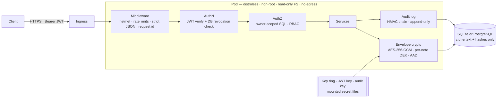

<div align="center">

[English](README.en.md) · [Français](README.fr.md) · **Español** · [Deutsch](README.de.md) · [Português](README.pt-BR.md) · [简体中文](README.zh-CN.md) · [← Inicio](../../README.md)

# 🛡️ Bastion Academy

**Una API de notas deliberadamente endurecida y con cifrado de sobre, la cadena DevSecOps que la entrega y una plataforma de aprendizaje de ciberseguridad construida sobre ella.**

[](https://github.com/Azog1812/bastion-academy/actions/workflows/ci.yml)
[](https://github.com/Azog1812/bastion-academy/actions/workflows/security.yml)
[](https://github.com/Azog1812/bastion-academy/actions/workflows/codeql.yml)
[](https://github.com/Azog1812/bastion-academy/actions/workflows/container.yml)
[](https://github.com/Azog1812/bastion-academy/actions/workflows/dast.yml)
[](https://scorecard.dev/viewer/?uri=github.com/Azog1812/bastion-academy)
[](../../LICENSE)

[Modelo de amenazas](../threat-model.md) · [Controles ↔ OWASP](../security-controls.md) · [Pipeline de seguridad](../security-pipeline.md) · [ADR](../adr/) · [Runbook](../runbook.md) · [Especificación de la API](../openapi.yaml)

</div>

> [!NOTE]
> Esta página es una traducción de la [versión en inglés](README.en.md), que prevalece en
> caso de discrepancia. Los documentos técnicos (modelo de amenazas, ADR, runbook) están
> solo en inglés. El contenido de los cursos (lecciones, cuestionarios, retos) está en
> francés.

## Bastion Academy

Bastion es el núcleo de **Bastion Academy**, una plataforma de aprendizaje de
ciberseguridad autoalojada. Su pedagogía es *rómpelo y luego arréglalo*: cada módulo
parte de una vulnerabilidad real (IDOR, falsificación de JWT, fuerza bruta, inyección
SQL, reutilización de tokens…). Primero, el alumno la explota en un laboratorio y
captura una flag. Después estudia cómo el propio código de Bastion frena el ataque y
ejecuta la prueba que lo demuestra. El recorrido va de los principios básicos hasta el
nivel que exigen las grandes certificaciones del sector.

| Hito | Alcance | Estado |
|---|---|---|
| **v3: fundamentos** | Rutas → módulos → lecciones, seguimiento del progreso, interfaz web, sobre el núcleo de autenticación de Bastion | ✅ API, interfaz web y los seis niveles publicados |
| **v4: retos** | Flags HMAC por usuario (imposibles de compartir), clasificación, antitrampas, MFA TOTP | ✅ Publicado: 11 retos (niveles 1 a 3), clasificación voluntaria, TOTP + códigos de recuperación · **passkeys** (WebAuthn, [ADR 0016](../adr/0016-passkeys.md)) |
| **v5: laboratorios aislados** | Un contenedor vulnerable por alumno: sin salida a red, TTL, runtime en sandbox, cuotas | ✅ Publicado: 10 laboratorios (SQLi, IDOR, mass assignment, JWT `alg:none`, SSRF, path traversal, inyección de comandos, XSS almacenado con una víctima en navegador headless, una cadena de tres fallos, una race condition), lab runner + pasarela, gVisor opcional |
| **v6: blue team** | Ruta de nivel 5 (registro, SIEM, ingeniería de detección, respuesta a incidentes, análisis forense) y retos de detección | ✅ Publicado: 6 lecciones, 5 retos de detección evaluados por precisión **y** exhaustividad · Wazuh real desde la interfaz y 2 retos de reglas XML de Wazuh ([ADR 0013](../adr/0013-shared-environments.md), [0014](../adr/0014-wazuh-rule-challenges.md)) · Observabilidad publicada (Prometheus, alertas probadas, [ADR 0011](../adr/0011-observability.md); enrutamiento con Alertmanager + Grafana, [ADR 0018](../adr/0018-alert-routing-and-dashboards.md)) · Tutor IA: previsto |

La plataforma está pensada para **ejecutarse en local** (`git clone` + Docker). Todavía
no existe una instancia pública alojada.

### Lo que ya está disponible

El plan de estudios abarca seis niveles, de **Fundamentos** a **Experto**, todos
disponibles (en francés, 50 lecciones, 143 preguntas de cuestionario). Los módulos
prácticos pesados son **opcionales**: cada alumno los añade a su formación desde la
interfaz web si su equipo puede ejecutarlos, y dejar uno fuera nunca bloquea el resto
de la ruta:

- **Nivel 1, Fundamentos**: bases de la seguridad, HTTP, sesiones y JWT, y después un
  módulo de IDOR *rómpelo y luego arréglalo*.
- **Nivel 2, Seguridad web y de API**: inyección SQL (con un minilaboratorio local
  autónomo), XSS, CSRF, ataques a JWT, mass assignment y control de acceso a nivel de
  función.
- **Nivel 3, Sistemas y redes**: TCP/IP, DNS y TLS, escaneo de puertos dentro de la
  ley, permisos de Linux y escalada de privilegios, endurecimiento de contenedores,
  cuentas y tokens de Windows, Kerberos y ataques a Active Directory, segmentación de
  red.
- **Nivel 4, Pruebas de penetración**: el marco legal y las reglas de compromiso
  (código penal francés, PASSI), PTES y OWASP WSTG, reconocimiento, encadenamiento de
  fallos, post-explotación dentro del alcance, CVSS 4.0 y un informe que consiga que se
  corrijan las cosas.
- **Nivel 5, Defensa y detección** (blue team): qué registrar, SIEM y correlación,
  reglas al estilo Sigma, leer ataques web en los logs, respuesta a incidentes (NIST SP
  800-61r3, notificación RGPD en 72 horas), primeros pasos en análisis forense (orden de
  volatilidad, contenedores); módulo **Wazuh** opcional (arquitectura, decodificadores y
  reglas XML, monitorización de integridad de archivos, evaluación de configuración CIS,
  respuesta activa y sus trampas).
- **Nivel 6, Experto**: race conditions (TOCTOU, ataque *single-packet*) y
  deserialización insegura (cadenas de gadgets, contaminación de prototipos); delegación
  Kerberos, AD CS (ESC1, ESC8) y DCSync, y cómo detectarlos (4769, 4662, 4887, cuentas
  señuelo); el panorama de certificaciones (OSCP+, CPTS, GIAC, cualificaciones ANSSI) y el
  método para un examen práctico de 24 horas.

**5 retos de detección** ([ADR 0010](../adr/0010-detection-challenges.md)): el alumno
**escribe una regla de detección** (un subconjunto JSON de Sigma) y el servidor la
evalúa sobre un conjunto de logs generado para él, en el que los ataques se esconden
entre actividad legítima **y trampas** pensadas para reglas ingenuas. Solo se supera si
se detectan todos los ataques **y** no hay ningún falso positivo: el equilibrio diario de
un SOC.

| Reto | Qué falla en la regla ingenua |
|---|---|
| Inyecciones SQL en logs de acceso | Un apóstrofo marca a *O'Connor*; el user agent no ve al atacante que se oculta tras un navegador |
| Password spraying (Windows 4624/4625) | Contar fallos marca una cuenta de servicio con la contraseña caducada |
| Living off the land (LOLBins) | Alertar sobre `certutil` o `rundll32` ahoga al SOC en actividad de administración |
| Fuerza bruta SSH, rápida y lenta | Una ventana corta no ve al atacante paciente; un umbral bajo marca al usuario despistado |
| Kerberoasting (Windows 4769) | «RC4 = alerta» marca la vieja aplicación de nóminas y las cuentas de máquina; contar servicios sin RC4 marca la cuenta de inventario |

El lenguaje de reglas **no tiene expresiones regulares a propósito** (una regex del
alumno se ejecutaría en el bucle de eventos del servidor: ReDoS), y los campos se
validan contra cada conjunto de datos.

**2 retos de reglas Wazuh** ([ADR 0014](../adr/0014-wazuh-rule-challenges.md)), en el
módulo Wazuh opcional: el alumno escribe **reglas XML reales de Wazuh**, como en
`local_rules.xml`, contra alertas con la forma del `alerts.json` de Wazuh. El XML del
alumno nunca llega a un parser de uso general: un lector cerrado rechaza DTD y entidades
(**XXE**, *billion laughs*), los patrones son solo OS_Match (sin ReDoS) y el árbol de
reglas no puede formar bucles. El evaluador se **contrasta con el Wazuh real en CI**:
las reglas de referencia se reproducen en `wazuh-logtest` (Wazuh 4.14, sin red) y deben
generar exactamente las mismas alertas. Esa comprobación corrigió el modelo: «Failed
password» pasa por 5716 → 5760, `<srcip>!x` no excluye x y `action` es un campo
estático.

| Reto | Qué falla en la regla ingenua |
|---|---|
| Fuerza bruta SSH, en XML | Correlacionar sobre 5716 no ve nada (el evento sigue hasta 5760); con solo 5760, se escapa el atacante que solo prueba usuarios inexistentes (5710); excluir toda la subred del servidor de copias oculta a un vecino comprometido |
| Vigilar al propio Bastion (su log de auditoría JSON) | `<match>refresh</match>` marca cada renovación normal de token; sin un hijo de nivel 0, el escaneo DAST nocturno de la CI despierta al SOC |

Cada módulo *rómpelo y luego arréglalo* termina en el propio código de Bastion: el
alumno ataca Bastion y luego lee las líneas exactas, las reglas de lint, las reglas de
Semgrep y las pruebas que detienen el ataque.

**11 retos**, cada uno una tarea real del oficio, cada uno con una flag única para el
alumno:

| Reto | Nivel | Qué hace el alumno |
|---|---|---|
| Encodage n'est pas chiffrement · La crypto maison | 1 | Pelar Base64 anidado; romper un XOR de un byte con un ataque de texto plano conocido |
| Un code PIN dans une empreinte rapide | 1 | Forzar un hash SHA-256 sin sal de un PIN (10 000 intentos) y abrir la caja fuerte |
| Des en-têtes trop bavards · Un jeton qui parle trop | 1 | Detectar una cabecera de depuración en una respuesta HTTP en bruto; leer los claims de un JWT |
| Reconstituer une injection SQL à l'aveugle | 2 | **Forense**: reproducir la búsqueda binaria de sqlmap a partir de un log de acceso, usando solo el tamaño de las respuestas |
| Un secret de signature trop faible | 2 | Romper sin conexión el secreto de un JWT HS256 con una lista de palabras (lo que hace `hashcat -m 16500`) |
| Un mot de passe sur le fil | 3 | Decodificar una captura `tcpdump -X` capa a capa y recuperar credenciales HTTP Basic |
| Qui peut vraiment lire ce fichier ? | 3 | Aplicar la regla exacta del kernel propietario/grupo/otros, trampas incluidas, para encontrar los archivos legibles |
| La première règle qui gagne | 3 | Evaluar un conjunto de reglas nftables (primera coincidencia, CIDR, protocolo, política por defecto) sobre flujos reales |
| Pulvérisation de mots de passe et porte dérobée | 3 | **Triaje SOC**: detectar un password spraying en eventos de Windows y decodificar `-EncodedCommand` |

Los retos se generan para cada alumno a partir de una semilla HMAC (no se almacena
nada), los señuelos comparten el formato de la flag y cada generador tiene una prueba
que lo resuelve tal como indica el enunciado
([`challenge-generators.test.ts`](../../test/unit/challenge-generators.test.ts)).

**10 laboratorios en vivo** ([ADR 0009](../adr/0009-isolated-labs.md)): un servicio real,
intencionadamente vulnerable, arrancado para un único alumno, que contiene su flag y
solo es accesible desde su equipo.

| Laboratorio | Nivel | Ataque |
|---|---|---|
| Les factures des autres | 1 | IDOR / BOLA en una API de facturación |
| Entrer sans mot de passe | 2 | Inyección SQL en un formulario de inicio de sesión (errores verbosos como primera pista) |
| Promu administrateur | 2 | Mass assignment en el registro (`"role": "admin"`) |
| Un jeton sans signature | 2 | Falsificar un JWT con `"alg": "none"` |
| Un modérateur trop confiant | 2 | XSS almacenado contra un moderador con **Chromium headless real**; exfiltrar su cookie *a través de la propia aplicación*, ya que los laboratorios no tienen salida |
| Un aperçu trop curieux | 2 | SSRF: hacer que el servidor consulte su propio servicio de administración en loopback |
| Le dossier d'à côté | 3 | Path traversal fuera de una carpeta de descargas |
| Trois failles, une chaîne | 4 | **Ningún fallo basta por sí solo**: path traversal → secreto JWT filtrado → token de administrador falsificado (atajos como `/proc/self/environ` bloqueados) |
| Une carte cadeau, plusieurs fois | 6 | Race condition: una tarjeta regalo de un solo uso canjeada muchas veces con peticiones paralelas (la corrección es el invariante 5 de Bastion: un compare-and-set atómico) |
| Un shell, mais dans une cage | 3 | Inyección de comandos → una shell real, y después **intentar escapar y ver por qué no se puede** (sin salida, solo lectura, `noexec`, sin capabilities) |

El laboratorio es vulnerable; la caja que lo rodea, no:

```
browser ─► bastion :3000 ──(internal network, token)──► lab-runner ── Docker socket
browser ─► lab-gateway :8088 ──(one internal network per lab)──► lab container
```

- **Solo el lab runner toca Docker** (equivalente a root): inaccesible salvo desde la
  plataforma, protegido por token, y nunca toma una imagen, un montaje o una opción de
  una petición.
- **Cada laboratorio** se ejecuta sin root, en solo lectura, sin capabilities, con
  memoria/CPU/PID limitados, sin puerto publicado, en **su propia red sin salida**: sin
  descarga de herramientas, sin reverse shell, sin vecinos. **gVisor** opcional
  (`LAB_RUNTIME=runsc`).
- **Cada laboratorio tiene su propio origen** (`l<id>.lab.localhost`): el XSS de un
  laboratorio no puede tocar la sesión de la plataforma.
- Un laboratorio por alumno, un TTL aplicado tanto por la plataforma como por el runner,
  arranques con límite de frecuencia. El aislamiento se comprobó en vivo: desde un
  laboratorio, Internet, el runner y la plataforma son inaccesibles.

### Empezar a aprender

Node ≥ 22.13:

```bash
git clone https://github.com/Azog1812/bastion-academy && cd bastion-academy
npm ci --ignore-scripts && npm run build
node dist/cli.js gen-secrets > .env
set -a && . ./.env && set +a && NODE_ENV=development npm start
```

Después abre **http://localhost:3000**, crea una cuenta y sigue la ruta.

**Con los laboratorios** (requiere Docker), genera `.env` como arriba y luego:

```bash
docker compose --profile labs build   # imágenes de los laboratorios, una vez
docker compose up --build             # plataforma + lab runner + pasarela, todo en 127.0.0.1
```

**Con monitorización**: `docker compose --profile observability up -d` añade Prometheus
en **http://127.0.0.1:9090** y Grafana en **http://127.0.0.1:3001** (`admin`,
`GRAFANA_ADMIN_PASSWORD` de `.env`). Reutiliza un refresh token y observa cómo
`BastionRefreshTokenReuse` se dispara en la pestaña *Alerts* y llega al receptor `pager`
en la sección *Alerting* de Grafana ([ADR 0011](../adr/0011-observability.md), [ADR 0018](../adr/0018-alert-routing-and-dashboards.md)).

**Con un Wazuh real** (módulo opcional, ~4 GiB de RAM):
`docker compose --profile wazuh up -d` una vez; después los alumnos lo arrancan y lo
detienen desde la tarjeta del módulo; panel en **https://localhost:8443**. La
instalación crea su propia CA sin conexión y elimina las cuentas de demostración de
Wazuh ([ADR 0013](../adr/0013-shared-environments.md)). El log de auditoría de la
plataforma también llega allí ([ADR 0015](../adr/0015-audit-log-to-siem.md)): reutiliza
un refresh token o sondea una ruta de administración y la alerta aparece en el panel
(`rule.groups: bastion`).

| Endpoint | Función |
|---|---|
| `GET /v1/curriculum` | Niveles, rutas, módulos y lecciones, con tu progreso y los módulos desbloqueados |
| `GET /v1/lessons/{id}` | Una lección (Markdown) y sus preguntas, nunca sus respuestas |
| `POST /v1/lessons/{id}/complete` | Envía tus respuestas; se corrigen en el servidor |
| `POST /v1/session/{login,mfa,passkey,refresh,logout}` | Sesiones de navegador: refresh token en una cookie HttpOnly |
| `GET /v1/challenges[/{id}]` · `POST /v1/challenges/{id}/submit` | Retos: tu artefacto personal y después tu flag personal |
| `GET /v1/scoreboard` · `PUT /v1/me/profile` | Clasificación voluntaria con seudónimo |
| `POST /v1/me/mfa/{setup,enable,disable}` · `POST /v1/auth/mfa` | Segundo factor TOTP y códigos de recuperación |
| `GET/POST /v1/me/passkeys` · `POST /v1/me/passkeys/options` · `DELETE /v1/me/passkeys/{id}` · `POST /v1/auth/mfa/passkey/options` | Passkeys (WebAuthn) como segundo factor resistente al phishing |
| `POST /v1/auth/passkey/options` · `POST /v1/auth/passkey` | Inicio de sesión sin contraseña con una passkey detectable y con verificación del usuario |

Cómo se protege ([ADR 0006](../adr/0006-curriculum-as-code.md), [ADR 0007](../adr/0007-web-front-end.md)):

- **El plan de estudios es código.** Las lecciones viven en [`content/`](../../content/)
  y solo cambian mediante pull requests revisadas. Se validan al arrancar y el servidor
  se niega a iniciarse con contenido incoherente. No hay CMS que comprometer.
- **Control en el servidor.** La API impone los requisitos previos y los cuestionarios,
  así que modificar el front-end no desbloquea nada. Las respuestas nunca salen del
  servidor.
- **Progreso aislado.** Cada consulta se limita al alumno autenticado. Una regla de
  Semgrep bloquea cualquier regresión.
- **Una interfaz web sin dependencias nuevas.** TypeScript simple compilado con `tsc`,
  servido desde el mismo origen (sin CORS). El access token se queda en memoria; el
  refresh token vive en una cookie `__Host-` `HttpOnly; Secure; SameSite=Strict` que
  ningún script puede leer.
- **Flags imposibles de compartir** ([ADR 0008](../adr/0008-flags-scoreboard-mfa.md)).
  Cada flag es `HMAC(clave, reto, alumno)`: nunca se almacena, nunca está en el
  repositorio y no le sirve a nadie más. Quien envía la flag de otro recibe la misma
  respuesta que con una incorrecta, y el log de auditoría registra de quién era.
- **MFA TOTP sin bibliotecas** (RFC 6238 sobre `node:crypto`, verificada con los vectores
  de prueba del RFC). Las semillas se cifran con el anillo de KEK; un código nunca se
  acepta dos veces; los códigos erróneos alimentan el bloqueo de la cuenta; desactivar
  la MFA exige la contraseña *y* un código.
- **Passkeys sin bibliotecas** (WebAuthn sobre `node:crypto`, [ADR 0016](../adr/0016-passkeys.md)):
  se comprueban el origen exacto y el hash del RP ID, así que se rechaza la firma
  retransmitida por un proxy de phishing, algo que TOTP no puede hacer. Desafíos de un
  solo uso ligados a su paso de MFA, un decodificador CBOR acotado para las estructuras
  que aporta el atacante y detección de clones mediante el contador de firmas (auditada,
  nivel 12 en Wazuh). Probado con un autenticador software que hace de atacante, y de
  extremo a extremo en Chromium con su autenticador virtual. Abre la instalación local
  en `http://localhost:3000` (una dirección IP no puede ser un RP ID).
- **Inicio de sesión sin contraseña** ([ADR 0017](../adr/0017-passwordless-passkey-login.md)):
  una passkey detectable con verificación del usuario sustituye a la contraseña y al
  segundo factor (AAL2). Las opciones no nombran ninguna cuenta (nada que enumerar), el
  user handle debe ser dueño de la clave, los fallos nunca alimentan el bloqueo (no hay
  botón de «bloquear a cualquiera») y la recuperación nunca se salta un factor: otra
  passkey, o contraseña más un código, o la CLI de operador en el servidor.
- **Un XSS requiere dos fallos independientes.** La interfaz nunca construye HTML a
  partir de cadenas (ESLint prohíbe todos los sinks HTML, el Markdown se renderiza nodo
  a nodo) y la CSP de la página impone **Trusted Types** sin ninguna política
  permitida, así que cualquier sink de ese tipo lanza una excepción en el navegador.

Recorrido rápido, con la API en marcha (consulta [Intenta romperlo](#try-to-break-it)
para arrancarla y obtener un token):

```bash
curl -s $B/v1/curriculum -H "authorization: Bearer $ALICE" | jq '.paths[].modules[] | {id, unlocked}'
curl -s $B/v1/lessons/cia-et-risque -H "authorization: Bearer $ALICE" | jq -r .body
```

> [!WARNING]
> Los laboratorios son aplicaciones **intencionadamente vulnerables**. Ejecútalos solo
> en tu propio equipo, ligados a `127.0.0.1`, y **nunca los expongas en una red que no
> controles**. Ataca solo objetivos que sean tuyos o que tengas autorización explícita
> para probar.

---

## Por qué existe este proyecto

Este repositorio empezó como un «hello world» de Express de 20 líneas con un pipeline
de Jenkins cuyas etapas de seguridad estaban comentadas, una contraseña pasada como
parámetro de compilación y un escaneo de vulnerabilidades que terminaba en `|| true`.
Esa versión sigue en el historial de git, a propósito.

La v2 plantea otra pregunta: **¿qué hace falta para que una pequeña API sobreviva a un
atacante real, y para demostrarlo?** La respuesta no es la lista de funciones: es que
cada afirmación de seguridad de esta página se apoya en código legible y en una prueba
que intenta romperla.

## Qué hay dentro



### Seguridad de la aplicación

| Amenaza | Control | Demostrado por |
|---|---|---|
| Volcado de la base de datos / copia de seguridad filtrada | **Cifrado de sobre**: una clave AES-256-GCM por nota, envuelta por una KEK rotatoria que nunca toca la base de datos | [`envelope.test.ts`](../../test/unit/envelope.test.ts) |
| Robo de la base de datos *y* de los secretos de la plataforma | **KEK en Vault Transit** (overlay opcional): la KEK nunca sale de Vault, una clave derivada por nota, AppRole con tokens de 1 hora, una política que prohíbe exportar y borrar, rotación dentro de Vault ([ADR 0019](../adr/0019-vault-transit-kms.md)) | [`kms-vault.test.ts`](../../test/security/kms-vault.test.ts), [`test/vault-real`](../../test/vault-real/run.sh) |
| Textos cifrados intercambiados entre usuarios por un atacante con acceso a la base | Id del propietario e id de la nota ligados en el **AAD** → el descifrado falla | [`authorization.test.ts`](../../test/security/authorization.test.ts) |
| IDOR / BOLA (OWASP API n.º 1) | Id del propietario en cada consulta SQL; las notas ajenas y las inexistentes son indistinguibles (404); los sondeos se auditan; en PostgreSQL, row-level security como segunda barrera, con un usuario de la API que no puede saltársela ([ADR 0022](../adr/0022-row-level-security.md)) | [`authorization.test.ts`](../../test/security/authorization.test.ts), [`row-level-security.test.ts`](../../test/security/row-level-security.test.ts) |
| Fuerza bruta y credential stuffing | Límite de frecuencia por IP, **bloqueo progresivo** con contadores atómicos, lista de contraseñas filtradas; con varias réplicas, límites compartidos en Valkey que fallan cerrados ([ADR 0023](../adr/0023-shared-rate-limits.md)) | [`authentication.test.ts`](../../test/security/authentication.test.ts) |
| Enumeración de cuentas | Respuesta idéntica para usuario desconocido / contraseña incorrecta / cuenta bloqueada, y un **hash scrypt ficticio** para que los tiempos coincidan | [`authentication.test.ts`](../../test/security/authentication.test.ts) |
| Ataques a JWT (`alg:none`, confusión de algoritmo, manipulación, reutilización) | Lista blanca de algoritmos, `iss`/`aud`/`typ`/`exp` obligatorios, claims revalidados | [`tokens.test.ts`](../../test/unit/tokens.test.ts) |
| Contraseña robada por phishing o reutilizada | **MFA TOTP** opcional: códigos no reutilizables (compare-and-set sobre el paso de tiempo), desafío de inicio de sesión de un solo uso y 5 intentos, semillas cifradas, códigos de recuperación de un solo uso con hash; **passkeys** contra el phishing (ligadas al origen y al RP ID) | [`mfa.test.ts`](../../test/security/mfa.test.ts), [`totp.test.ts`](../../test/unit/totp.test.ts) |
| Compartir flags, trampas en la clasificación | **Flags HMAC por alumno**, comparación en tiempo constante, límite por cuenta, flags compartidas atribuidas en el log de auditoría | [`challenges.test.ts`](../../test/security/challenges.test.ts) |
| Escapar de un laboratorio (al host, a la plataforma, a otros laboratorios, a Internet) | Contenedor endurecido, **red interna por instancia**, la pasarela como único par, socket de Docker solo en manos del runner, catálogo cerrado de laboratorios | [`lab-runner.test.ts`](../../test/unit/lab-runner.test.ts), [`labs.test.ts`](../../test/security/labs.test.ts) |
| SSRF a través de la pasarela de laboratorios | Destino **construido** a partir de un id de instancia de 32 caracteres hexadecimales, nunca leído de la petición | [`lab-runner.test.ts`](../../test/unit/lab-runner.test.ts) |
| Refresh token robado | **Rotación de un solo uso con detección de reutilización**: una reutilización mata toda la familia de sesiones (RFC 9700) | [`authentication.test.ts`](../../test/security/authentication.test.ts) |
| Race conditions (TOCTOU) en el refresh, el bloqueo, la cadena de auditoría y el último segundo factor | Token reclamado con un único compare-and-set; contadores con `UPDATE … RETURNING`; cualquier otro check-then-act en una transacción, nunca «sin `await` entre medias» ([ADR 0020](../adr/0020-async-database-layer.md)); en PostgreSQL, transacciones SERIALIZABLE reintentadas y un advisory lock en la cadena de auditoría ([ADR 0021](../adr/0021-postgresql-backend.md)) | pruebas con peticiones paralelas; pruebas de concurrencia contra una base de datos que inyecta latencia ([`db.test.ts`](../../test/unit/db.test.ts)); toda la suite de nuevo contra un PostgreSQL real en CI |
| JWT «sin estado» que no se puede revocar | `token_version` + rol comprobados en cada petición → cierre de sesión global y degradación instantáneos | [`authorization.test.ts`](../../test/security/authorization.test.ts) |
| Mass assignment, contaminación de prototipos, HPP | Esquemas estrictos que rechazan claves desconocidas; parser de query simple | [`input-and-transport.test.ts`](../../test/security/input-and-transport.test.ts) |
| Inyección SQL | Solo parámetros enlazados, impuesto por **reglas de ESLint y Semgrep** | pruebas + CI |
| Manipulación de pruebas tras una intrusión | **Log de auditoría a prueba de manipulaciones**: cadena HMAC + triggers en la base; `verify` señala la primera entrada alterada | [`config-and-audit.test.ts`](../../test/unit/config-and-audit.test.ts) |
| Configuración incorrecta | **Configuración que falla cerrada**: se niega a arrancar con secretos ausentes, cortos o de ejemplo | [`config-and-audit.test.ts`](../../test/unit/config-and-audit.test.ts) |

Además: scrypt (N=2¹⁷) con rehash transparente · política de contraseñas NIST 800-63B ·
cabeceras de seguridad estrictas (CSP `default-src 'none'`, HSTS preload…) · caché
`no-store` · errores genéricos con ids de correlación · secretos ocultados en los logs ·
secretos leídos de archivos en vez de variables de entorno · timeouts de socket ·
operaciones privilegiadas solo mediante una CLI de operador, nunca por HTTP.

**459 pruebas, ~98 % de cobertura de líneas**: la mayoría son *casos de abuso*, no
casos nominales.

### Cadena de suministro e infraestructura

| Etapa | Qué se ejecuta |
|---|---|
| Código | ESLint (`strictTypeChecked` + plugin de seguridad + reglas SQL propias), `tsc --strict` |
| Secretos | gitleaks sobre **todo el historial de git** |
| SAST | Semgrep (OWASP Top 10, Node, TS, JWT) + [reglas propias del proyecto](../../.semgrep/bastion.yml), CodeQL `security-extended` |
| SCA | `npm audit`, **`npm audit signatures`**, OSV-Scanner, Dependency Review en las PR, Dependabot con 7 días de espera |
| IaC | hadolint, Checkov (0 hallazgos sin revisar; aceptaciones de riesgo documentadas en el propio código) |
| Contenedor | Distroless, UID 65532, sin shell (comprobado en CI), probado con `--read-only --cap-drop ALL`, puerta de Trivy |
| DAST | Escaneo de API con OWASP ZAP **autenticado con un token real**, guiado por la especificación OpenAPI |
| Publicación | Push de la imagen exacta escaneada → **firma cosign keyless** → **SBOM CycloneDX** firmado → **procedencia SLSA** → autoverificación |
| Monitorización | Métricas de Prometheus en un **listener separado protegido por token**, etiquetas solo de conjuntos cerrados (sin datos personales, sin DoS por cardinalidad), **alertas con pruebas unitarias de `promtool`** en CI y enlazadas al [runbook](../runbook.md), **enrutadas por severidad en Alertmanager** (enrutamiento e inhibición probados con `amtool` y una instancia real, silencios solo tras el login de Grafana, dead man's switch Watchdog, [ADR 0018](../adr/0018-alert-routing-and-dashboards.md)); el propio log de auditoría en **Wazuh**, con reglas comprobadas en el `wazuh-logtest` real ([ADR 0015](../adr/0015-audit-log-to-siem.md)) |
| Ejecución | Kubernetes PSS *restricted*, NetworkPolicy de denegación por defecto **sin salida**, sin token de service account, secretos como archivos 0400, **Kyverno rechaza imágenes sin firmar** |
| El propio pipeline | `permissions: {}`, cada acción **fijada por SHA**, `--ignore-scripts`, `persist-credentials: false`, harden-runner, OpenSSF Scorecard |

<a id="try-to-break-it"></a>

## Intenta romperlo

```bash
git clone https://github.com/Azog1812/bastion-academy && cd bastion-academy
npm ci --ignore-scripts && npm run build
node dist/cli.js gen-secrets > .env
set -a && . ./.env && set +a && NODE_ENV=development npm start
```

Después, en otra terminal:

```bash
B=http://localhost:3000; J='content-type: application/json'
login() { curl -s -X POST $B/v1/auth/register -H "$J" -d "{\"email\":\"$1\",\"password\":\"correct horse battery staple\"}" >/dev/null
          curl -s -X POST $B/v1/auth/login -H "$J" -d "{\"email\":\"$1\",\"password\":\"correct horse battery staple\"}" | jq -r .accessToken; }
ALICE=$(login alice@demo.test); MALLORY=$(login mallory@demo.test)

NOTE=$(curl -s -X POST $B/v1/notes -H "$J" -H "authorization: Bearer $ALICE" -d '{"title":"diary","body":"secret"}' | jq -r .id)

# IDOR: Mallory pide la nota de Alice → 404, igual que una nota que no existe
curl -s $B/v1/notes/$NOTE -H "authorization: Bearer $MALLORY"

# Mass assignment: intentar registrarse como admin → 400, campo desconocido rechazado
curl -s -X POST $B/v1/auth/register -H "$J" -d '{"email":"x@demo.test","password":"correct horse battery staple","role":"admin"}'

# Falsificación alg:none → 401
H=$(printf '{"alg":"none","typ":"at+jwt"}' | base64 | tr -d '=' | tr '/+' '_-')
P=$(printf '{"sub":"x","role":"admin","tv":0}' | base64 | tr -d '=' | tr '/+' '_-')
curl -s $B/v1/me -H "authorization: Bearer $H.$P."

# La base de datos no contiene texto en claro
sqlite3 data/bastion.db "SELECT hex(ciphertext) FROM notes" | head -c 80; echo
```

O ejecuta toda la batería: `npm test`. Con Docker: `docker compose up --build` (el
mismo endurecimiento que en producción: sistema de archivos de solo lectura, sin
capabilities, puerto solo en loopback).

## Estructura del repositorio

```
src/
  config.ts            configuración que falla cerrada (zod), secretos leídos de archivos
  db.ts · postgres.ts  capa de base de datos: SQLite (por defecto) o PostgreSQL con row-level security
  redis.ts             cliente Valkey mínimo y acotado para los límites de frecuencia compartidos
  crypto/              cifrado de sobre · KMS (anillo local / Vault Transit) · scrypt · JWT + refresh tokens · TOTP · WebAuthn + CBOR
  services/            auth (bloqueo, rotación, revocación) · notas (por propietario) ·
                       aprendizaje (progreso, control en el servidor) · mfa · passkeys ·
                       retos (flags por alumno, clasificación) · laboratorios · entornos
  challenges/          conjunto cerrado de generadores de artefactos de retos
  labs/                catálogo de laboratorios · runner (el único cliente de Docker) · pasarela (un origen por laboratorio)
  detection/           motor de reglas (subconjunto de Sigma, sin regex) · subconjunto XML de Wazuh · conjuntos de datos etiquetados por alumno
  curriculum/          carga y valida content/ al arrancar (falla cerrado)
  http/                middleware (authn, RBAC, errores) · esquemas estrictos · rutas · sesiones · métricas
  audit.ts             registro de auditoría encadenado con HMAC, solo de anexado
  cli.ts               acciones solo para el operador: promote, rotate-keys, verify-audit, recover-account
test/
  unit/                criptografía, tokens, configuración, cadena de auditoría, detección, configuración de monitorización
  security/            autenticación, autorización/IDOR, inyección y transporte, aprendizaje,
                       MFA, passkeys, retos y clasificación, laboratorios, row-level security
  labs/                cada laboratorio es explotable como se pretende, y solo así
labs/                  aplicaciones de laboratorio intencionadamente vulnerables (excluidas del lint y del SAST a propósito)
content/               el plan de estudios como código: niveles, rutas, cuestionarios, retos (JSON), lecciones (Markdown)
web/                   front-end: TypeScript simple, sin dependencias, Markdown → DOM, Trusted Types
deploy/                manifiestos k8s · política de Kyverno · Prometheus · Alertmanager · Grafana · Wazuh
.github/workflows/     CI · Security · CodeQL · Container (firma/SBOM/SLSA) · DAST · Scorecard
.semgrep/              reglas SAST propias del proyecto
docs/                  modelo de amenazas · correspondencia OWASP/ASVS · pipeline · ADR · runbook · OpenAPI · i18n (esta página)
```

## Decisiones de diseño y límites

Cada decisión importante tiene su [ADR](../adr/), con las alternativas descartadas: por
ejemplo, por qué scrypt en lugar de Argon2 (sin addon nativo), por qué SQLite sigue
siendo la opción por defecto (cero dependencias nativas, nada que ejecutar) y cómo
PostgreSQL atiende varias réplicas con el mismo SQL
([ADR 0021](../adr/0021-postgresql-backend.md)). Los riesgos conocidos y aceptados
(enumeración en el registro, bloqueo usado como DoS, HS256…) figuran en el
[modelo de amenazas](../threat-model.md#5-accepted-risks) en lugar de ocultarse.

**Hoja de ruta:** commits y releases firmados · fuzzing de la capa HTTP · tutor IA.

## Seguridad

¿Has encontrado una vulnerabilidad? Infórmanos de forma privada: consulta
[SECURITY.md](../../SECURITY.md).

---

<sub>Creado por **Florent Roch**, Mastère cybersécurité (ESTIAM). Licencia MIT. [Créditos](../../README.md#credits)</sub>
