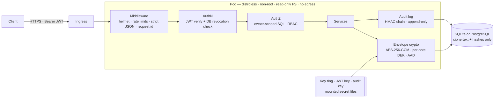

<div align="center">

[English](README.en.md) · **Français** · [Español](README.es.md) · [Deutsch](README.de.md) · [Português](README.pt-BR.md) · [简体中文](README.zh-CN.md) · [← Accueil](../../README.md)

# 🛡️ Bastion Academy

**Une API de notes volontairement durcie et chiffrée par enveloppe, la chaîne DevSecOps qui la livre, et une plateforme d'apprentissage de la cybersécurité construite par-dessus.**

[](https://github.com/Azog1812/bastion-academy/actions/workflows/ci.yml)
[](https://github.com/Azog1812/bastion-academy/actions/workflows/security.yml)
[](https://github.com/Azog1812/bastion-academy/actions/workflows/codeql.yml)
[](https://github.com/Azog1812/bastion-academy/actions/workflows/container.yml)
[](https://github.com/Azog1812/bastion-academy/actions/workflows/dast.yml)
[](https://scorecard.dev/viewer/?uri=github.com/Azog1812/bastion-academy)
[](../../LICENSE)

[Modèle de menace](../threat-model.md) · [Contrôles ↔ OWASP](../security-controls.md) · [Pipeline de sécurité](../security-pipeline.md) · [ADR](../adr/) · [Runbook](../runbook.md) · [Spécification de l'API](../openapi.yaml)

</div>

> [!NOTE]
> Cette page est une traduction de la [version anglaise](README.en.md), qui fait foi en cas
> de divergence. Les documents techniques (modèle de menace, ADR, runbook) sont en anglais.
> Le contenu des cours (leçons, quiz, défis) est en français.

## Bastion Academy

Bastion est le cœur de **Bastion Academy**, une plateforme d'apprentissage de la
cybersécurité à installer chez soi. Sa pédagogie : *casse-le, puis répare-le*. Chaque
module part d'une vulnérabilité réelle (IDOR, falsification de JWT, force brute,
injection SQL, rejeu de jeton…). L'élève l'exploite d'abord dans un lab et capture un
flag. Il étudie ensuite comment le code de Bastion neutralise l'attaque et lance le test
qui le prouve. Le parcours va des bases jusqu'au niveau attendu par les grandes
certifications du métier.

| Jalon | Périmètre | État |
|---|---|---|
| **v3 : fondations** | Parcours → modules → leçons, suivi de progression, interface web, sur le socle d'authentification de Bastion | ✅ API, interface web, les six niveaux livrés |
| **v4 : défis** | Flags HMAC par utilisateur (impossibles à partager), classement, anti-triche, MFA TOTP | ✅ Livré : 11 défis (niveaux 1 à 3), classement sur inscription, TOTP + codes de secours · **passkeys** (WebAuthn, [ADR 0016](../adr/0016-passkeys.md)) |
| **v5 : labs isolés** | Un conteneur vulnérable par élève : sans sortie réseau, TTL, runtime sandboxé, quotas | ✅ Livré : 10 labs (SQLi, IDOR, mass assignment, JWT `alg:none`, SSRF, path traversal, injection de commande, XSS stockée avec une victime en navigateur headless, une chaîne de trois failles, une race condition), lab runner + passerelle, gVisor en option |
| **v6 : blue team** | Parcours niveau 5 (journalisation, SIEM, ingénierie de détection, réponse à incident, forensique) et défis de détection | ✅ Livré : 6 leçons, 5 défis de détection notés sur la précision **et** le rappel · vrai Wazuh lancé depuis l'interface et 2 défis de règles XML Wazuh ([ADR 0013](../adr/0013-shared-environments.md), [0014](../adr/0014-wazuh-rule-challenges.md)) · Observabilité livrée (Prometheus, alertes testées, [ADR 0011](../adr/0011-observability.md) ; routage Alertmanager + Grafana, [ADR 0018](../adr/0018-alert-routing-and-dashboards.md)) · Tuteur IA : prévu |

La plateforme est conçue pour **tourner en local** (`git clone` + Docker). Il n'existe
pas encore d'instance publique hébergée.

### Ce qui est disponible aujourd'hui

Le cursus couvre six niveaux, des **Fondamentaux** à **Expert**, tous disponibles (en
français, 50 leçons, 143 questions de quiz). Les modules pratiques lourds sont
**optionnels** : chaque élève les ajoute à sa formation depuis l'interface web si sa
machine peut les faire tourner, et en laisser un de côté ne bloque jamais le reste du
parcours :

- **Niveau 1, Fondamentaux** : bases de la sécurité, HTTP, sessions et JWT, puis un
  module IDOR *casse-le, puis répare-le*.
- **Niveau 2, Sécurité web et API** : injection SQL (avec un mini-lab local autonome),
  XSS, CSRF, attaques sur les JWT, mass assignment et contrôle d'accès au niveau des
  fonctions.
- **Niveau 3, Systèmes et réseaux** : TCP/IP, DNS et TLS, scan de ports dans la
  légalité, permissions Linux et élévation de privilèges, durcissement de conteneurs,
  comptes et jetons Windows, Kerberos et attaques Active Directory, segmentation réseau.
- **Niveau 4, Test d'intrusion** : le cadre légal et les règles d'engagement (code
  pénal, PASSI), PTES et OWASP WSTG, reconnaissance, chaînage de failles,
  post-exploitation dans le périmètre, CVSS 4.0 et un rapport qui fait corriger.
- **Niveau 5, Défense et détection** (blue team) : quoi journaliser, SIEM et
  corrélation, écrire des règles façon Sigma, lire les attaques web dans les logs,
  réponse à incident (NIST SP 800-61r3, notification RGPD sous 72 heures), premiers pas
  en forensique (ordre de volatilité, conteneurs) ; module **Wazuh** optionnel
  (architecture, décodeurs et règles XML, contrôle d'intégrité des fichiers, évaluation
  de configuration CIS, réponse active et ses pièges).
- **Niveau 6, Expert** : race conditions (TOCTOU, attaque *single-packet*) et
  désérialisation non sûre (chaînes de gadgets, pollution de prototype) ; délégation
  Kerberos, AD CS (ESC1, ESC8) et DCSync, puis leur détection (4769, 4662, 4887, comptes
  leurres) ; le paysage des certifications (OSCP+, CPTS, GIAC, qualifications ANSSI) et
  la méthode pour un examen pratique de 24 heures.

**5 défis de détection** ([ADR 0010](../adr/0010-detection-challenges.md)) : l'élève
**écrit une règle de détection** (un sous-ensemble JSON de Sigma) et le serveur la note
sur un jeu de logs généré pour lui, où les attaques se cachent parmi l'activité normale
**et des pièges** conçus pour les règles naïves. Le défi n'est réussi que si toutes les
attaques sont détectées **et** qu'il n'y a aucun faux positif : l'arbitrage quotidien
d'un SOC.

| Défi | Ce que la règle naïve rate |
|---|---|
| Injections SQL dans les logs d'accès | Une apostrophe signale *O'Connor* ; le user agent rate l'attaquant qui se cache derrière un navigateur |
| Pulvérisation de mots de passe (Windows 4624/4625) | Compter les échecs signale un compte de service au mot de passe expiré |
| Living off the land (LOLBins) | Alerter sur `certutil` ou `rundll32` noie le SOC sous l'activité d'administration |
| Force brute SSH, rapide et lente | Une fenêtre courte rate l'attaquant patient ; un seuil bas signale l'utilisateur distrait |
| Kerberoasting (Windows 4769) | « RC4 = alerte » signale la vieille appli de paie et les comptes machines ; compter les services sans RC4 signale le compte d'inventaire |

Le langage de règles n'a **volontairement aucune expression régulière** (une regex
d'élève tournerait sur la boucle d'événements du serveur : ReDoS), et les champs sont
vérifiés pour chaque jeu de données.

**2 défis de règles Wazuh** ([ADR 0014](../adr/0014-wazuh-rule-challenges.md)), dans le
module Wazuh optionnel : l'élève écrit de **vraies règles XML Wazuh**, comme dans
`local_rules.xml`, contre des alertes au format du `alerts.json` de Wazuh. Le XML de
l'élève n'atteint jamais un parseur généraliste : un lecteur fermé refuse les DTD et les
entités (**XXE**, *billion laughs*), les motifs sont en OS_Match uniquement (pas de
ReDoS), et l'arbre des règles ne peut pas boucler. L'évaluateur est **vérifié contre le
vrai Wazuh en CI** : les règles de référence sont rejouées dans `wazuh-logtest`
(Wazuh 4.14, sans réseau) et doivent lever exactement les mêmes alertes. Cette
vérification a corrigé le modèle : « Failed password » passe par 5716 → 5760,
`<srcip>!x` n'exclut pas x, et `action` est un champ statique.

| Défi | Ce que la règle naïve rate |
|---|---|
| Force brute SSH, en XML | Corréler sur 5716 ne voit rien (l'événement continue vers 5760) ; sur 5760 seul, l'attaquant qui n'essaie que des utilisateurs inexistants (5710) passe ; exclure tout le sous-réseau du serveur de sauvegarde masque un voisin compromis |
| Surveiller Bastion lui-même (son journal d'audit JSON) | `<match>refresh</match>` signale chaque renouvellement de jeton normal ; sans enfant de niveau 0, le scan DAST nocturne de la CI réveille le SOC |

Chaque module *casse-le, puis répare-le* se termine dans le code de Bastion : l'élève
attaque Bastion, puis lit les lignes exactes, les règles de lint, les règles Semgrep et
les tests qui arrêtent l'attaque.

**11 défis**, chacun une tâche du métier, chacun avec un flag propre à l'élève :

| Défi | Niveau | Ce que fait l'élève |
|---|---|---|
| Encodage n'est pas chiffrement · La crypto maison | 1 | Éplucher du Base64 imbriqué ; casser un XOR à un octet par texte clair connu |
| Un code PIN dans une empreinte rapide | 1 | Forcer une empreinte SHA-256 non salée d'un PIN (10 000 essais), ouvrir le coffre |
| Des en-têtes trop bavards · Un jeton qui parle trop | 1 | Repérer un en-tête de debug dans une réponse HTTP brute ; lire les claims d'un JWT |
| Reconstituer une injection SQL à l'aveugle | 2 | **Forensique** : rejouer la recherche dichotomique de sqlmap à partir d'un log d'accès, avec les seules tailles de réponse |
| Un secret de signature trop faible | 2 | Casser hors ligne le secret d'un JWT HS256 avec une liste de mots (ce que fait `hashcat -m 16500`) |
| Un mot de passe sur le fil | 3 | Décoder une capture `tcpdump -X` couche par couche, retrouver des identifiants HTTP Basic |
| Qui peut vraiment lire ce fichier ? | 3 | Appliquer la règle exacte du noyau propriétaire/groupe/autres, pièges compris, pour trouver les fichiers lisibles |
| La première règle qui gagne | 3 | Évaluer un jeu de règles nftables (première correspondance, CIDR, protocole, politique par défaut) sur des flux réels |
| Pulvérisation de mots de passe et porte dérobée | 3 | **Triage SOC** : repérer une pulvérisation dans des événements Windows, décoder `-EncodedCommand` |

Les énigmes sont générées pour chaque élève à partir d'une graine HMAC (rien n'est
stocké), les leurres ont le même format que le flag, et chaque générateur a un test qui
le résout comme l'énoncé l'indique
([`challenge-generators.test.ts`](../../test/unit/challenge-generators.test.ts)).

**10 labs en direct** ([ADR 0009](../adr/0009-isolated-labs.md)) : un vrai service,
volontairement vulnérable, démarré pour un seul élève, qui contient son flag et n'est
joignable que depuis sa machine.

| Lab | Niveau | Attaque |
|---|---|---|
| Les factures des autres | 1 | IDOR / BOLA sur une API de facturation |
| Entrer sans mot de passe | 2 | Injection SQL sur un formulaire de connexion (erreurs verbeuses comme premier indice) |
| Promu administrateur | 2 | Mass assignment à l'inscription (`"role": "admin"`) |
| Un jeton sans signature | 2 | Forger un JWT avec `"alg": "none"` |
| Un modérateur trop confiant | 2 | XSS stockée contre un modérateur **Chromium headless réel** ; exfiltrer son cookie *par l'application elle-même*, puisque les labs n'ont aucune route vers l'extérieur |
| Un aperçu trop curieux | 2 | SSRF : faire interroger par le serveur son propre service d'administration en loopback |
| Le dossier d'à côté | 3 | Path traversal hors d'un dossier de téléchargement |
| Trois failles, une chaîne | 4 | **Aucune faille ne suffit seule** : path traversal → secret JWT divulgué → jeton admin forgé (raccourcis comme `/proc/self/environ` bloqués) |
| Une carte cadeau, plusieurs fois | 6 | Race condition : une carte cadeau à usage unique encaissée plusieurs fois par des requêtes parallèles (le correctif est l'invariant 5 de Bastion : un compare-and-set atomique) |
| Un shell, mais dans une cage | 3 | Injection de commande → un vrai shell, puis **essayer de s'échapper et comprendre pourquoi c'est impossible** (aucune route vers l'extérieur, lecture seule, `noexec`, aucune capability) |

Le lab est vulnérable, la boîte qui l'entoure ne l'est pas :

```
browser ─► bastion :3000 ──(internal network, token)──► lab-runner ── Docker socket
browser ─► lab-gateway :8088 ──(one internal network per lab)──► lab container
```

- **Seul le lab runner touche Docker** (équivalent root) : injoignable sauf depuis la
  plateforme, protégé par un jeton, et il ne prend jamais d'image, de montage ou
  d'option dans une requête.
- **Chaque lab** tourne sans root, en lecture seule, sans capabilities, avec
  mémoire/CPU/PID plafonnés, sans port publié, sur **son propre réseau sans route vers
  l'extérieur** : pas de téléchargement d'outils, pas de reverse shell, pas de voisin.
  **gVisor** en option (`LAB_RUNTIME=runsc`).
- **Chaque lab a sa propre origine** (`l<id>.lab.localhost`) : la XSS d'un lab ne peut
  pas toucher la session de la plateforme.
- Un lab par élève, un TTL appliqué à la fois par la plateforme et par le runner, des
  démarrages limités en débit. L'isolation a été vérifiée en conditions réelles : depuis
  un lab, Internet, le runner et la plateforme sont tous injoignables.

### Commencer à apprendre

Node ≥ 22.13 :

```bash
git clone https://github.com/Azog1812/bastion-academy && cd bastion-academy
npm ci --ignore-scripts && npm run build
node dist/cli.js gen-secrets > .env
set -a && . ./.env && set +a && NODE_ENV=development npm start
```

Ouvrez ensuite **http://localhost:3000**, créez un compte et suivez le parcours.

**Avec les labs** (Docker requis), générez `.env` comme ci-dessus, puis :

```bash
docker compose --profile labs build   # images des labs, une seule fois
docker compose up --build             # plateforme + lab runner + passerelle, tout sur 127.0.0.1
```

**Avec la supervision** : `docker compose --profile observability up -d` ajoute
Prometheus sur **http://127.0.0.1:9090** et Grafana sur **http://127.0.0.1:3001**
(`admin`, `GRAFANA_ADMIN_PASSWORD` dans `.env`). Rejouez un refresh token et regardez
`BastionRefreshTokenReuse` se déclencher dans l'onglet *Alerts*, puis atteindre le
récepteur `pager` dans l'onglet *Alerting* de Grafana ([ADR 0011](../adr/0011-observability.md), [ADR 0018](../adr/0018-alert-routing-and-dashboards.md)).

**Avec un vrai Wazuh** (module optionnel, ~4 Gio de RAM) :
`docker compose --profile wazuh up -d` une fois, puis les élèves le démarrent et
l'arrêtent depuis la carte du module ; tableau de bord sur **https://localhost:8443**.
L'installation crée sa propre CA hors ligne et supprime les comptes de démonstration de
Wazuh ([ADR 0013](../adr/0013-shared-environments.md)). Le journal d'audit de la
plateforme y est aussi envoyé ([ADR 0015](../adr/0015-audit-log-to-siem.md)) : rejouez
un refresh token ou sondez une route d'administration, et l'alerte apparaît dans le
tableau de bord (`rule.groups: bastion`).

| Endpoint | Rôle |
|---|---|
| `GET /v1/curriculum` | Niveaux, parcours, modules et leçons, avec votre progression et les modules déverrouillés |
| `GET /v1/lessons/{id}` | Une leçon (Markdown) et ses questions de quiz, jamais leurs réponses |
| `POST /v1/lessons/{id}/complete` | Envoyer vos réponses au quiz ; corrigées sur le serveur |
| `POST /v1/session/{login,mfa,passkey,refresh,logout}` | Sessions navigateur : refresh token dans un cookie HttpOnly |
| `GET /v1/challenges[/{id}]` · `POST /v1/challenges/{id}/submit` | Défis : votre artefact personnel, puis votre flag personnel |
| `GET /v1/scoreboard` · `PUT /v1/me/profile` | Classement sur inscription, sous pseudonyme |
| `POST /v1/me/mfa/{setup,enable,disable}` · `POST /v1/auth/mfa` | Second facteur TOTP et codes de secours |
| `GET/POST /v1/me/passkeys` · `POST /v1/me/passkeys/options` · `DELETE /v1/me/passkeys/{id}` · `POST /v1/auth/mfa/passkey/options` | Passkeys (WebAuthn) comme second facteur résistant au phishing |
| `POST /v1/auth/passkey/options` · `POST /v1/auth/passkey` | Connexion sans mot de passe avec une passkey découvrable et vérifiant l'utilisateur |

Comment c'est sécurisé ([ADR 0006](../adr/0006-curriculum-as-code.md), [ADR 0007](../adr/0007-web-front-end.md)) :

- **Le cursus est du code.** Les leçons vivent dans [`content/`](../../content/) et ne
  changent que par des pull requests relues. Elles sont validées au démarrage, et le
  serveur refuse de démarrer sur un contenu incohérent. Il n'y a pas de CMS à
  compromettre.
- **Contrôle d'accès côté serveur.** Les prérequis et les quiz sont appliqués par l'API :
  modifier le front-end ne déverrouille rien. Les réponses des quiz ne quittent jamais le
  serveur.
- **Progression isolée.** Chaque requête est limitée à l'élève authentifié. Une règle
  Semgrep bloque toute régression.
- **Une interface web sans nouvelle dépendance.** Du TypeScript simple compilé par
  `tsc`, servi depuis la même origine (pas de CORS). L'access token reste en mémoire ;
  le refresh token vit dans un cookie `__Host-` `HttpOnly; Secure; SameSite=Strict`
  qu'aucun script ne peut lire.
- **Des flags impossibles à partager** ([ADR 0008](../adr/0008-flags-scoreboard-mfa.md)).
  Chaque flag vaut `HMAC(clé, défi, élève)` : jamais stocké, jamais dans le dépôt, et
  inutile à quelqu'un d'autre. Un élève qui soumet le flag d'un autre obtient la même
  réponse que pour un mauvais flag, et le journal d'audit enregistre à qui il appartenait.
- **MFA TOTP sans bibliothèque** (RFC 6238 sur `node:crypto`, vérifiée avec les vecteurs
  de test de la RFC). Les graines sont chiffrées sous l'anneau de KEK ; un code n'est
  jamais accepté deux fois ; les mauvais codes alimentent le verrouillage du compte ;
  désactiver la MFA exige le mot de passe *et* un code.
- **Passkeys sans bibliothèque** (WebAuthn sur `node:crypto`, [ADR 0016](../adr/0016-passkeys.md)) :
  l'origine exacte et l'empreinte du RP ID sont vérifiées, donc la signature relayée par
  un proxy de phishing est refusée, ce que le TOTP ne peut pas faire. Des challenges à
  usage unique liés à leur étape MFA, un décodeur CBOR borné pour les structures fournies
  par l'attaquant, la détection de clonage par le compteur de signatures (audité, niveau
  Wazuh 12). Testé avec un authentificateur logiciel qui joue l'attaquant, et de bout en
  bout dans Chromium avec son authentificateur virtuel. Ouvrez l'installation locale sur
  `http://localhost:3000` (une adresse IP ne peut pas être un RP ID).
- **Connexion sans mot de passe** ([ADR 0017](../adr/0017-passwordless-passkey-login.md)) :
  une passkey découvrable avec vérification de l'utilisateur remplace le mot de passe et
  le second facteur (AAL2). Les options ne nomment aucun compte (rien à énumérer), le
  user handle doit posséder la clé, les échecs n'alimentent jamais le verrouillage (pas
  de bouton « verrouiller n'importe qui »), et la récupération ne contourne jamais un
  facteur : une autre passkey, ou le mot de passe plus un code, ou la CLI opérateur sur
  l'hôte.
- **Une XSS exige deux défaillances indépendantes.** L'interface ne construit jamais de
  HTML à partir de chaînes (ESLint interdit tous les sinks HTML, le Markdown est rendu
  nœud par nœud), et la CSP de la page impose les **Trusted Types** sans aucune politique
  autorisée : un tel sink lèverait une exception dans le navigateur.

Petit tour, une fois l'API lancée (voir [Essayez de le casser](#try-to-break-it) pour la
démarrer et obtenir un jeton) :

```bash
curl -s $B/v1/curriculum -H "authorization: Bearer $ALICE" | jq '.paths[].modules[] | {id, unlocked}'
curl -s $B/v1/lessons/cia-et-risque -H "authorization: Bearer $ALICE" | jq -r .body
```

> [!WARNING]
> Les labs sont des applications **volontairement vulnérables**. Lancez-les uniquement
> sur votre propre machine, liés à `127.0.0.1`, et **ne les exposez jamais sur un réseau
> que vous ne contrôlez pas**. N'attaquez que des cibles qui vous appartiennent ou que
> vous êtes explicitement autorisé à tester.

---

## Pourquoi ce projet existe

Ce dépôt a commencé comme un « hello world » Express de 20 lignes, avec un pipeline
Jenkins dont les étapes de sécurité étaient commentées, un mot de passe passé en
paramètre de build et un scan de vulnérabilités terminé par `|| true`. Cette version est
toujours dans l'historique git, volontairement.

La v2 pose une autre question : **que faut-il pour qu'une petite API survive à un vrai
attaquant, et pour le prouver ?** La réponse n'est pas la liste des fonctionnalités :
c'est que chaque affirmation de sécurité ci-dessous s'appuie sur du code lisible et sur
un test qui tente de la casser.

## Ce qu'il y a dedans



### Sécurité applicative

| Menace | Contrôle | Prouvé par |
|---|---|---|
| Dump de la base / sauvegarde divulguée | **Chiffrement par enveloppe** : une clé AES-256-GCM par note, enveloppée par une KEK tournante qui ne touche jamais la base | [`envelope.test.ts`](../../test/unit/envelope.test.ts) |
| Vol de la base *et* des secrets de la plateforme | **KEK dans Vault Transit** (overlay optionnel) : la KEK ne quitte jamais Vault, une clé dérivée par note, AppRole avec des jetons d'une heure, une politique qui interdit l'export et la suppression, rotation dans Vault ([ADR 0019](../adr/0019-vault-transit-kms.md)) | [`kms-vault.test.ts`](../../test/security/kms-vault.test.ts), [`test/vault-real`](../../test/vault-real/run.sh) |
| Chiffrés échangés entre utilisateurs par un attaquant au niveau de la base | Id du propriétaire et id de la note liés dans l'**AAD** → le déchiffrement échoue | [`authorization.test.ts`](../../test/security/authorization.test.ts) |
| IDOR / BOLA (OWASP API n° 1) | Id du propriétaire dans chaque requête SQL ; notes étrangères et inexistantes indiscernables (404) ; les sondages sont audités ; sur PostgreSQL, row-level security en seconde barrière, sous un compte API qui ne peut pas s'en échapper ([ADR 0022](../adr/0022-row-level-security.md)) | [`authorization.test.ts`](../../test/security/authorization.test.ts), [`row-level-security.test.ts`](../../test/security/row-level-security.test.ts) |
| Force brute et credential stuffing | Limite de débit par IP, **verrouillage progressif** avec compteurs atomiques, liste de mots de passe compromis ; avec plusieurs réplicas, limites partagées dans Valkey et fermées en cas de panne ([ADR 0023](../adr/0023-shared-rate-limits.md)) | [`authentication.test.ts`](../../test/security/authentication.test.ts) |
| Énumération de comptes | Réponse identique pour utilisateur inconnu / mauvais mot de passe / compte verrouillé, et une **empreinte scrypt factice** pour que le temps de réponse soit le même | [`authentication.test.ts`](../../test/security/authentication.test.ts) |
| Attaques JWT (`alg:none`, confusion d'algorithme, altération, rejeu) | Liste blanche d'algorithmes, `iss`/`aud`/`typ`/`exp` imposés, claims revalidés | [`tokens.test.ts`](../../test/unit/tokens.test.ts) |
| Mot de passe hameçonné ou réutilisé | **MFA TOTP** optionnelle : codes non rejouables (compare-and-set sur le pas de temps), challenge de connexion à usage unique et 5 essais, graines chiffrées, codes de secours à usage unique hachés ; **passkeys** contre le phishing (liées à l'origine et au RP ID) | [`mfa.test.ts`](../../test/security/mfa.test.ts), [`totp.test.ts`](../../test/unit/totp.test.ts) |
| Partage de flags, triche au classement | **Flags HMAC par élève**, comparaison à temps constant, limite par compte, flags partagés attribués dans le journal d'audit | [`challenges.test.ts`](../../test/security/challenges.test.ts) |
| Évasion d'un lab (vers l'hôte, la plateforme, les autres labs, Internet) | Conteneur durci, **réseau interne par instance**, passerelle comme seul pair, socket Docker détenu par le seul runner, catalogue de labs fermé | [`lab-runner.test.ts`](../../test/unit/lab-runner.test.ts), [`labs.test.ts`](../../test/security/labs.test.ts) |
| SSRF via la passerelle des labs | Amont **construit** à partir d'un id d'instance de 32 caractères hexadécimaux, jamais lu dans la requête | [`lab-runner.test.ts`](../../test/unit/lab-runner.test.ts) |
| Refresh token volé | **Rotation à usage unique avec détection de réutilisation** : un rejeu tue toute la famille de sessions (RFC 9700) | [`authentication.test.ts`](../../test/security/authentication.test.ts) |
| Race conditions (TOCTOU) sur le refresh, le verrouillage, la chaîne d'audit, le dernier second facteur | Jeton réclamé par un seul compare-and-set ; compteurs en `UPDATE … RETURNING` ; tout autre check-then-act dans une transaction, jamais « pas d'`await` entre les deux » ([ADR 0020](../adr/0020-async-database-layer.md)) ; sur PostgreSQL, transactions SERIALIZABLE rejouées et verrou consultatif sur la chaîne d'audit ([ADR 0021](../adr/0021-postgresql-backend.md)) | tests de requêtes parallèles ; tests de concurrence contre une base qui injecte de la latence ([`db.test.ts`](../../test/unit/db.test.ts)) ; toute la suite rejouée contre un vrai PostgreSQL en CI |
| JWT « sans état » impossible à révoquer | `token_version` + rôle vérifiés à chaque requête → déconnexion partout et rétrogradation instantanées | [`authorization.test.ts`](../../test/security/authorization.test.ts) |
| Mass assignment, pollution de prototype, HPP | Schémas stricts qui rejettent les clés inconnues ; parseur de query simple | [`input-and-transport.test.ts`](../../test/security/input-and-transport.test.ts) |
| Injection SQL | Paramètres liés uniquement, imposés par des **règles ESLint et Semgrep** | tests + CI |
| Altération des preuves après une intrusion | **Journal d'audit infalsifiable** : chaîne HMAC + triggers en base ; `verify` désigne la première entrée altérée | [`config-and-audit.test.ts`](../../test/unit/config-and-audit.test.ts) |
| Mauvaise configuration | **Configuration fermée par défaut** : refuse de démarrer avec des secrets absents, trop courts ou d'exemple | [`config-and-audit.test.ts`](../../test/unit/config-and-audit.test.ts) |

En plus : scrypt (N=2¹⁷) avec rehachage transparent · politique de mots de passe NIST
800-63B · en-têtes de sécurité stricts (CSP `default-src 'none'`, HSTS preload…) · cache
`no-store` · erreurs génériques avec identifiants de corrélation · secrets masqués dans
les logs · secrets lus depuis des fichiers plutôt que des variables d'environnement ·
timeouts de socket · opérations privilégiées uniquement via une CLI opérateur, jamais en
HTTP.

**459 tests, ~98 % de couverture de lignes** : la plupart sont des *cas d'abus*, pas des
cas nominaux.

### Chaîne d'approvisionnement et infrastructure

| Étape | Ce qui tourne |
|---|---|
| Code | ESLint (`strictTypeChecked` + plugin sécurité + règles SQL maison), `tsc --strict` |
| Secrets | gitleaks sur **tout l'historique git** |
| SAST | Semgrep (OWASP Top 10, Node, TS, JWT) + [règles propres au projet](../../.semgrep/bastion.yml), CodeQL `security-extended` |
| SCA | `npm audit`, **`npm audit signatures`**, OSV-Scanner, Dependency Review sur les PR, Dependabot avec un délai de 7 jours |
| IaC | hadolint, Checkov (0 alerte non relue ; acceptations de risque documentées sur place) |
| Conteneur | Distroless, UID 65532, sans shell (vérifié en CI), testé avec `--read-only --cap-drop ALL`, porte Trivy |
| DAST | Scan d'API OWASP ZAP **authentifié avec un vrai jeton**, piloté par la spécification OpenAPI |
| Livraison | Push de l'image exacte qui a été scannée → **signature cosign keyless** → **SBOM CycloneDX** signé → **provenance SLSA** → auto-vérification |
| Supervision | Métriques Prometheus sur un **listener séparé protégé par jeton**, labels issus d'ensembles fermés uniquement (pas de données personnelles, pas de DoS par cardinalité), **alertes testées unitairement avec `promtool`** en CI et reliées au [runbook](../runbook.md), **routées par sévérité dans Alertmanager** (routage et inhibition testés avec `amtool` et une instance réelle, silences uniquement derrière la connexion Grafana, dead man's switch Watchdog, [ADR 0018](../adr/0018-alert-routing-and-dashboards.md)) ; le journal d'audit lui-même dans **Wazuh**, avec des règles vérifiées dans le vrai `wazuh-logtest` ([ADR 0015](../adr/0015-audit-log-to-siem.md)) |
| Exécution | Kubernetes PSS *restricted*, NetworkPolicy deny par défaut **sans sortie réseau**, pas de jeton de service account, secrets en fichiers 0400, **Kyverno rejette les images non signées** |
| Le pipeline lui-même | `permissions: {}`, chaque action **épinglée par SHA**, `--ignore-scripts`, `persist-credentials: false`, harden-runner, OpenSSF Scorecard |

<a id="try-to-break-it"></a>

## Essayez de le casser

```bash
git clone https://github.com/Azog1812/bastion-academy && cd bastion-academy
npm ci --ignore-scripts && npm run build
node dist/cli.js gen-secrets > .env
set -a && . ./.env && set +a && NODE_ENV=development npm start
```

Puis, dans un autre terminal :

```bash
B=http://localhost:3000; J='content-type: application/json'
login() { curl -s -X POST $B/v1/auth/register -H "$J" -d "{\"email\":\"$1\",\"password\":\"correct horse battery staple\"}" >/dev/null
          curl -s -X POST $B/v1/auth/login -H "$J" -d "{\"email\":\"$1\",\"password\":\"correct horse battery staple\"}" | jq -r .accessToken; }
ALICE=$(login alice@demo.test); MALLORY=$(login mallory@demo.test)

NOTE=$(curl -s -X POST $B/v1/notes -H "$J" -H "authorization: Bearer $ALICE" -d '{"title":"diary","body":"secret"}' | jq -r .id)

# IDOR : Mallory demande la note d'Alice → 404, comme pour une note qui n'existe pas
curl -s $B/v1/notes/$NOTE -H "authorization: Bearer $MALLORY"

# Mass assignment : tenter de s'inscrire en admin → 400, champ inconnu rejeté
curl -s -X POST $B/v1/auth/register -H "$J" -d '{"email":"x@demo.test","password":"correct horse battery staple","role":"admin"}'

# Falsification alg:none → 401
H=$(printf '{"alg":"none","typ":"at+jwt"}' | base64 | tr -d '=' | tr '/+' '_-')
P=$(printf '{"sub":"x","role":"admin","tv":0}' | base64 | tr -d '=' | tr '/+' '_-')
curl -s $B/v1/me -H "authorization: Bearer $H.$P."

# La base ne contient aucun texte en clair
sqlite3 data/bastion.db "SELECT hex(ciphertext) FROM notes" | head -c 80; echo
```

Ou lancez toute la batterie : `npm test`. Avec Docker : `docker compose up --build`
(même durcissement qu'en production : système de fichiers en lecture seule, aucune
capability, port lié au loopback uniquement).

## Organisation du dépôt

```
src/
  config.ts            configuration fermée par défaut (zod), secrets lus depuis des fichiers
  db.ts · postgres.ts  couche base de données : SQLite (par défaut) ou PostgreSQL avec row-level security
  redis.ts             client Valkey minimal et borné pour les limites de débit partagées
  crypto/              chiffrement par enveloppe · KMS (anneau local / Vault Transit) · scrypt · JWT + refresh tokens · TOTP · WebAuthn + CBOR
  services/            auth (verrouillage, rotation, révocation) · notes (par propriétaire) ·
                       apprentissage (progression, contrôle côté serveur) · mfa · passkeys ·
                       défis (flags par élève, classement) · labs · environnements
  challenges/          ensemble fermé de générateurs d'artefacts de défis
  labs/                catalogue des labs · runner (le seul client Docker) · passerelle (une origine par lab)
  detection/           moteur de règles (sous-ensemble Sigma, sans regex) · sous-ensemble XML Wazuh · jeux de données étiquetés par élève
  curriculum/          charge et valide content/ au démarrage (fermé par défaut)
  http/                middleware (authn, RBAC, erreurs) · schémas stricts · routes · sessions · métriques
  audit.ts             journal d'audit chaîné par HMAC, en ajout seul
  cli.ts               actions réservées à l'opérateur : promote, rotate-keys, verify-audit, recover-account
test/
  unit/                crypto, jetons, configuration, chaîne d'audit, détection, configuration de supervision
  security/            authentification, autorisation/IDOR, injection et transport, apprentissage,
                       MFA, passkeys, défis et classement, labs, row-level security
  labs/                chaque lab est exploitable comme prévu, et seulement ainsi
labs/                  applications de labs volontairement vulnérables (exclues du lint et du SAST, volontairement)
content/               le cursus en code : niveaux, parcours, quiz, défis (JSON), leçons (Markdown)
web/                   front-end : TypeScript simple, sans dépendance, Markdown → DOM, Trusted Types
deploy/                manifestes k8s · politique Kyverno · Prometheus · Alertmanager · Grafana · Wazuh
.github/workflows/     CI · Security · CodeQL · Container (signature/SBOM/SLSA) · DAST · Scorecard
.semgrep/              règles SAST propres au projet
docs/                  modèle de menace · correspondance OWASP/ASVS · pipeline · ADR · runbook · OpenAPI · i18n (cette page)
```

## Décisions de conception et limites

Chaque choix important a son [ADR](../adr/), alternatives écartées comprises : par
exemple pourquoi scrypt plutôt qu'Argon2 (pas d'addon natif), pourquoi SQLite reste le
choix par défaut (zéro dépendance native, rien à faire tourner) et comment PostgreSQL
sert plusieurs réplicas avec le même SQL ([ADR 0021](../adr/0021-postgresql-backend.md)).
Les risques connus et acceptés (énumération à l'inscription, verrouillage détourné en
DoS, HS256…) sont listés dans le [modèle de menace](../threat-model.md#5-accepted-risks)
plutôt que cachés.

**Feuille de route :** commits et releases signés · fuzzing de la couche HTTP · tuteur IA.

## Sécurité

Vous avez trouvé une vulnérabilité ? Merci de la signaler en privé : voir
[SECURITY.md](../../SECURITY.md).

---

<sub>Réalisé par **Florent Roch**, Mastère cybersécurité (ESTIAM). Licence MIT. [Crédits](../../README.md#credits)</sub>
