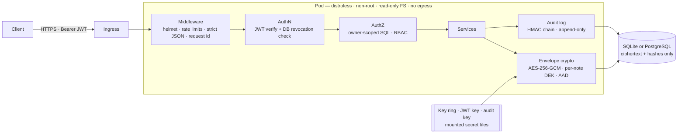

<div align="center">

[English](README.en.md) · [Français](README.fr.md) · [Español](README.es.md) · [Deutsch](README.de.md) · **Português** · [简体中文](README.zh-CN.md) · [← Início](../../README.md)

# 🛡️ Bastion Academy

**Uma API de notas deliberadamente endurecida e com criptografia de envelope, a cadeia DevSecOps que a entrega e uma plataforma de aprendizado de cibersegurança construída sobre ela.**

[](https://github.com/Azog1812/bastion-academy/actions/workflows/ci.yml)
[](https://github.com/Azog1812/bastion-academy/actions/workflows/security.yml)
[](https://github.com/Azog1812/bastion-academy/actions/workflows/codeql.yml)
[](https://github.com/Azog1812/bastion-academy/actions/workflows/container.yml)
[](https://github.com/Azog1812/bastion-academy/actions/workflows/dast.yml)
[](https://scorecard.dev/viewer/?uri=github.com/Azog1812/bastion-academy)
[](../../LICENSE)

[Modelo de ameaças](../threat-model.md) · [Controles ↔ OWASP](../security-controls.md) · [Pipeline de segurança](../security-pipeline.md) · [ADRs](../adr/) · [Runbook](../runbook.md) · [Especificação da API](../openapi.yaml)

</div>

> [!NOTE]
> Esta página é uma tradução da [versão em inglês](README.en.md), que prevalece em caso
> de divergência. Os documentos técnicos (modelo de ameaças, ADRs, runbook) estão apenas
> em inglês. O conteúdo dos cursos (lições, quizzes, desafios) está em francês.

## Bastion Academy

O Bastion é o núcleo da **Bastion Academy**, uma plataforma de aprendizado de
cibersegurança auto-hospedada. A pedagogia é *quebre e depois conserte*: cada módulo
parte de uma vulnerabilidade real (IDOR, falsificação de JWT, força bruta, injeção SQL,
reutilização de token…). Primeiro, o aluno a explora em um laboratório e captura uma
flag. Depois estuda como o próprio código do Bastion barra o ataque e executa o teste
que comprova isso. A trilha vai dos princípios básicos até o nível exigido pelas
grandes certificações do mercado.

| Marco | Escopo | Status |
|---|---|---|
| **v3: fundações** | Trilhas → módulos → lições, acompanhamento de progresso, interface web, sobre o núcleo de autenticação do Bastion | ✅ API, interface web, os seis níveis entregues |
| **v4: desafios** | Flags HMAC por usuário (impossíveis de compartilhar), ranking, antitrapaça, MFA TOTP | ✅ Entregue: 11 desafios (níveis 1 a 3), ranking opcional, TOTP + códigos de recuperação · **passkeys** (WebAuthn, [ADR 0016](../adr/0016-passkeys.md)) |
| **v5: laboratórios isolados** | Um contêiner vulnerável por aluno: sem saída de rede, TTL, runtime em sandbox, cotas | ✅ Entregue: 10 laboratórios (SQLi, IDOR, mass assignment, JWT `alg:none`, SSRF, path traversal, injeção de comandos, XSS armazenado com uma vítima em navegador headless, uma cadeia de três falhas, uma race condition), lab runner + gateway, gVisor opcional |
| **v6: blue team** | Trilha do nível 5 (registro de logs, SIEM, engenharia de detecção, resposta a incidentes, perícia forense) e desafios de detecção | ✅ Entregue: 6 lições, 5 desafios de detecção avaliados por precisão **e** recall · Wazuh real a partir da interface e 2 desafios de regras XML do Wazuh ([ADR 0013](../adr/0013-shared-environments.md), [0014](../adr/0014-wazuh-rule-challenges.md)) · Observabilidade entregue (Prometheus, alertas testados, [ADR 0011](../adr/0011-observability.md); roteamento com Alertmanager + Grafana, [ADR 0018](../adr/0018-alert-routing-and-dashboards.md)) · Tutor de IA: planejado |

A plataforma foi pensada para **rodar localmente** (`git clone` + Docker). Ainda não
existe uma instância pública hospedada.

### O que já está disponível

O currículo cobre seis níveis, de **Fundamentos** a **Especialista**, todos disponíveis
(em francês, 50 lições, 143 perguntas de quiz). Os módulos práticos pesados são
**opcionais**: cada aluno os adiciona à sua formação pela interface web se a máquina
aguentar, e deixar um de fora nunca bloqueia o restante da trilha:

- **Nível 1, Fundamentos**: noções básicas de segurança, HTTP, sessões e JWT, e depois
  um módulo de IDOR *quebre e depois conserte*.
- **Nível 2, Segurança web e de APIs**: injeção SQL (com um minilaboratório local
  autônomo), XSS, CSRF, ataques a JWT, mass assignment e controle de acesso por função.
- **Nível 3, Sistemas e redes**: TCP/IP, DNS e TLS, varredura de portas dentro da lei,
  permissões do Linux e escalonamento de privilégios, endurecimento de contêineres,
  contas e tokens do Windows, Kerberos e ataques ao Active Directory, segmentação de
  rede.
- **Nível 4, Testes de intrusão**: o enquadramento legal e as regras de engajamento
  (código penal francês, PASSI), PTES e OWASP WSTG, reconhecimento, encadeamento de
  falhas, pós-exploração dentro do escopo, CVSS 4.0 e um relatório que faça as coisas
  serem corrigidas.
- **Nível 5, Defesa e detecção** (blue team): o que registrar, SIEM e correlação,
  regras no estilo Sigma, ler ataques web nos logs, resposta a incidentes (NIST SP
  800-61r3, notificação do RGPD em 72 horas), primeiros passos em perícia forense (ordem
  de volatilidade, contêineres); módulo **Wazuh** opcional (arquitetura, decoders e
  regras XML, monitoramento de integridade de arquivos, avaliação de configuração CIS,
  resposta ativa e suas armadilhas).
- **Nível 6, Especialista**: race conditions (TOCTOU, ataque *single-packet*) e
  desserialização insegura (cadeias de gadgets, poluição de protótipo); delegação
  Kerberos, AD CS (ESC1, ESC8) e DCSync, e como detectá-los (4769, 4662, 4887, contas
  isca); o panorama das certificações (OSCP+, CPTS, GIAC, qualificações ANSSI) e o
  método para uma prova prática de 24 horas.

**5 desafios de detecção** ([ADR 0010](../adr/0010-detection-challenges.md)): o aluno
**escreve uma regra de detecção** (um subconjunto JSON do Sigma) e o servidor a avalia
em um conjunto de logs gerado para ele, onde os ataques se escondem no meio de atividade
legítima **e de armadilhas** feitas para regras ingênuas. Só é resolvido com todos os
ataques detectados **e** nenhum falso positivo: o dilema diário de um SOC.

| Desafio | O que a regra ingênua erra |
|---|---|
| Injeções SQL em logs de acesso | Um apóstrofo marca *O'Connor*; o user agent deixa passar o atacante que se esconde atrás de um navegador |
| Password spraying (Windows 4624/4625) | Contar falhas marca uma conta de serviço com senha expirada |
| Living off the land (LOLBins) | Alertar sobre `certutil` ou `rundll32` afoga o SOC em atividade administrativa |
| Força bruta SSH, rápida e lenta | Uma janela curta deixa passar o atacante paciente; um limite baixo marca o usuário esquecido |
| Kerberoasting (Windows 4769) | "RC4 = alerta" marca o velho sistema de folha de pagamento e as contas de máquina; contar serviços sem RC4 marca a conta de inventário |

A linguagem de regras **não tem expressões regulares de propósito** (uma regex do aluno
rodaria no event loop do servidor: ReDoS), e os campos são validados em cada conjunto
de dados.

**2 desafios de regras Wazuh** ([ADR 0014](../adr/0014-wazuh-rule-challenges.md)), no
módulo Wazuh opcional: o aluno escreve **regras XML reais do Wazuh**, como em
`local_rules.xml`, contra alertas no formato do `alerts.json` do Wazuh. O XML do aluno
nunca chega a um parser de uso geral: um leitor fechado recusa DTDs e entidades
(**XXE**, *billion laughs*), os padrões são apenas OS_Match (sem ReDoS) e a árvore de
regras não pode formar laços. O avaliador é **conferido contra o Wazuh real na CI**: as
regras de referência são reproduzidas no `wazuh-logtest` (Wazuh 4.14, sem rede) e
precisam gerar exatamente os mesmos alertas. Essa verificação corrigiu o modelo:
"Failed password" passa por 5716 → 5760, `<srcip>!x` não exclui x e `action` é um campo
estático.

| Desafio | O que a regra ingênua erra |
|---|---|
| Força bruta SSH, em XML | Correlacionar em 5716 não vê nada (o evento segue para 5760); só com 5760, escapa o atacante que tenta apenas usuários inexistentes (5710); excluir toda a sub-rede do servidor de backup esconde um vizinho comprometido |
| Monitorar o próprio Bastion (seu log de auditoria JSON) | `<match>refresh</match>` marca cada renovação normal de token; sem um filho de nível 0, a varredura DAST noturna da CI aciona o SOC |

Todo módulo *quebre e depois conserte* termina no próprio código do Bastion: o aluno
ataca o Bastion e depois lê as linhas exatas, as regras de lint, as regras do Semgrep e
os testes que impedem o ataque.

**11 desafios**, cada um uma tarefa real da profissão, cada um com uma flag exclusiva do
aluno:

| Desafio | Nível | O que o aluno faz |
|---|---|---|
| Encodage n'est pas chiffrement · La crypto maison | 1 | Descascar Base64 aninhado; quebrar um XOR de um byte com um ataque de texto claro conhecido |
| Un code PIN dans une empreinte rapide | 1 | Forçar um hash SHA-256 sem sal de um PIN (10.000 tentativas) e abrir o cofre |
| Des en-têtes trop bavards · Un jeton qui parle trop | 1 | Identificar um cabeçalho de depuração em uma resposta HTTP bruta; ler os claims de um JWT |
| Reconstituer une injection SQL à l'aveugle | 2 | **Perícia**: refazer a busca binária do sqlmap a partir de um log de acesso, usando apenas os tamanhos das respostas |
| Un secret de signature trop faible | 2 | Quebrar offline o segredo de um JWT HS256 com uma lista de palavras (o que o `hashcat -m 16500` faz) |
| Un mot de passe sur le fil | 3 | Decodificar uma captura `tcpdump -X` camada por camada e recuperar credenciais HTTP Basic |
| Qui peut vraiment lire ce fichier ? | 3 | Aplicar a regra exata do kernel dono/grupo/outros, armadilhas incluídas, para encontrar os arquivos legíveis |
| La première règle qui gagne | 3 | Avaliar um conjunto de regras nftables (primeira correspondência, CIDR, protocolo, política padrão) em fluxos reais |
| Pulvérisation de mots de passe et porte dérobée | 3 | **Triagem de SOC**: identificar um password spraying em eventos do Windows e decodificar `-EncodedCommand` |

Os desafios são gerados para cada aluno a partir de uma semente HMAC (nada é
armazenado), as iscas têm o mesmo formato da flag e cada gerador tem um teste que o
resolve do jeito que o enunciado descreve
([`challenge-generators.test.ts`](../../test/unit/challenge-generators.test.ts)).

**10 laboratórios ao vivo** ([ADR 0009](../adr/0009-isolated-labs.md)): um serviço real,
intencionalmente vulnerável, iniciado para um único aluno, contendo a flag dele e
acessível apenas a partir da máquina dele.

| Laboratório | Nível | Ataque |
|---|---|---|
| Les factures des autres | 1 | IDOR / BOLA em uma API de faturamento |
| Entrer sans mot de passe | 2 | Injeção SQL em um formulário de login (erros detalhados como primeira pista) |
| Promu administrateur | 2 | Mass assignment no cadastro (`"role": "admin"`) |
| Un jeton sans signature | 2 | Forjar um JWT com `"alg": "none"` |
| Un modérateur trop confiant | 2 | XSS armazenado contra um moderador em **Chromium headless real**; exfiltrar o cookie dele *pela própria aplicação*, já que os laboratórios não têm rota para fora |
| Un aperçu trop curieux | 2 | SSRF: fazer o servidor buscar o próprio serviço de administração em loopback |
| Le dossier d'à côté | 3 | Path traversal para fora de uma pasta de downloads |
| Trois failles, une chaîne | 4 | **Nenhuma falha basta sozinha**: path traversal → segredo JWT vazado → token de administrador forjado (atalhos como `/proc/self/environ` bloqueados) |
| Une carte cadeau, plusieurs fois | 6 | Race condition: um vale-presente de uso único resgatado várias vezes por requisições paralelas (a correção é o invariante 5 do Bastion: um compare-and-set atômico) |
| Un shell, mais dans une cage | 3 | Injeção de comandos → um shell real, e depois **tentar escapar e entender por que não dá** (sem rota para fora, somente leitura, `noexec`, sem capabilities) |

O laboratório é vulnerável; a caixa em volta dele, não:

```
browser ─► bastion :3000 ──(internal network, token)──► lab-runner ── Docker socket
browser ─► lab-gateway :8088 ──(one internal network per lab)──► lab container
```

- **Só o lab runner toca no Docker** (equivalente a root): inacessível exceto pela
  plataforma, protegido por token, e nunca aceita uma imagem, montagem ou opção vinda de
  uma requisição.
- **Cada laboratório** roda sem root, somente leitura, sem capabilities, com
  memória/CPU/PIDs limitados, sem porta publicada, em **sua própria rede sem rota para
  fora**: sem download de ferramentas, sem reverse shell, sem vizinhos. **gVisor**
  opcional (`LAB_RUNTIME=runsc`).
- **Cada laboratório tem sua própria origem** (`l<id>.lab.localhost`): o XSS de um
  laboratório não alcança a sessão da plataforma.
- Um laboratório por aluno, um TTL aplicado tanto pela plataforma quanto pelo runner,
  inícios com limite de taxa. O isolamento foi verificado ao vivo: de dentro de um
  laboratório, a Internet, o runner e a plataforma ficam todos inacessíveis.

### Comece a aprender

Node ≥ 22.13:

```bash
git clone https://github.com/Azog1812/bastion-academy && cd bastion-academy
npm ci --ignore-scripts && npm run build
node dist/cli.js gen-secrets > .env
set -a && . ./.env && set +a && NODE_ENV=development npm start
```

Depois abra **http://localhost:3000**, crie uma conta e siga a trilha.

**Com os laboratórios** (Docker necessário), gere o `.env` como acima e depois:

```bash
docker compose --profile labs build   # imagens dos laboratórios, uma vez
docker compose up --build             # plataforma + lab runner + gateway, tudo em 127.0.0.1
```

**Com monitoramento**: `docker compose --profile observability up -d` adiciona o
Prometheus em **http://127.0.0.1:9090** e o Grafana em **http://127.0.0.1:3001**
(`admin`, `GRAFANA_ADMIN_PASSWORD` do `.env`). Reutilize um refresh token e veja o
`BastionRefreshTokenReuse` disparar na aba *Alerts* e chegar ao receptor `pager` na
seção *Alerting* do Grafana ([ADR 0011](../adr/0011-observability.md), [ADR 0018](../adr/0018-alert-routing-and-dashboards.md)).

**Com um Wazuh real** (módulo opcional, ~4 GiB de RAM):
`docker compose --profile wazuh up -d` uma vez; depois os alunos o iniciam e o param
pelo card do módulo; painel em **https://localhost:8443**. A instalação cria sua própria
CA offline e remove as contas de demonstração do Wazuh
([ADR 0013](../adr/0013-shared-environments.md)). O log de auditoria da própria
plataforma também vai para lá ([ADR 0015](../adr/0015-audit-log-to-siem.md)): reutilize
um refresh token ou sonde uma rota de administração, e o alerta aparece no painel
(`rule.groups: bastion`).

| Endpoint | Função |
|---|---|
| `GET /v1/curriculum` | Níveis, trilhas, módulos e lições, com seu progresso e os módulos desbloqueados |
| `GET /v1/lessons/{id}` | Uma lição (Markdown) e suas perguntas, nunca as respostas |
| `POST /v1/lessons/{id}/complete` | Envie suas respostas; corrigidas no servidor |
| `POST /v1/session/{login,mfa,passkey,refresh,logout}` | Sessões de navegador: refresh token em um cookie HttpOnly |
| `GET /v1/challenges[/{id}]` · `POST /v1/challenges/{id}/submit` | Desafios: seu artefato pessoal e depois sua flag pessoal |
| `GET /v1/scoreboard` · `PUT /v1/me/profile` | Ranking opcional com pseudônimo |
| `POST /v1/me/mfa/{setup,enable,disable}` · `POST /v1/auth/mfa` | Segundo fator TOTP e códigos de recuperação |
| `GET/POST /v1/me/passkeys` · `POST /v1/me/passkeys/options` · `DELETE /v1/me/passkeys/{id}` · `POST /v1/auth/mfa/passkey/options` | Passkeys (WebAuthn) como segundo fator resistente a phishing |
| `POST /v1/auth/passkey/options` · `POST /v1/auth/passkey` | Login sem senha com uma passkey detectável e com verificação do usuário |

Como é protegido ([ADR 0006](../adr/0006-curriculum-as-code.md), [ADR 0007](../adr/0007-web-front-end.md)):

- **Currículo como código.** As lições ficam em [`content/`](../../content/) e só mudam
  por pull requests revisados. Elas são validadas na inicialização, e o servidor se
  recusa a subir com conteúdo inconsistente. Não há CMS para comprometer.
- **Controle no servidor.** Pré-requisitos e quizzes são aplicados pela API, então
  alterar o front-end não desbloqueia nada. As respostas dos quizzes nunca saem do
  servidor.
- **Progresso isolado.** Toda consulta é limitada ao aluno autenticado. Uma regra do
  Semgrep bloqueia qualquer regressão.
- **Uma interface web sem novas dependências.** TypeScript simples compilado pelo
  `tsc`, servido pela mesma origem (sem CORS). O access token fica em memória; o refresh
  token vive em um cookie `__Host-` `HttpOnly; Secure; SameSite=Strict` que nenhum
  script consegue ler.
- **Flags impossíveis de compartilhar** ([ADR 0008](../adr/0008-flags-scoreboard-mfa.md)).
  Cada flag é `HMAC(chave, desafio, aluno)`: nunca armazenada, nunca no repositório e
  inútil para qualquer outra pessoa. Quem envia a flag de outro recebe a mesma resposta
  que para uma flag errada, e o log de auditoria registra de quem ela era.
- **MFA TOTP sem biblioteca** (RFC 6238 sobre `node:crypto`, conferida com os vetores de
  teste da RFC). As sementes são criptografadas sob o anel de KEKs; um código nunca é
  aceito duas vezes; códigos errados alimentam o bloqueio da conta; desativar a MFA
  exige a senha *e* um código.
- **Passkeys sem biblioteca** (WebAuthn sobre `node:crypto`, [ADR 0016](../adr/0016-passkeys.md)):
  a origem exata e o hash do RP ID são verificados, então a assinatura repassada por um
  proxy de phishing é recusada, algo que o TOTP não consegue fazer. Desafios de uso
  único vinculados à sua etapa de MFA, um decodificador CBOR limitado para as estruturas
  fornecidas pelo atacante e detecção de clones pelo contador de assinaturas (auditada,
  nível 12 no Wazuh). Testado com um autenticador em software fazendo o papel do
  atacante, e de ponta a ponta no Chromium com seu autenticador virtual. Abra a
  instalação local em `http://localhost:3000` (um endereço IP não pode ser um RP ID).
- **Login sem senha** ([ADR 0017](../adr/0017-passwordless-passkey-login.md)): uma
  passkey detectável com verificação do usuário substitui a senha e o segundo fator
  (AAL2). As opções não citam nenhuma conta (nada para enumerar), o user handle precisa
  ser dono da chave, as falhas nunca alimentam o bloqueio (sem botão de "bloquear
  qualquer um") e a recuperação nunca contorna um fator: outra passkey, ou senha mais um
  código, ou a CLI de operador no servidor.
- **Um XSS exige duas falhas independentes.** A interface nunca monta HTML a partir de
  strings (o ESLint proíbe todos os sinks de HTML, o Markdown é renderizado nó por nó) e
  a CSP da página impõe **Trusted Types** sem nenhuma política permitida, então qualquer
  sink desse tipo lança uma exceção no navegador.

Tour rápido, com a API rodando (veja [Tente quebrá-lo](#try-to-break-it) para iniciá-la
e obter um token):

```bash
curl -s $B/v1/curriculum -H "authorization: Bearer $ALICE" | jq '.paths[].modules[] | {id, unlocked}'
curl -s $B/v1/lessons/cia-et-risque -H "authorization: Bearer $ALICE" | jq -r .body
```

> [!WARNING]
> Os laboratórios são aplicações **intencionalmente vulneráveis**. Rode-os apenas na sua
> própria máquina, vinculados a `127.0.0.1`, e **nunca os exponha em uma rede que você
> não controla**. Ataque apenas alvos que sejam seus ou que você tenha autorização
> explícita para testar.

---

## Por que este projeto existe

Este repositório começou como um "hello world" de Express com 20 linhas e um pipeline
Jenkins cujas etapas de segurança estavam comentadas, uma senha passada como parâmetro
de build e uma varredura de vulnerabilidades terminando em `|| true`. Essa versão
continua no histórico do git, de propósito.

A v2 faz outra pergunta: **o que é preciso para uma pequena API sobreviver a um
atacante real, e como provar isso?** A resposta não é a lista de funcionalidades: é que
cada afirmação de segurança desta página se apoia em código legível e em um teste que
tenta quebrá-la.

## O que tem dentro



### Segurança da aplicação

| Ameaça | Controle | Comprovado por |
|---|---|---|
| Dump do banco / backup vazado | **Criptografia de envelope**: uma chave AES-256-GCM por nota, envolvida por uma KEK rotativa que nunca toca o banco | [`envelope.test.ts`](../../test/unit/envelope.test.ts) |
| Roubo do banco *e* dos segredos da plataforma | **KEKs no Vault Transit** (overlay opcional): a KEK nunca sai do Vault, uma chave derivada por nota, AppRole com tokens de 1 hora, uma política que proíbe exportação e exclusão, rotação dentro do Vault ([ADR 0019](../adr/0019-vault-transit-kms.md)) | [`kms-vault.test.ts`](../../test/security/kms-vault.test.ts), [`test/vault-real`](../../test/vault-real/run.sh) |
| Textos cifrados trocados entre usuários por um atacante com acesso ao banco | Id do dono e id da nota vinculados no **AAD** → a decifração falha | [`authorization.test.ts`](../../test/security/authorization.test.ts) |
| IDOR / BOLA (OWASP API nº 1) | Id do dono em toda consulta SQL; notas alheias e inexistentes são indistinguíveis (404); sondagens são auditadas; no PostgreSQL, row-level security como segunda barreira, sob um login de API que não consegue escapar dela ([ADR 0022](../adr/0022-row-level-security.md)) | [`authorization.test.ts`](../../test/security/authorization.test.ts), [`row-level-security.test.ts`](../../test/security/row-level-security.test.ts) |
| Força bruta e credential stuffing | Limite de taxa por IP, **bloqueio progressivo** com contadores atômicos, lista de senhas vazadas; com várias réplicas, limites compartilhados no Valkey que falham fechados ([ADR 0023](../adr/0023-shared-rate-limits.md)) | [`authentication.test.ts`](../../test/security/authentication.test.ts) |
| Enumeração de contas | Resposta idêntica para usuário desconhecido / senha errada / conta bloqueada, e um **hash scrypt fictício** para que o tempo de resposta seja o mesmo | [`authentication.test.ts`](../../test/security/authentication.test.ts) |
| Ataques a JWT (`alg:none`, confusão de algoritmo, adulteração, reutilização) | Lista de algoritmos permitidos, `iss`/`aud`/`typ`/`exp` obrigatórios, claims revalidados | [`tokens.test.ts`](../../test/unit/tokens.test.ts) |
| Senha capturada por phishing ou reutilizada | **MFA TOTP** opcional: códigos não reutilizáveis (compare-and-set sobre o passo de tempo), desafio de login de uso único com 5 tentativas, sementes criptografadas, códigos de recuperação de uso único com hash; **passkeys** contra phishing (vinculadas à origem e ao RP ID) | [`mfa.test.ts`](../../test/security/mfa.test.ts), [`totp.test.ts`](../../test/unit/totp.test.ts) |
| Compartilhamento de flags, trapaça no ranking | **Flags HMAC por aluno**, comparação em tempo constante, limite por conta, flags compartilhadas atribuídas no log de auditoria | [`challenges.test.ts`](../../test/security/challenges.test.ts) |
| Fuga de um laboratório (para o host, a plataforma, outros laboratórios, a Internet) | Contêiner endurecido, **rede interna por instância**, gateway como único par, socket do Docker apenas com o runner, catálogo fechado de laboratórios | [`lab-runner.test.ts`](../../test/unit/lab-runner.test.ts), [`labs.test.ts`](../../test/security/labs.test.ts) |
| SSRF pelo gateway dos laboratórios | Destino **construído** a partir de um id de instância com 32 caracteres hexadecimais, nunca lido da requisição | [`lab-runner.test.ts`](../../test/unit/lab-runner.test.ts) |
| Refresh token roubado | **Rotação de uso único com detecção de reutilização**: uma reutilização derruba toda a família de sessões (RFC 9700) | [`authentication.test.ts`](../../test/security/authentication.test.ts) |
| Race conditions (TOCTOU) no refresh, no bloqueio, na cadeia de auditoria e no último segundo fator | Token reivindicado por um único compare-and-set; contadores com `UPDATE … RETURNING`; qualquer outro check-then-act em uma transação, nunca "sem `await` no meio" ([ADR 0020](../adr/0020-async-database-layer.md)); no PostgreSQL, transações SERIALIZABLE repetidas e um advisory lock na cadeia de auditoria ([ADR 0021](../adr/0021-postgresql-backend.md)) | testes com requisições paralelas; testes de concorrência contra um banco que injeta latência ([`db.test.ts`](../../test/unit/db.test.ts)); a suíte inteira de novo contra um PostgreSQL real na CI |
| JWT "sem estado" que não pode ser revogado | `token_version` + papel verificados a cada requisição → logout em todos os lugares e rebaixamento instantâneos | [`authorization.test.ts`](../../test/security/authorization.test.ts) |
| Mass assignment, poluição de protótipo, HPP | Esquemas estritos rejeitam chaves desconhecidas; parser de query simples | [`input-and-transport.test.ts`](../../test/security/input-and-transport.test.ts) |
| Injeção SQL | Apenas parâmetros vinculados, imposto por **regras do ESLint e do Semgrep** | testes + CI |
| Adulteração de evidências após uma intrusão | **Log de auditoria à prova de adulteração**: cadeia HMAC + triggers no banco; `verify` aponta a primeira entrada alterada | [`config-and-audit.test.ts`](../../test/unit/config-and-audit.test.ts) |
| Configuração incorreta | **Configuração que falha fechada**: recusa-se a iniciar com segredos ausentes, curtos ou de exemplo | [`config-and-audit.test.ts`](../../test/unit/config-and-audit.test.ts) |

Além disso: scrypt (N=2¹⁷) com rehash transparente · política de senhas NIST 800-63B ·
cabeçalhos de segurança estritos (CSP `default-src 'none'`, HSTS preload…) · cache
`no-store` · erros genéricos com ids de correlação · segredos ocultados nos logs ·
segredos lidos de arquivos em vez de variáveis de ambiente · timeouts de socket ·
operações privilegiadas apenas por uma CLI de operador, nunca por HTTP.

**459 testes, ~98 % de cobertura de linhas**: a maioria são *casos de abuso*, não
casos de sucesso.

### Cadeia de suprimentos e infraestrutura

| Etapa | O que roda |
|---|---|
| Código | ESLint (`strictTypeChecked` + plugin de segurança + regras SQL próprias), `tsc --strict` |
| Segredos | gitleaks sobre **todo o histórico do git** |
| SAST | Semgrep (OWASP Top 10, Node, TS, JWT) + [regras próprias do projeto](../../.semgrep/bastion.yml), CodeQL `security-extended` |
| SCA | `npm audit`, **`npm audit signatures`**, OSV-Scanner, Dependency Review nos PRs, Dependabot com 7 dias de espera |
| IaC | hadolint, Checkov (0 achados não revisados; aceitações de risco documentadas no próprio código) |
| Contêiner | Distroless, UID 65532, sem shell (verificado na CI), smoke test com `--read-only --cap-drop ALL`, barreira do Trivy |
| DAST | Varredura de API com OWASP ZAP **autenticada com um token real**, guiada pela especificação OpenAPI |
| Publicação | Push exatamente da imagem varrida → **assinatura cosign keyless** → **SBOM CycloneDX** assinado → **proveniência SLSA** → autoverificação |
| Monitoramento | Métricas do Prometheus em um **listener separado protegido por token**, rótulos apenas de conjuntos fechados (sem dados pessoais, sem DoS por cardinalidade), **alertas com testes unitários de `promtool`** na CI e ligados ao [runbook](../runbook.md), **roteados por severidade no Alertmanager** (roteamento e inibição testados com `amtool` e uma instância real, silenciamentos apenas atrás do login do Grafana, dead man's switch Watchdog, [ADR 0018](../adr/0018-alert-routing-and-dashboards.md)); o próprio log de auditoria no **Wazuh**, com regras verificadas no `wazuh-logtest` real ([ADR 0015](../adr/0015-audit-log-to-siem.md)) |
| Execução | Kubernetes PSS *restricted*, NetworkPolicy com negação padrão e **sem saída**, sem token de service account, segredos como arquivos 0400, **Kyverno rejeita imagens não assinadas** |
| O próprio pipeline | `permissions: {}`, toda action **fixada por SHA**, `--ignore-scripts`, `persist-credentials: false`, harden-runner, OpenSSF Scorecard |

<a id="try-to-break-it"></a>

## Tente quebrá-lo

```bash
git clone https://github.com/Azog1812/bastion-academy && cd bastion-academy
npm ci --ignore-scripts && npm run build
node dist/cli.js gen-secrets > .env
set -a && . ./.env && set +a && NODE_ENV=development npm start
```

Depois, em outro terminal:

```bash
B=http://localhost:3000; J='content-type: application/json'
login() { curl -s -X POST $B/v1/auth/register -H "$J" -d "{\"email\":\"$1\",\"password\":\"correct horse battery staple\"}" >/dev/null
          curl -s -X POST $B/v1/auth/login -H "$J" -d "{\"email\":\"$1\",\"password\":\"correct horse battery staple\"}" | jq -r .accessToken; }
ALICE=$(login alice@demo.test); MALLORY=$(login mallory@demo.test)

NOTE=$(curl -s -X POST $B/v1/notes -H "$J" -H "authorization: Bearer $ALICE" -d '{"title":"diary","body":"secret"}' | jq -r .id)

# IDOR: Mallory pede a nota da Alice → 404, igual a uma nota que não existe
curl -s $B/v1/notes/$NOTE -H "authorization: Bearer $MALLORY"

# Mass assignment: tentar se cadastrar como admin → 400, campo desconhecido rejeitado
curl -s -X POST $B/v1/auth/register -H "$J" -d '{"email":"x@demo.test","password":"correct horse battery staple","role":"admin"}'

# Falsificação alg:none → 401
H=$(printf '{"alg":"none","typ":"at+jwt"}' | base64 | tr -d '=' | tr '/+' '_-')
P=$(printf '{"sub":"x","role":"admin","tv":0}' | base64 | tr -d '=' | tr '/+' '_-')
curl -s $B/v1/me -H "authorization: Bearer $H.$P."

# O banco não contém texto em claro
sqlite3 data/bastion.db "SELECT hex(ciphertext) FROM notes" | head -c 80; echo
```

Ou rode a bateria inteira: `npm test`. Com Docker: `docker compose up --build` (o mesmo
endurecimento de produção: sistema de arquivos somente leitura, sem capabilities, porta
apenas em loopback).

## Estrutura do repositório

```
src/
  config.ts            configuração que falha fechada (zod), segredos lidos de arquivos
  db.ts · postgres.ts  camada de banco: SQLite (padrão) ou PostgreSQL com row-level security
  redis.ts             cliente Valkey mínimo e limitado para os limites de taxa compartilhados
  crypto/              criptografia de envelope · KMS (anel local / Vault Transit) · scrypt · JWT + refresh tokens · TOTP · WebAuthn + CBOR
  services/            auth (bloqueio, rotação, revogação) · notas (por dono) ·
                       aprendizado (progresso, controle no servidor) · mfa · passkeys ·
                       desafios (flags por aluno, ranking) · laboratórios · ambientes
  challenges/          conjunto fechado de geradores de artefatos de desafios
  labs/                catálogo de laboratórios · runner (o único cliente Docker) · gateway (uma origem por laboratório)
  detection/           motor de regras (subconjunto do Sigma, sem regex) · subconjunto XML do Wazuh · conjuntos de dados rotulados por aluno
  curriculum/          carrega e valida content/ na inicialização (falha fechada)
  http/                middleware (authn, RBAC, erros) · esquemas estritos · rotas · sessões · métricas
  audit.ts             trilha de auditoria encadeada por HMAC, somente acréscimo
  cli.ts               ações exclusivas do operador: promote, rotate-keys, verify-audit, recover-account
test/
  unit/                criptografia, tokens, configuração, cadeia de auditoria, detecção, configuração de monitoramento
  security/            autenticação, autorização/IDOR, injeção e transporte, aprendizado,
                       MFA, passkeys, desafios e ranking, laboratórios, row-level security
  labs/                cada laboratório é explorável como previsto, e só assim
labs/                  aplicações de laboratório intencionalmente vulneráveis (excluídas do lint/SAST de propósito)
content/               currículo como código: níveis, trilhas, quizzes, desafios (JSON), lições (Markdown)
web/                   front-end: TypeScript simples, sem dependências, Markdown → DOM, Trusted Types
deploy/                manifestos k8s · política do Kyverno · Prometheus · Alertmanager · Grafana · Wazuh
.github/workflows/     CI · Security · CodeQL · Container (assinatura/SBOM/SLSA) · DAST · Scorecard
.semgrep/              regras de SAST próprias do projeto
docs/                  modelo de ameaças · mapeamento OWASP/ASVS · pipeline · ADRs · runbook · OpenAPI · i18n (esta página)
```

## Decisões de design e limites

Toda escolha importante tem seu [ADR](../adr/), incluindo as alternativas descartadas:
por exemplo, por que scrypt em vez de Argon2 (sem addon nativo), por que o SQLite
continua sendo o padrão (zero dependências nativas, nada para rodar) e como o
PostgreSQL atende várias réplicas com o mesmo SQL
([ADR 0021](../adr/0021-postgresql-backend.md)). Os riscos conhecidos e aceitos
(enumeração no cadastro, bloqueio usado como DoS, HS256…) estão listados no
[modelo de ameaças](../threat-model.md#5-accepted-risks) em vez de escondidos.

**Roadmap:** commits e releases assinados · fuzzing da camada HTTP · tutor de IA.

## Segurança

Encontrou uma vulnerabilidade? Por favor, informe de forma privada: veja o
[SECURITY.md](../../SECURITY.md).

---

<sub>Feito por **Florent Roch**, Mastère cybersécurité (ESTIAM). Licença MIT. [Créditos](../../README.md#credits)</sub>
