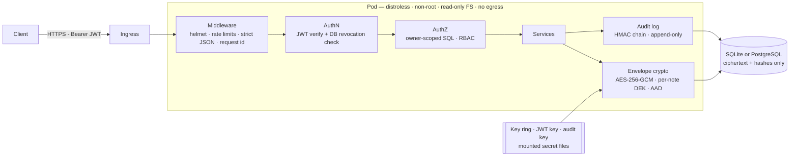

<div align="center">

[English](README.en.md) · [Français](README.fr.md) · [Español](README.es.md) · [Deutsch](README.de.md) · [Português](README.pt-BR.md) · **简体中文** · [← 首页](../../README.md)

# 🛡️ Bastion Academy

**一个经过刻意加固、采用信封加密的笔记 API，交付它的 DevSecOps 供应链，以及构建在其之上的网络安全学习平台。**

[](https://github.com/Azog1812/bastion-academy/actions/workflows/ci.yml)
[](https://github.com/Azog1812/bastion-academy/actions/workflows/security.yml)
[](https://github.com/Azog1812/bastion-academy/actions/workflows/codeql.yml)
[](https://github.com/Azog1812/bastion-academy/actions/workflows/container.yml)
[](https://github.com/Azog1812/bastion-academy/actions/workflows/dast.yml)
[](https://scorecard.dev/viewer/?uri=github.com/Azog1812/bastion-academy)
[](../../LICENSE)

[威胁模型](../threat-model.md) · [控制措施 ↔ OWASP](../security-controls.md) · [安全流水线](../security-pipeline.md) · [ADR](../adr/) · [运维手册](../runbook.md) · [API 规范](../openapi.yaml)

</div>

> [!NOTE]
> 本页是[英文版](README.en.md)的翻译；如有出入，以英文版为准。技术文档（威胁模型、ADR、运维手册）仅提供英文版。课程内容（课程、测验、挑战）为法语。

## Bastion Academy

Bastion 是 **Bastion Academy** 的核心。Bastion Academy 是一个可自行部署的网络安全学习平台，教学理念是*先攻破，再修复*：每个模块都从一个真实漏洞出发（IDOR、JWT 伪造、暴力破解、SQL 注入、令牌重放……）。学员先在实验环境中利用它并拿到 flag，然后研究 Bastion 自身的代码如何挡住这次攻击，并运行证明这一点的测试。学习路径从基本原理一直延伸到业界主流认证所要求的水平。

| 里程碑 | 范围 | 状态 |
|---|---|---|
| **v3：基础** | 学习路径 → 模块 → 课程、进度跟踪、Web 前端，构建在 Bastion 的认证核心之上 | ✅ API、Web 界面、全部六个等级已发布 |
| **v4：挑战** | 每位用户独有的 HMAC flag（无法共享）、排行榜、防作弊、TOTP 多因素认证 | ✅ 已发布：11 个挑战（1 至 3 级）、自愿加入的排行榜、TOTP + 恢复码 · **通行密钥**（WebAuthn，[ADR 0016](../adr/0016-passkeys.md)） |
| **v5：隔离实验环境** | 每位学员一个有漏洞的容器：无出站网络、TTL、沙箱运行时、配额 | ✅ 已发布：10 个实验（SQLi、IDOR、批量赋值、JWT `alg:none`、SSRF、路径遍历、命令注入、以无头浏览器为受害者的存储型 XSS、三个漏洞组成的攻击链、竞态条件）、lab runner + 网关、可选 gVisor |
| **v6：蓝队** | 5 级路径（日志、SIEM、检测工程、事件响应、取证）和检测挑战 | ✅ 已发布：6 节课、5 个按精确率**和**召回率评分的检测挑战 · 可从界面启动的真实 Wazuh 和 2 个 Wazuh XML 规则挑战（[ADR 0013](../adr/0013-shared-environments.md)、[0014](../adr/0014-wazuh-rule-challenges.md)）· 可观测性已发布（Prometheus、经过测试的告警，[ADR 0011](../adr/0011-observability.md)；Alertmanager 路由 + Grafana，[ADR 0018](../adr/0018-alert-routing-and-dashboards.md)）· AI 导师：计划中 |

本平台设计为**在本地运行**（`git clone` + Docker），目前还没有公开托管的实例。

### 目前可用的内容

课程体系共六个等级，从**基础**到**专家**，全部可用（法语，50 节课，143 道测验题）。较重的实操模块是**可选的**：学员可以在 Web 界面中按自己机器的承受能力添加，不选某个模块也绝不会锁住路径的其余部分：

- **1 级，基础**：安全基础、HTTP、会话与 JWT，然后是一个*先攻破，再修复*的 IDOR 模块。
- **2 级，Web 与 API 安全**：SQL 注入（附带一个独立的本地小型实验）、XSS、CSRF、JWT 攻击、批量赋值和功能级访问控制。
- **3 级，系统与网络**：TCP/IP、DNS 与 TLS、合法的端口扫描、Linux 权限与提权、容器加固、Windows 账户与令牌、Kerberos 与 Active Directory 攻击、网络分段。
- **4 级，渗透测试**：法律框架与交战规则（法国刑法、PASSI）、PTES 与 OWASP WSTG、信息收集、漏洞串联、授权范围内的后渗透、CVSS 4.0，以及一份能让问题真正得到修复的报告。
- **5 级，防御与检测**（蓝队）：该记录什么日志、SIEM 与关联分析、编写 Sigma 风格的规则、从日志中识别 Web 攻击、事件响应（NIST SP 800-61r3、GDPR 72 小时通报）、取证入门（易失性顺序、容器）；可选的 **Wazuh** 模块（架构、解码器与 XML 规则、文件完整性监控、CIS 配置评估、主动响应及其陷阱）。
- **6 级，专家**：竞态条件（TOCTOU、单包攻击）与不安全的反序列化（gadget 链、原型污染）；Kerberos 委派、AD CS（ESC1、ESC8）与 DCSync，以及如何检测它们（4769、4662、4887、蜜罐账户）；认证全景（OSCP+、CPTS、GIAC、ANSSI 资质）以及应对 24 小时实操考试的方法。

**5 个检测挑战**（[ADR 0010](../adr/0010-detection-challenges.md)）：学员**编写一条检测规则**（Sigma 的 JSON 子集），服务器在为该学员生成的日志数据集上为其打分。攻击隐藏在正常活动**以及**专为幼稚规则设计的**陷阱**之中。只有捕获全部攻击**且**零误报才算通过，这正是 SOC 每天都要做的权衡。

| 挑战 | 幼稚规则的问题 |
|---|---|
| 访问日志中的 SQL 注入 | 一个撇号就会把 *O'Connor* 标记出来；按 user agent 判断会漏掉伪装成浏览器的攻击者 |
| 密码喷洒（Windows 4624/4625） | 统计失败次数会把一个密码已过期的服务账户标记出来 |
| 就地取材攻击（LOLBins） | 对 `certutil` 或 `rundll32` 告警会让 SOC 淹没在管理活动中 |
| SSH 暴力破解，快与慢 | 时间窗口太短会漏掉有耐心的攻击者；阈值太低会标记健忘的用户 |
| Kerberoasting（Windows 4769） | "RC4 = 告警" 会标记老旧的薪资系统和机器账户；统计不带 RC4 的服务又会标记资产盘点账户 |

规则语言**有意不支持正则表达式**（学员写的正则会在服务器的事件循环上运行：ReDoS），并且字段会针对每个数据集进行校验。

**2 个 Wazuh 规则挑战**（[ADR 0014](../adr/0014-wazuh-rule-challenges.md)），位于可选的 Wazuh 模块中：学员编写**真正的 Wazuh XML 规则**（如同 `local_rules.xml`），针对与 Wazuh `alerts.json` 格式一致的告警。学员的 XML 绝不会交给通用解析器：一个封闭的读取器拒绝 DTD 和实体（**XXE**、*billion laughs*），模式只允许 OS_Match（无 ReDoS），规则树也不会形成循环。评估器**在 CI 中与真实的 Wazuh 进行比对**：参考规则在 `wazuh-logtest`（Wazuh 4.14，无网络）中回放，必须产生完全相同的告警。这项检查纠正了模型："Failed password" 会经过 5716 → 5760，`<srcip>!x` 并不会排除 x，而 `action` 是一个静态字段。

| 挑战 | 幼稚规则的问题 |
|---|---|
| SSH 暴力破解，XML 版 | 在 5716 上做关联什么也看不到（事件会继续流向 5760）；只看 5760 会漏掉只尝试不存在用户（5710）的攻击者；排除备份服务器的整个子网会掩盖一台已被攻陷的邻近主机 |
| 监控 Bastion 自身（其 JSON 审计日志） | `<match>refresh</match>` 会标记每一次正常的令牌刷新；没有 0 级子规则时，CI 每晚的 DAST 扫描会惊动 SOC |

每个*先攻破，再修复*模块最终都会回到 Bastion 自己的代码：学员攻击 Bastion，然后阅读挡住这次攻击的具体代码行、lint 规则、Semgrep 规则和测试。

**11 个挑战**，每个都是真实工作中的任务，每个都有学员专属的 flag：

| 挑战 | 等级 | 学员要做什么 |
|---|---|---|
| Encodage n'est pas chiffrement · La crypto maison | 1 | 剥开嵌套的 Base64；用已知明文攻击破解单字节 XOR |
| Un code PIN dans une empreinte rapide | 1 | 暴力破解未加盐的 SHA-256 PIN 哈希（10,000 次尝试），打开保险箱 |
| Des en-têtes trop bavards · Un jeton qui parle trop | 1 | 在原始 HTTP 响应中发现调试头；读取 JWT 的 claims |
| Reconstituer une injection SQL à l'aveugle | 2 | **取证**：仅凭响应大小，从访问日志中还原 sqlmap 的二分查找 |
| Un secret de signature trop faible | 2 | 用字典离线破解 HS256 JWT 的密钥（即 `hashcat -m 16500` 所做的事） |
| Un mot de passe sur le fil | 3 | 逐层解码一段 `tcpdump -X` 抓包，还原 HTTP Basic 凭据 |
| Qui peut vraiment lire ce fichier ? | 3 | 套用内核精确的属主/属组/其他人规则（包括陷阱），找出可读的文件 |
| La première règle qui gagne | 3 | 在真实流量上评估一套 nftables 规则（首条匹配、CIDR、协议、默认策略） |
| Pulvérisation de mots de passe et porte dérobée | 3 | **SOC 研判**：在 Windows 事件中发现密码喷洒，解码 `-EncodedCommand` |

题目由每位学员专属的 HMAC 种子生成（不存储任何内容），干扰项与 flag 格式相同，并且每个生成器都有一个按题目说明的方式解题的测试（[`challenge-generators.test.ts`](../../test/unit/challenge-generators.test.ts)）。

**10 个在线实验**（[ADR 0009](../adr/0009-isolated-labs.md)）：为单个学员启动的真实、有意设置漏洞的服务，其中保存着该学员的 flag，只能从其本机访问。

| 实验 | 等级 | 攻击 |
|---|---|---|
| Les factures des autres | 1 | 针对开票 API 的 IDOR / BOLA |
| Entrer sans mot de passe | 2 | 登录表单上的 SQL 注入（详细的错误信息是第一条线索） |
| Promu administrateur | 2 | 注册时的批量赋值（`"role": "admin"`） |
| Un jeton sans signature | 2 | 伪造一个 `"alg": "none"` 的 JWT |
| Un modérateur trop confiant | 2 | 针对**真实无头 Chromium** 审核员的存储型 XSS；由于实验环境没有出站路由，需要*借助应用本身*窃取其 cookie |
| Un aperçu trop curieux | 2 | SSRF：让服务器访问其自身回环地址上的管理服务 |
| Le dossier d'à côté | 3 | 从下载目录中进行路径遍历 |
| Trois failles, une chaîne | 4 | **单个漏洞都不够**：路径遍历 → 泄露的 JWT 密钥 → 伪造的管理员令牌（`/proc/self/environ` 之类的捷径已被封堵） |
| Une carte cadeau, plusieurs fois | 6 | 竞态条件：一张一次性礼品卡被并行请求多次兑换（修复方法就是 Bastion 的第 5 条不变量：原子的 compare-and-set） |
| Un shell, mais dans une cage | 3 | 命令注入 → 拿到一个真正的 shell，然后**尝试逃逸并弄明白为什么逃不出去**（无出站路由、只读、`noexec`、无 capabilities） |

实验本身有漏洞，但包围它的盒子没有：

```
browser ─► bastion :3000 ──(internal network, token)──► lab-runner ── Docker socket
browser ─► lab-gateway :8088 ──(one internal network per lab)──► lab container
```

- **只有 lab runner 能接触 Docker**（等同 root）：除平台外无法访问，受令牌保护，并且绝不会从请求中接收镜像、挂载或任何选项。
- **每个实验**都以非 root 身份、只读方式运行，没有 capabilities，内存/CPU/PID 受限，不发布端口，位于**独立且没有出站路由的网络**中：无法下载工具，无法反弹 shell，也没有邻居。可选 **gVisor**（`LAB_RUNTIME=runsc`）。
- **每个实验都有自己的源**（`l<id>.lab.localhost`）：实验中的 XSS 无法触及平台的会话。
- 每位学员只有一个实验，TTL 由平台和 runner 双重执行，启动受速率限制。隔离效果已实际验证：从实验内部，互联网、runner 和平台都无法访问。

### 开始学习

Node ≥ 22.13：

```bash
git clone https://github.com/Azog1812/bastion-academy && cd bastion-academy
npm ci --ignore-scripts && npm run build
node dist/cli.js gen-secrets > .env
set -a && . ./.env && set +a && NODE_ENV=development npm start
```

然后打开 **http://localhost:3000**，注册账户并按路径学习。

**使用实验环境**（需要 Docker），先按上面的方法生成 `.env`，然后：

```bash
docker compose --profile labs build   # 构建实验镜像，只需一次
docker compose up --build             # 平台 + lab runner + 实验网关，全部在 127.0.0.1 上
```

**启用监控**：`docker compose --profile observability up -d` 会在 **http://127.0.0.1:9090** 启动 Prometheus，在 **http://127.0.0.1:3001** 启动 Grafana（用户 `admin`，密码为 `.env` 中的 `GRAFANA_ADMIN_PASSWORD`）。重放一个 refresh token，观察 `BastionRefreshTokenReuse` 在 *Alerts* 标签页中触发，然后在 Grafana 的 *Alerting* 中到达 `pager` 接收器（[ADR 0011](../adr/0011-observability.md)、[ADR 0018](../adr/0018-alert-routing-and-dashboards.md)）。

**使用真实的 Wazuh**（可选模块，约 4 GiB 内存）：先执行一次 `docker compose --profile wazuh up -d`，之后学员即可在模块卡片上启动和停止它；仪表盘位于 **https://localhost:8443**。安装过程会离线生成自己的 CA，并删除 Wazuh 的演示账户（[ADR 0013](../adr/0013-shared-environments.md)）。平台自身的审计日志也会进入其中（[ADR 0015](../adr/0015-audit-log-to-siem.md)）：重放一个 refresh token 或探测一个管理路由，告警就会出现在仪表盘中（`rule.groups: bastion`）。

| 端点 | 用途 |
|---|---|
| `GET /v1/curriculum` | 等级、路径、模块和课程，以及你的进度和已解锁的模块 |
| `GET /v1/lessons/{id}` | 一节课（Markdown）及其测验题，绝不包含答案 |
| `POST /v1/lessons/{id}/complete` | 提交测验答案，由服务器评分 |
| `POST /v1/session/{login,mfa,passkey,refresh,logout}` | 浏览器会话：refresh token 存放在 HttpOnly cookie 中 |
| `GET /v1/challenges[/{id}]` · `POST /v1/challenges/{id}/submit` | 挑战：先获取你的专属素材，再提交你的专属 flag |
| `GET /v1/scoreboard` · `PUT /v1/me/profile` | 使用化名、自愿加入的排行榜 |
| `POST /v1/me/mfa/{setup,enable,disable}` · `POST /v1/auth/mfa` | TOTP 第二因素和恢复码 |
| `GET/POST /v1/me/passkeys` · `POST /v1/me/passkeys/options` · `DELETE /v1/me/passkeys/{id}` · `POST /v1/auth/mfa/passkey/options` | 通行密钥（WebAuthn）作为抗钓鱼的第二因素 |
| `POST /v1/auth/passkey/options` · `POST /v1/auth/passkey` | 使用可发现、经用户验证的通行密钥进行无密码登录 |

安全设计（[ADR 0006](../adr/0006-curriculum-as-code.md)、[ADR 0007](../adr/0007-web-front-end.md)）：

- **课程即代码。** 课程存放在 [`content/`](../../content/) 中，只能通过经过审查的 pull request 修改。它们在启动时接受校验，内容不一致时服务器拒绝启动。不存在可以被攻破的 CMS。
- **服务器端门控。** 先修条件和测验由 API 强制执行，修改前端解锁不了任何东西。测验答案永远不会离开服务器。
- **进度隔离。** 每条查询都限定在已认证的学员范围内，一条 Semgrep 规则会阻止任何回退。
- **零新增依赖的 Web 界面。** 由 `tsc` 编译的纯 TypeScript，从同一源提供（无 CORS）。access token 只保存在内存中；refresh token 存放在 `HttpOnly; Secure; SameSite=Strict` 的 `__Host-` cookie 中，任何脚本都读不到。
- **无法共享的 flag**（[ADR 0008](../adr/0008-flags-scoreboard-mfa.md)）。每个 flag 都是 `HMAC(密钥, 挑战, 学员)`：从不存储，也不在代码仓库中，对其他人毫无用处。提交他人 flag 的学员得到的回应与提交错误 flag 相同，审计日志会记录该 flag 属于谁。
- **不依赖第三方库的 TOTP 多因素认证**（基于 `node:crypto` 实现 RFC 6238，并用 RFC 的测试向量验证）。种子在 KEK 密钥环下加密；同一个码永远不会被接受两次；错误的码会计入账户锁定；关闭 MFA 需要密码*和*一个验证码。
- **不依赖第三方库的通行密钥**（基于 `node:crypto` 实现 WebAuthn，[ADR 0016](../adr/0016-passkeys.md)）：会校验精确的源和 RP ID 哈希，因此钓鱼代理转发的签名会被拒绝，这是 TOTP 做不到的。一次性 challenge 绑定到对应的 MFA 步骤，针对攻击者提供的结构使用有边界的 CBOR 解码器，通过签名计数器检测克隆（有审计记录，Wazuh 12 级）。测试中用软件认证器扮演攻击者，并在 Chromium 中借助其虚拟认证器进行端到端测试。请通过 `http://localhost:3000` 打开本地安装（IP 地址不能作为 RP ID）。
- **无密码登录**（[ADR 0017](../adr/0017-passwordless-passkey-login.md)）：一个带用户验证的可发现通行密钥同时取代密码和第二因素（AAL2）。options 中不出现任何账户（无从枚举），user handle 必须拥有该密钥，失败绝不计入锁定（不存在"随便锁住任何人"的按钮），账户恢复也绝不绕过任何因素：另一个通行密钥，或密码加验证码，或主机上的运维 CLI。
- **XSS 需要两处独立的失守。** 界面从不用字符串拼接 HTML（ESLint 禁止所有 HTML sink，Markdown 逐节点渲染），并且页面 CSP 强制启用 **Trusted Types** 且不允许任何策略，因此任何此类 sink 都会在浏览器中抛出异常。

API 启动后的快速浏览（启动方法和获取令牌见[试着攻破它](#try-to-break-it)）：

```bash
curl -s $B/v1/curriculum -H "authorization: Bearer $ALICE" | jq '.paths[].modules[] | {id, unlocked}'
curl -s $B/v1/lessons/cia-et-risque -H "authorization: Bearer $ALICE" | jq -r .body
```

> [!WARNING]
> 实验环境是**有意设置漏洞**的应用。只能在你自己的机器上运行并绑定到 `127.0.0.1`，**绝不要将其暴露在你无法控制的网络中**。只攻击属于你自己或你已获得明确授权测试的目标。

---

## 为什么会有这个项目

这个仓库最初只是一个 20 行的 Express "hello world"，配有一条 Jenkins 流水线：安全阶段被注释掉，密码作为构建参数传入，漏洞扫描以 `|| true` 结尾。那个版本至今仍保留在 git 历史中，这是有意为之。

v2 提出了另一个问题：**一个小型 API 要怎样才能挺过真正的攻击者，又该如何证明这一点？** 答案不在功能列表里，而在于本页的每一项安全声明都有可读的代码和一个试图攻破它的测试作为支撑。

## 内部结构



### 应用安全

| 威胁 | 控制措施 | 证明 |
|---|---|---|
| 数据库被导出 / 备份泄露 | **信封加密**：每条笔记一个 AES-256-GCM 密钥，由一个轮换的 KEK 包裹，KEK 从不接触数据库 | [`envelope.test.ts`](../../test/unit/envelope.test.ts) |
| 数据库*和*平台密钥同时被盗 | **KEK 存放在 Vault Transit 中**（可选叠加配置）：KEK 永不离开 Vault，每条笔记使用派生密钥，AppRole 令牌有效期 1 小时，策略禁止导出和删除，在 Vault 内部轮换（[ADR 0019](../adr/0019-vault-transit-kms.md)） | [`kms-vault.test.ts`](../../test/security/kms-vault.test.ts)、[`test/vault-real`](../../test/vault-real/run.sh) |
| 拥有数据库权限的攻击者在用户之间调换密文 | 所有者 id 和笔记 id 绑定在 **AAD** 中 → 解密失败 | [`authorization.test.ts`](../../test/security/authorization.test.ts) |
| IDOR / BOLA（OWASP API 第 1 位） | 每条 SQL 查询都包含所有者 id；他人的笔记和不存在的笔记无法区分（404）；探测行为会被审计；在 PostgreSQL 上，行级安全作为第二道屏障，API 使用的登录角色无法绕过它（[ADR 0022](../adr/0022-row-level-security.md)） | [`authorization.test.ts`](../../test/security/authorization.test.ts)、[`row-level-security.test.ts`](../../test/security/row-level-security.test.ts) |
| 暴力破解与撞库 | 按 IP 限速、使用原子计数器的**渐进式锁定**、已泄露密码黑名单；多副本时，限速状态共享在 Valkey 中，故障时默认拒绝（[ADR 0023](../adr/0023-shared-rate-limits.md)） | [`authentication.test.ts`](../../test/security/authentication.test.ts) |
| 账户枚举 | 未知用户 / 密码错误 / 账户锁定返回完全相同的响应，并使用**虚拟 scrypt 哈希**使耗时一致 | [`authentication.test.ts`](../../test/security/authentication.test.ts) |
| JWT 攻击（`alg:none`、算法混淆、篡改、重放） | 算法白名单，强制校验 `iss`/`aud`/`typ`/`exp`，claims 重新验证 | [`tokens.test.ts`](../../test/unit/tokens.test.ts) |
| 密码被钓鱼或重复使用 | 可选的 **TOTP 多因素认证**：不可重放的验证码（对时间步做 compare-and-set）、一次性且最多 5 次尝试的登录 challenge、加密的种子、哈希存储的一次性恢复码；抗钓鱼的**通行密钥**（绑定源和 RP ID） | [`mfa.test.ts`](../../test/security/mfa.test.ts)、[`totp.test.ts`](../../test/unit/totp.test.ts) |
| 共享 flag、排行榜作弊 | **每位学员独有的 HMAC flag**、常量时间比较、按账户限速、共享的 flag 会在审计日志中被追溯 | [`challenges.test.ts`](../../test/security/challenges.test.ts) |
| 从实验环境逃逸（到宿主机、平台、其他实验、互联网） | 加固的容器、**每个实例独立的内部网络**、网关是唯一的对端、只有 runner 持有 Docker socket、封闭的实验目录 | [`lab-runner.test.ts`](../../test/unit/lab-runner.test.ts)、[`labs.test.ts`](../../test/security/labs.test.ts) |
| 通过实验网关发起 SSRF | 上游地址由 32 位十六进制的实例 id **构造**而来，从不读取请求内容 | [`lab-runner.test.ts`](../../test/unit/lab-runner.test.ts) |
| refresh token 被盗 | 一次性**轮换并检测重用**：一旦重放，整个会话族全部失效（RFC 9700） | [`authentication.test.ts`](../../test/security/authentication.test.ts) |
| refresh、锁定、审计链、最后一个第二因素上的竞态条件（TOCTOU） | 令牌通过单条 compare-and-set 认领；计数器使用 `UPDATE … RETURNING`；其他所有先检查后执行的操作都放在一个事务中，绝不依赖"中间没有 `await`"（[ADR 0020](../adr/0020-async-database-layer.md)）；在 PostgreSQL 上，SERIALIZABLE 事务会重试，审计链使用 advisory lock（[ADR 0021](../adr/0021-postgresql-backend.md)） | 并行请求测试；针对注入延迟的数据库的竞态测试（[`db.test.ts`](../../test/unit/db.test.ts)）；CI 中再针对真实 PostgreSQL 运行整个测试套件 |
| 无法吊销的"无状态" JWT | 每次请求都检查 `token_version` + 角色 → 即时全端登出和即时降权 | [`authorization.test.ts`](../../test/security/authorization.test.ts) |
| 批量赋值、原型污染、HPP | 严格的 schema 拒绝未知字段；简单的查询字符串解析器 | [`input-and-transport.test.ts`](../../test/security/input-and-transport.test.ts) |
| SQL 注入 | 只使用绑定参数，由 **ESLint 和 Semgrep 规则**强制执行 | 测试 + CI |
| 入侵后篡改证据 | **防篡改审计日志**：HMAC 链 + 数据库触发器；`verify` 可精确定位第一条被篡改的记录 | [`config-and-audit.test.ts`](../../test/unit/config-and-audit.test.ts) |
| 配置错误 | **默认拒绝的配置**：密钥缺失、过短或为占位值时拒绝启动 | [`config-and-audit.test.ts`](../../test/unit/config-and-audit.test.ts) |

此外还有：带透明重新哈希的 scrypt（N=2¹⁷）· NIST 800-63B 密码策略 · 严格的安全响应头（CSP `default-src 'none'`、HSTS preload……）· `no-store` 缓存 · 带关联 id 的通用错误 · 日志中的密钥脱敏 · 从文件而非环境变量读取密钥 · socket 超时 · 特权操作只能通过运维 CLI 执行，绝不经由 HTTP。

**459 个测试，约 98 % 的行覆盖率**：其中大部分是*滥用用例*，而不是正常流程。

### 供应链与基础设施

| 阶段 | 运行内容 |
|---|---|
| 代码 | ESLint（`strictTypeChecked` + 安全插件 + 自定义 SQL 规则）、`tsc --strict` |
| 密钥 | 用 gitleaks 扫描**完整的 git 历史** |
| SAST | Semgrep（OWASP Top 10、Node、TS、JWT）+ [项目专属规则](../../.semgrep/bastion.yml)、CodeQL `security-extended` |
| SCA | `npm audit`、**`npm audit signatures`**、OSV-Scanner、PR 上的 Dependency Review、带 7 天冷却期的 Dependabot |
| IaC | hadolint、Checkov（0 个未审查的发现；风险接受情况就地记录） |
| 容器 | Distroless、UID 65532、无 shell（在 CI 中断言）、以 `--read-only --cap-drop ALL` 进行冒烟测试、Trivy 门禁 |
| DAST | OWASP ZAP API 扫描，**使用真实令牌认证**，由 OpenAPI 规范驱动 |
| 发布 | 推送经过扫描的同一镜像 → **cosign 无密钥签名** → 已签名的 **CycloneDX SBOM** → **SLSA 来源证明** → 自我验证 |
| 监控 | Prometheus 指标位于**独立且受令牌保护的监听端口**，标签只取自封闭集合（不含个人数据，不会造成基数 DoS），**告警在 CI 中用 `promtool` 做单元测试**并关联到[运维手册](../runbook.md)，**在 Alertmanager 中按严重程度路由**（路由和抑制用 `amtool` 和真实实例测试，静默操作只能在 Grafana 登录之后进行，Watchdog 作为死人开关，[ADR 0018](../adr/0018-alert-routing-and-dashboards.md)）；审计日志本身进入 **Wazuh**，其规则在真实的 `wazuh-logtest` 中验证（[ADR 0015](../adr/0015-audit-log-to-siem.md)） |
| 运行时 | Kubernetes PSS *restricted*、默认拒绝且**无出站**的 NetworkPolicy、不挂载服务账户令牌、密钥以 0400 文件形式挂载、**Kyverno 拒绝未签名镜像** |
| 流水线本身 | `permissions: {}`、每个 action 都**按 SHA 固定**、`--ignore-scripts`、`persist-credentials: false`、harden-runner、OpenSSF Scorecard |

<a id="try-to-break-it"></a>

## 试着攻破它

```bash
git clone https://github.com/Azog1812/bastion-academy && cd bastion-academy
npm ci --ignore-scripts && npm run build
node dist/cli.js gen-secrets > .env
set -a && . ./.env && set +a && NODE_ENV=development npm start
```

然后在另一个终端中：

```bash
B=http://localhost:3000; J='content-type: application/json'
login() { curl -s -X POST $B/v1/auth/register -H "$J" -d "{\"email\":\"$1\",\"password\":\"correct horse battery staple\"}" >/dev/null
          curl -s -X POST $B/v1/auth/login -H "$J" -d "{\"email\":\"$1\",\"password\":\"correct horse battery staple\"}" | jq -r .accessToken; }
ALICE=$(login alice@demo.test); MALLORY=$(login mallory@demo.test)

NOTE=$(curl -s -X POST $B/v1/notes -H "$J" -H "authorization: Bearer $ALICE" -d '{"title":"diary","body":"secret"}' | jq -r .id)

# IDOR：Mallory 请求 Alice 的笔记 → 404，与不存在的笔记完全相同
curl -s $B/v1/notes/$NOTE -H "authorization: Bearer $MALLORY"

# 批量赋值：尝试以管理员身份注册 → 400，未知字段被拒绝
curl -s -X POST $B/v1/auth/register -H "$J" -d '{"email":"x@demo.test","password":"correct horse battery staple","role":"admin"}'

# alg:none 伪造 → 401
H=$(printf '{"alg":"none","typ":"at+jwt"}' | base64 | tr -d '=' | tr '/+' '_-')
P=$(printf '{"sub":"x","role":"admin","tv":0}' | base64 | tr -d '=' | tr '/+' '_-')
curl -s $B/v1/me -H "authorization: Bearer $H.$P."

# 数据库中没有任何明文
sqlite3 data/bastion.db "SELECT hex(ciphertext) FROM notes" | head -c 80; echo
```

或者运行全部测试：`npm test`。使用 Docker：`docker compose up --build`（与生产环境相同的加固：只读文件系统、无 capabilities、端口只绑定回环地址）。

## 仓库结构

```
src/
  config.ts            默认拒绝的配置（zod），从文件读取密钥
  db.ts · postgres.ts  数据库层：SQLite（默认）或带行级安全的 PostgreSQL
  redis.ts             用于共享限速的极简、有边界的 Valkey 客户端
  crypto/              信封加密 · KMS（本地密钥环 / Vault Transit）· scrypt · JWT + refresh token · TOTP · WebAuthn + CBOR
  services/            认证（锁定、轮换、吊销）· 笔记（按所有者隔离）·
                       学习（进度、服务器端门控）· mfa · 通行密钥 ·
                       挑战（每位学员独有的 flag、排行榜）· 实验 · 共享环境
  challenges/          封闭的挑战素材生成器集合
  labs/                实验目录 · runner（唯一的 Docker 客户端）· 网关（每个实验独立的源）
  detection/           规则引擎（Sigma 子集，无正则）· Wazuh XML 子集 · 按学员生成的带标签数据集
  curriculum/          启动时加载并校验 content/（默认拒绝）
  http/                中间件（认证、RBAC、错误）· 严格的 schema · 路由 · 会话 · 指标
  audit.ts             HMAC 链式、只可追加的审计日志
  cli.ts               仅限运维的操作：promote、rotate-keys、verify-audit、recover-account
test/
  unit/                密码学、令牌、配置、审计链、检测、监控配置
  security/            认证、授权/IDOR、注入与传输、学习、
                       MFA、通行密钥、挑战与排行榜、实验、行级安全
  labs/                每个实验都能按预期被利用，而且只能这样利用
labs/                  有意设置漏洞的实验应用（有意排除在 lint/SAST 之外）
content/               课程即代码：等级、路径、测验、挑战（JSON）、课程（Markdown）
web/                   前端：纯 TypeScript，无依赖，Markdown → DOM，Trusted Types
deploy/                k8s 清单 · Kyverno 策略 · Prometheus · Alertmanager · Grafana · Wazuh
.github/workflows/     CI · Security · CodeQL · Container（签名/SBOM/SLSA）· DAST · Scorecard
.semgrep/              项目专属的 SAST 规则
docs/                  威胁模型 · OWASP/ASVS 对照 · 流水线 · ADR · 运维手册 · OpenAPI · i18n（本页）
```

## 设计决策与局限

每个重要决定都有对应的 [ADR](../adr/)，包括被否决的备选方案：例如为什么选 scrypt 而不是 Argon2（无需原生扩展）、为什么 SQLite 仍是默认选项（零原生依赖，无需额外运行任何服务），以及 PostgreSQL 如何用同一套 SQL 支撑多个副本（[ADR 0021](../adr/0021-postgresql-backend.md)）。已知并接受的风险（注册时可枚举、锁定机制被用于 DoS、HS256……）都列在[威胁模型](../threat-model.md#5-accepted-risks)中，而不是被隐藏起来。

**路线图：** 签名的提交与发布 · HTTP 层模糊测试 · AI 导师。

## 安全

发现了漏洞？请私下报告：参见 [SECURITY.md](../../SECURITY.md)。

---

<sub>作者 **Florent Roch**，Mastère cybersécurité（ESTIAM）。MIT 许可证。[致谢](../../README.md#credits)</sub>
