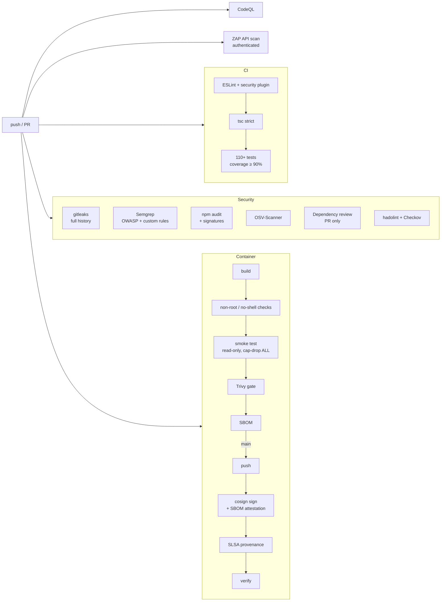

# Security pipeline

Every push and pull request goes through the gates below. A red gate blocks the merge
(enable branch protection with these checks as *required*). Findings from SAST, IaC,
container and supply-chain scanners are uploaded as SARIF to the repository's
**Security → Code scanning** tab.

| Gate | Tool | Catches | Fails the build when |
|---|---|---|---|
| Lint | ESLint, `typescript-eslint` strict, `eslint-plugin-security`, custom SQL rules | Unsafe patterns, SQL interpolation, `eval` | Any error |
| Types | `tsc --strict` + `noUncheckedIndexedAccess` + `exactOptionalPropertyTypes` | Whole classes of runtime bugs | Any error |
| Tests | Vitest + Supertest | Functional and **abuse-case** regressions (IDOR, races, token forgery…) | A test fails or coverage < 90 % lines |
| Secrets | gitleaks (entire git history) | Committed credentials, even deleted ones | Any finding not in the reviewed allowlist |
| SAST | Semgrep (OWASP Top 10, Node.js, TypeScript, JWT, secrets) + 7 project rules | Injection, weak crypto, JWT misuse, missing owner scoping | Any blocking finding |
| SAST | CodeQL `security-extended` | Data-flow vulnerabilities (taint tracking) | Alerts in code scanning |
| SCA | `npm audit`, `npm audit signatures`, OSV-Scanner, Dependency Review | Known CVEs, unsigned / tampered packages, risky licences | HIGH+ in prod deps; invalid signature; moderate+ on PR |
| IaC | hadolint, Checkov | Dockerfile and Kubernetes misconfigurations | Any unreviewed finding |
| Container | Custom checks, Trivy | Root user, shell present, OS/library CVEs, embedded secrets | Shell found; fixable HIGH/CRITICAL CVE |
| DAST | OWASP ZAP API scan with a real bearer token | Runtime injection, traversal, header issues | Rules marked `FAIL` in `.zap/rules.tsv` |
| Supply chain | cosign, SBOM attestation, SLSA provenance, OpenSSF Scorecard | Image tampering, unverifiable builds | Signature or attestation verification fails |

## Pipeline hardening

- `permissions: {}` at workflow level; each job requests only what it needs.
- Every third-party action pinned to a full commit SHA (tags can be moved — see the 2025
  `tj-actions/changed-files` compromise); Dependabot keeps the pins current.
- `persist-credentials: false` on checkout: the token is not left on disk for later steps.
- `npm ci --ignore-scripts`: no dependency install hook ever executes.
- `step-security/harden-runner` monitors runner egress.
- Signing is keyless (OIDC): there is no signing key stored anywhere to be stolen.
