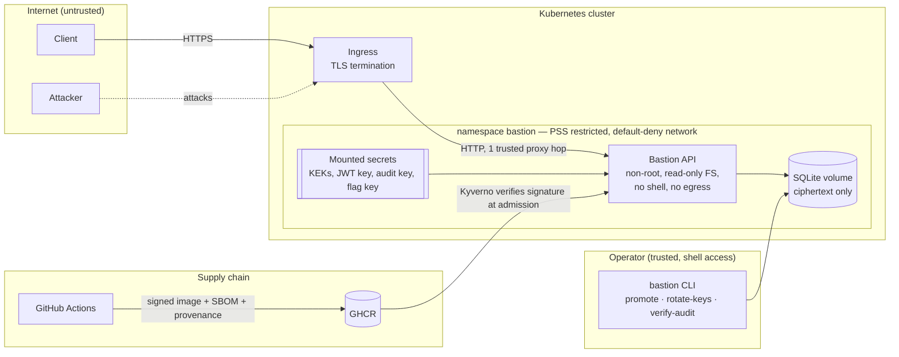

# Threat model

Method: data-flow diagram + STRIDE per element, then abuse cases with the
control and the test that proves it. Reviewed whenever the attack surface
changes (the PR template asks for it).

## 1. Scope and assets

| Asset | Why it matters | Where it lives |
|---|---|---|
| Note contents | Users' private data — the core confidentiality promise | `notes.ciphertext` (AES-256-GCM) |
| Credentials | Account takeover | `users.password_hash` (scrypt) |
| Refresh tokens | Long-lived session (7 days) | `refresh_tokens.token_hash` (SHA-256 only); in browsers, an HttpOnly `__Host-` cookie |
| Key ring (KEKs) | Decrypts every note | Secret store → mounted file, never in the DB |
| JWT signing key | Forge any identity, including admin | Secret store → mounted file |
| Audit HMAC key | Forge or hide audit history | Secret store → mounted file |
| Flag HMAC key | Compute every learner's flags (forge scores only) | Secret store → mounted file |
| TOTP seeds, recovery codes | Bypass the second factor | `user_mfa.secret` (AES-256-GCM under the KEK ring, AAD-bound to the user); `mfa_recovery_codes.code_hash` (SHA-256) |
| Passkey public keys and counters | Enrol an attacker's key, or roll a counter back to hide a clone | `passkeys` (SPKI DER public keys only, nothing that signs); `credential_id` UNIQUE; counter updated by compare-and-set |
| Scores and pseudonyms | Scoreboard integrity; pseudonyms are the only cross-user data shown | `challenge_solves`, `users.display_name` (opt-in) |
| Audit trail | Detection, forensics, accountability | `audit_log` (append-only, HMAC chain) |
| Docker socket | Root on the host: any container, any mount | Lab runner only (ADR 0009); never in the platform or the gateway |
| Lab runner token | Start and stop lab containers (catalog labs only) | Platform and runner configuration, from a secret file or `.env` |
| The host, the platform, other learners' labs | What an attacker inside a lab would go for next | Separated by the per-instance internal network, container hardening, the gateway's fixed routing |
| Learning progress | Learners' record; future scoreboard and certificates depend on its integrity | `lesson_progress` (scoped by `user_id`) |
| Learning content | What learners are taught; a tampered lesson could mislead or carry malicious links | `content/` in git, shipped read-only in the signed image |
| Build pipeline | Ship a backdoored image to production | GitHub Actions, GHCR |

## 2. Data flow and trust boundaries



Trust boundaries crossed by data:

1. **Internet → ingress**: everything is untrusted; TLS required (HSTS preload).
2. **Ingress → API**: only `X-Forwarded-For` from exactly one hop is trusted (`TRUST_PROXY=1`).
3. **API → database**: the DB is treated as *potentially readable by an attacker* (backup leak, volume snapshot): it only ever holds ciphertext and hashes.
4. **Operator → system**: privileged actions (grant admin, rotate keys) need host access; they are not reachable over HTTP at all.
5. **CI → cluster**: an image only runs if its Sigstore signature matches this repository's workflow identity.
6. **Platform → lab runner** (v5): internal network, shared token, closed lab catalog; the runner is the only holder of the Docker socket.
7. **Lab → anything**: a lab container is assumed compromised (that is its purpose). It sits alone with the gateway on an `internal` network, unprivileged and read-only; the browser reaches it on its own origin (`l<id>.lab.localhost`), never the platform's.
8. **Monitoring → API** (ADR 0011): Prometheus scrapes a separate metrics port that neither the ingress nor the published ports reach, with a bearer token; it learns counts, never identities.
9. **Operator → alerts** (ADR 0018): Grafana on loopback, login required, is the only way to Alertmanager (no published port); silencing an alert is an authenticated, attributed act.
9. **Learner → shared environment** (ADR 0013): the platform forwards an environment id to the runner, which may only inspect, start and stop the containers the catalog names; the Wazuh stack itself sits on an `internal` network, its dashboard published on loopback only.

```
browser ─► bastion :3000 ──(lab-control, internal, token)──► lab-runner ── Docker socket
browser ─► lab-gateway :8088 ──(per-instance internal network)──► lab container
```

## 3. STRIDE

| Threat | Element | Attack | Mitigation | Evidence |
|---|---|---|---|---|
| **S**poofing | Login | Credential stuffing, brute force | Per-IP rate limit (10 / 15 min), progressive account lockout, breached-password blocklist | `authentication.test.ts` › brute-force protection |
| **S**poofing | Login (stolen password) | Phished or reused password | Optional TOTP second factor (RFC 6238); refresh cookie and tokens only issued after it | `mfa.test.ts` |
| **S**poofing | TOTP code | Replay of an observed code; brute force of the 6 digits | Last accepted time step stored, compare-and-set update (no reuse, no race); challenge single-use, 5-min life, 5 attempts; wrong codes feed the account lockout | `mfa.test.ts`, `totp.test.ts` |
| **S**poofing | MFA removal | Hijacked session or stolen password turns MFA off | Disabling requires the password *and* a valid code; setup requires the password | `mfa.test.ts` › removal |
| **S**poofing | Passkey login (ADR 0016) | Adversary-in-the-middle phishing relays the second factor; replay of an assertion; a foreign or cloned key | Exact origin and RP ID hash checked (a proxy's origin is signed and refused); single-use challenge bound to its user, purpose and MFA step; allow-list and lookup scoped to the account; signature with the stored key; counter must grow, a stale one is refused and audited | `passkeys.test.ts`, `webauthn.test.ts`, `test/e2e/passkeys-browser.sh` |
| **S**poofing | Passwordless passkey login (ADR 0017) | Another account's user handle with one's own key; a key without PIN found or stolen; a challenge borrowed from the MFA step; account or credential enumeration | Lookup `WHERE user_id = <handle> AND credential_id`; user verification required (UV flag); separate single-use challenge table; options name no account, one 401 for every failure; plus every check of the MFA-step row above | `passkey-login.test.ts`, `webauthn.test.ts`, `test/e2e/passkeys-browser.sh` |
| **D**enial of service | Passwordless login | Locking a victim by sending forged assertions with their handle; filling the database with unauthenticated challenges | Failed assertions never count as failed logins; per-address auth rate limit and a global cap on pending challenges (503 beyond, expired ones swept first) | `passkey-login.test.ts` |
| **E**levation of privilege | Account recovery | Using "I lost everything" as a way around the factors | No recovery over HTTP; operator CLI on the host only, removes every factor and session (an attacker's passkey too), audited and alerted (Wazuh 100206) | `account-recovery.test.ts` |
| **T**ampering / **D**enial of service | WebAuthn parsing | Hostile CBOR before the signature check: huge announced lengths, deep nesting, duplicate keys, trailing bytes; keys off the curve | Strict bounded decoder (definite lengths checked before allocation, depth/item caps, no tags/floats, duplicates refused); COSE to KeyObject via JWK import; three algorithms only; bodies bounded by strict schemas | `webauthn.test.ts` |
| **E**levation of privilege | Passkey management | Enrolling one's key on a victim, reading or deleting another account's passkeys (IDOR), removing the last factor with a stolen session | Password required to add or remove; `user_id` in every query (Semgrep); foreign ids answer 404; removing the last factor needs a recovery code too | `passkeys.test.ts` |
| **S**poofing | Access token | `alg: none`, algorithm confusion, forged/modified token, cross-service replay | Algorithm allow-list, `iss`/`aud`/`typ` checks, mandatory `exp`, claims re-validated | `tokens.test.ts` |
| **S**poofing | Refresh token | Stolen token replayed | Single-use rotation + reuse detection → whole family revoked + access tokens invalidated (RFC 9700 §4.14) | `authentication.test.ts` › reuse |
| **T**ampering | Stored note | Attacker with DB write access edits or swaps ciphertexts | AES-GCM authentication, AAD binds ciphertext to note id *and* owner id | `envelope.test.ts`, `authorization.test.ts` › data at rest |
| **T**ampering | Audit trail | Erase evidence after an intrusion | DB triggers block UPDATE/DELETE; HMAC chain detects edits even if triggers are dropped; `verify` pinpoints the first broken entry | `config-and-audit.test.ts` |
| **T**ampering | Container image | Backdoored image pushed to the registry | Keyless cosign signature, SLSA provenance, admission policy rejects unsigned images | `container.yml`, `deploy/policies/` |
| **T**ampering | Request body | Mass assignment (`"role":"admin"`), prototype pollution | Strict schemas reject unknown keys | `authorization.test.ts`, `input-and-transport.test.ts` |
| **R**epudiation | Any sensitive action | "It wasn't me" | Tamper-evident audit log: who, what, target, IP, outcome | `auditActions()` assertions across tests |
| **I**nformation disclosure | Notes | IDOR / BOLA — guessing other users' note ids | Owner scoping inside every SQL query; foreign and missing notes return the same 404; probing is logged | `authorization.test.ts` › IDOR |
| **T**ampering | Learning progress | Unlocking modules or completing lessons without doing them (edited front-end, replayed or forged requests) | Prerequisites and quizzes enforced server-side; answers never sent to the client; strict body schema (no client-supplied `completedAt`); completion idempotent | `learning.test.ts` |
| **T**ampering | Learning content | Malicious lesson (phishing link, script in Markdown) | Content is code: reviewed in PRs, validated at startup (strict schema, `https:` links only, slug ids), no write endpoint; clients must render Markdown without trusting HTML | `curriculum.test.ts` |
| **T**ampering | Optional modules (ADR 0012) | Opening a left-out module by calling its lessons or challenges directly; changing another learner's choices; removing a mandatory module | Gate in the learning service for lessons, quizzes, challenges and labs (403, audited `not_added`); choices scoped by `user_id` in SQL (Semgrep rule), no user id in the route; strict body; mandatory modules refused; boot check that no mandatory module depends on an optional one | `optional-modules.test.ts`, `curriculum.test.ts` |
| **E**levation of privilege | Shared environments (ADR 0013) | Using the start/stop routes to make the Docker-holding runner create, mount or start something else (path tricks in the id, unknown ids, extra body fields) | The id is a slug checked against the closed catalog on the platform and with `z.enum` on the runner; container names come from `src/labs/environments.ts`; the runner has no create call for environments | `environments.test.ts` (unit and security) |
| **I**nformation disclosure | Shared environments | Reading the Wazuh password or the host's container state without access; logging in with a public demo password | Login *hint* only (the password stays in `.env`); a locked learner gets no live state; setup removes the demo accounts and hashes generated passwords; dashboard on 127.0.0.1 only | `environments.test.ts` |
| **D**enial of service | Shared environments | Starting the SIEM in a loop, or leaving it running to hold 4 GiB | Same per-account limiter as labs; module gate; idempotent start; the runner stops it after 8 h, measured from the containers' own start time | `environments.test.ts` › reaper |
| **I**nformation disclosure | Learning progress | One learner reading or altering another's progress | Every query scoped by `user_id` from the verified token; no route takes a user id | `learning.test.ts` › isolation |
| **S**poofing / **I**nformation disclosure | Browser session | XSS steals the session | Refresh token only in an HttpOnly `__Host-` cookie; access token in memory, never in web storage (ESLint ban); UI built without HTML strings (ESLint ban); CSP `script-src 'self'` + Trusted Types with no policy, so HTML sinks throw | `web.test.ts`, `markdown.test.ts`, ADR 0007 |
| **T**ampering | Browser session | CSRF on cookie routes (refresh, logout, login) | `SameSite=Strict`, JSON-only bodies (forms cannot send JSON; cross-origin JSON needs a preflight nobody passes, no CORS configured), explicit `Origin` check | `web.test.ts` › CSRF |
| **T**ampering | Lesson rendering | Script or dangerous link in Markdown content | Parser produces a tree, never HTML; raw HTML stays text; only `https:` and `#/` links survive | `markdown.test.ts` |
| **T**ampering | Scores | Copying a flag from the repo or another learner; guessing flags; submitting twice | Flags are HMAC(key, challenge, user), never stored or in the repo; constant-time compare; per-account rate limit; shared flags attributed in the audit log; solves idempotent | `challenges.test.ts` |
| **I**nformation disclosure | Scoreboard | Learner enumeration or e-mail harvesting | Opt-in pseudonyms only; response carries pseudonym + score, no id or e-mail; a shared flag gets the same answer as a wrong one (no oracle on other accounts) | `challenges.test.ts` › scoreboard |
| **I**nformation disclosure | Accounts | User enumeration via login messages or timing | Identical 401 for unknown user / bad password / locked; dummy scrypt hash for unknown users | `authentication.test.ts` › enumeration |
| **I**nformation disclosure | Database dump | Backup or snapshot leaks | Envelope encryption: KEKs never stored with data; refresh tokens stored as hashes | `authorization.test.ts` › raw dump |
| **I**nformation disclosure | Errors & logs | Stack traces, SQL, secrets in logs | Central error handler with generic messages; logger-level redaction of secrets | `input-and-transport.test.ts` |
| **I**nformation disclosure | Secrets in env | `/proc/<pid>/environ`, crash dumps | Secrets mounted as read-only files (`*_FILE`), mode 0400 | `config-and-audit.test.ts` |
| **D**enial of service | API | Request floods | Global + per-route rate limits | `authentication.test.ts` › rate limit |
| **D**enial of service / brute force | Quizzes | Guessing answers by enumeration | Per-account rate limit on submissions (30 / 15 min), every question must be answered, failures audited | `learning.test.ts` › rate limit |
| **D**enial of service | Password hashing | Huge passwords, parallel logins exhausting RAM | Length capped before hashing; scrypt concurrency bounded by libuv pool (4 × 128 MiB); memory limit sized for it | `input-and-transport.test.ts` |
| **D**enial of service | HTTP server | Slow-loris, giant bodies | Header/request timeouts, 100 kB body limit | `server.ts`, tests |
| **E**levation of privilege | Content loader | Path traversal through a lesson id (`../../`) | Ids restricted to `[a-z0-9-]`, checked at startup and on every route; unknown ids 404 without touching the disk (content is loaded once at boot) | `curriculum.test.ts`, `learning.test.ts` |
| **E**levation of privilege | Static files | Path traversal or dotfile read through the web server | `express.static` with a fixed root, `dotfiles: 'deny'`, no directory index for `/js`; pages served with their own CSP only on files actually served | `web.test.ts` |
| **E**levation of privilege | Admin API | Regular user calls admin routes | Role check server-side, role read from DB on every request (instant demotion); attempts audited | `authorization.test.ts` › function-level |
| **E**levation of privilege | Container | RCE → host / cluster takeover | Distroless (no shell), non-root, read-only rootfs, all capabilities dropped, seccomp, no SA token, no egress | `deployment.yaml`, smoke test in `container.yml` |
| **E**levation of privilege | Lab container | Code execution in a lab → host, platform, other labs, Internet | Non-root, read-only rootfs, no capabilities, no-new-privileges, `noexec` tmpfs, memory/CPU/PID caps, no mount, no published port; per-instance `internal` network (no egress, no neighbour); optional gVisor runtime | `lab-runner.test.ts` › container spec; isolation checked live (no route to Internet, runner or platform) |
| **E**levation of privilege | Lab runner | Abusing the runner to start an arbitrary container (privileged, host mounts) | Only the platform can reach it (internal network) with a 256-bit token compared in constant time; strict schema: catalog lab id, hex instance id, flag, bounded TTL; image, command, mounts and ports come from code | `lab-runner.test.ts` › runner API |
| **I**nformation disclosure | Lab gateway | SSRF through the Host header (cloud metadata, runner, platform) | Upstream built from a 32-hex id only; any other Host gets 404 without a connection | `lab-runner.test.ts` › gateway |
| **S**poofing / **I**nformation disclosure | Browser | A lab's XSS or cookies reaching the platform session | Each lab on its own origin (`l<id>.lab.localhost`), distinct from the platform's; platform cookies are `__Host-` on the platform origin | ADR 0009, checked in Chrome (`document.cookie` empty in the lab) |
| **I**nformation disclosure | Labs | Reading or stopping another learner's lab; reusing their flag | Instance ids are 128 random bits; rows read and deleted with `user_id` in SQL; flags are per learner (ADR 0008) | `labs.test.ts` › IDOR |
| **D**enial of service | Detection rules (v6) | A learner rule that makes evaluation slow (ReDoS, huge rules) and stalls the event loop for everyone | No regular expressions; linear substring/prefix/suffix tests only; every rule dimension capped; datasets under 400 events; per-account evaluation rate limit | `detection.test.ts` (unit and security) |
| **I**nformation disclosure / **D**enial of service | Wazuh rule challenges (ADR 0014) | Learner XML with a DTD: external entities read server files or reach internal URLs (XXE), nested entities expand to gigabytes (billion laughs) | No general-purpose XML parser: a closed reader refuses DOCTYPE, ENTITY, CDATA and processing instructions up front and knows only the five predefined entities; 8000 characters, depth 4, 300 elements | `wazuh.test.ts`, `wazuh-rules.test.ts` |
| **D**enial of service | Wazuh rule challenges | A `<regex>` or `<pcre2>` pattern built for catastrophic backtracking; a rule tree that loops | Regular expressions refused (OS_Match only, linear); `<field>` must say `type="osmatch"`; parents must be defined above, each rule visited once per event; 10 rules, 8 conditions; per-account rate limit | `wazuh.test.ts` › linear, acyclic |
| **E**levation of privilege | Detection rules (v6) | Field names used to reach object internals (`__proto__`, `constructor`) | Rule keys validated against the dataset's field list before evaluation; values read with `Object.hasOwn` | `detection.test.ts` › rule language |
| **I**nformation disclosure | Detection challenges | Recovering the answer key (which events are malicious) | Labels stay in the evaluator; responses carry counts and at most three examples; ids follow time order | `detection.test.ts` › datasets |
| **D**enial of service | Labs | Starting many labs to exhaust the host | One running lab per learner (`UNIQUE(user_id)`, race-proof), per-account start rate limit, TTL enforced by both platform and runner, per-container resource caps | `labs.test.ts` |
| **I**nformation disclosure | Metrics (ADR 0011) | Reading `/metrics` to count accounts or to see whether a brute force is noticed; personal data copied into the monitoring system | Separate listener and port (never on the API, absent from the Service and ingress, `internal` network / NetworkPolicy), 256-bit bearer token compared in constant time, configuration refuses a port without a token; labels from closed sets only (route patterns, audit actions), never ids, e-mails or IPs | `observability.test.ts` |
| **T**ampering / **R**epudiation | Alerting pipeline (ADR 0018) | Silencing every alert through Alertmanager's unauthenticated API before an attack; a broken pipeline that nobody notices; a dashboard or alert on a metric that does not exist | Alertmanager on the `internal` network only, silences through Grafana after login (author + comment); Watchdog dead man's switch, `AlertmanagerUnreachable`, `AlertmanagerNotificationsFailing`; metric names, audit actions and runbook links checked against the real exports | `routes.test.sh`, `alerts.test.yml`, `observability-config.test.ts` |
| **S**poofing | Grafana | Default `admin/admin`, anonymous access or self sign-up | Password from a compose secret, anonymous and sign-up off, provisioning read-only, telemetry and plugin catalogue off | ADR 0018 (checked on the live stack) |
| **D**enial of service | Metrics | Cardinality explosion: crafted URLs or values creating one series each until memory runs out | Route patterns instead of URLs, fixed method list, per-metric series cap with a counted (and alerted) drop | `metrics.test.ts`, `observability.test.ts` |
| **R**epudiation / detection | Security events | An attack in progress that nobody notices (stolen refresh token, password spray, database tampering) | Audit events counted by action and outcome; fifteen Prometheus alerts (with a Watchdog) linked to runbook sections, unit-tested with `promtool test rules` in CI; the audit log itself in Wazuh with rules checked in the real `wazuh-logtest` (ADR 0015) | `deploy/prometheus/alerts.test.yml`, `test/wazuh-real/` |
| **T**ampering | SIEM copy of the audit log (ADR 0015) | Forging audit lines through user input (a newline in a URL or an e-mail, CWE-117); a detail overwriting `action` or `srcip` | One `JSON.stringify` per line (control characters escaped); details never overwrite the line's own keys; the forged-line case replayed in the real `wazuh-logtest` | `audit-export.test.ts`, `test/wazuh-real/bastion-audit.ts` |
| **I**nformation disclosure | SIEM copy | The SIEM, or whoever reads its volume, sees more than security events | Its own volume, read-only in the manager, mode 0600; only what the audit log already holds (ids, IPs, actions), never the database | `audit-export.test.ts`, `docker-compose.yml` |
| **D**enial of service | SIEM copy | A full disk or a broken volume makes every request fail | Write errors are counted (`BastionAuditExportFailing`) and never thrown; the database stays the record; rotation by size | `audit-export.test.ts` |
| **E**levation of privilege | CI | Malicious dependency or action | `npm ci --ignore-scripts`, `npm audit signatures`, SHA-pinned actions, least-privilege tokens, harden-runner | `.github/workflows/` |

## 4. Abuse cases worth highlighting

**Race conditions (TOCTOU).** Two concurrent refreshes with the same token, or eight
concurrent wrong passwords, are classic ways to bypass single-use tokens and
lockouts. The refresh token is *claimed* with a conditional `UPDATE … WHERE
revoked_at IS NULL` before any `await`, and failed logins use an atomic
`UPDATE … RETURNING` instead of read-modify-write. Both are covered by tests
that fire the requests in parallel.

**Ciphertext relocation.** An attacker with write access to the database (but
not the keys) copies Alice's encrypted note into a row owned by Mallory. Without
AAD, decryption would succeed and serve Alice's data to Mallory. With the owner
id in the AAD, GCM authentication fails and the API returns a generic 500 and
logs a tampering alert.

**Audit cover-up.** An intruder deletes the log lines describing their actions.
The append-only triggers stop naive attempts; dropping the triggers is detected
by the HMAC chain, and the attacker cannot recompute the chain without the
audit key, which lives outside the database.

**Lab escape chain.** A learner gets code execution in a lab (expected for some labs)
and tries to go further. Downloading a tool or opening a reverse shell fails: the
network has no route out. Reaching another learner's lab or the platform fails: the
instance network contains only the lab and the gateway, and the names do not resolve.
Writing to the image or escalating inside the container fails: read-only root,
non-root user, no capabilities, `noexec` tmpfs. What is left is a kernel or runtime
vulnerability, which is why the runner can run labs under gVisor. The command-injection
lab gives the learner a real shell on purpose; all of the above was checked from that
shell (`wget` fails, `touch` on the root fails, a script in `/tmp` cannot run, every
capability set is zero).

## 5. Accepted risks

| Risk | Why accepted | Revisit when |
|---|---|---|
| Registration reveals whether an e-mail is taken (409) | No e-mail channel to send "if this address is free, check your inbox". Mitigated by the auth rate limit. | An e-mail verification flow is added |
| Account lockout can be triggered by an attacker (targeted DoS) | Trade-off against online brute force; lockout is temporary (15 min, progressive, capped at 24 h). Wrong TOTP codes count too, so someone holding the password can lock the account. Learners with a passkey are not affected: passwordless login ignores the password lockout (ADR 0017). | Adding CAPTCHA-on-risk |
| Someone holding a full session can add their own passkey and keep a way in after a password change | Adding a passkey asks the password again; `passkey.register` is audited and reaches Wazuh; the account page lists every passkey with its last use. Revoking passkeys on password change would punish the learner who changes a leaked password (ADR 0017). | Hosting: e-mail notification of new passkeys |
| Rate limiting is in-memory, per replica | Single replica by design (SQLite). | Moving to PostgreSQL + several replicas → Redis store |
| Quiz answers are readable in the public repository | Content is open source by design and the platform runs locally; the quiz checks learning, it is not an exam. Lessons only weigh 10 points on the scoreboard; challenges use per-learner HMAC flags that cannot be read from the repo (ADR 0008). | Certificates are introduced |
| Failed quiz responses say which questions are wrong | Pedagogical feedback beats secrecy here; enumeration is slowed by the per-account rate limit. | Same as above |
| JWT signed with a symmetric key (HS256) | One service both issues and verifies tokens; no third party needs to verify them. | Another service must verify tokens → EdDSA + JWKS |
| MFA is optional, and TOTP stays phishable in real time (a proxy relays a fresh code within 30 s) | Passkeys (ADR 0016) are the phishing-resistant option; TOTP remains for users without an authenticator, and recovery codes are a phishable fallback by nature. | Hosting: require passkeys for admins |
| A learner with a correct artifact can always score (challenges teach, they are not proctored) | Artifacts are deterministic per learner by design; the scoreboard is for motivation, not certification. Lab challenges (v5) close this: their flag only exists inside the learner's running lab. | Certificates are introduced |
| The lab runner holds the Docker socket (root-equivalent) and runs as root in its container | Starting containers needs it. The runner is small, unreachable except from the platform, token-protected, read-only and cap-less, and never takes an image, mount or option from a request (ADR 0009). | Hosting: replace with Kubernetes Jobs created by a narrowly-scoped service account |
| A kernel or container-runtime escape from a lab bypasses container isolation | Defense in depth already removes most escape prerequisites (no capabilities, no-new-privileges, non-root, read-only). gVisor (`LAB_RUNTIME=runsc`) adds a user-space kernel where installed; it is not the default because Docker Desktop does not ship it. | Hosting with untrusted learners: make gVisor or Kata mandatory |
| Whoever administers the host can read lab flags (`docker inspect` shows the environment) | On a local install the learner is the host administrator anyway (and holds `FLAG_HMAC_KEY` in `.env`); anti-cheat cannot exist there. | Hosting: learners never get host access, flags can then be trusted |
| Wazuh reads only future lines (`only-future-events`): what is written while it is stopped never becomes an alert | The database keeps every entry and `seq` shows the gap; a local SIEM that sleeps by design (ADR 0013) | Hosting: an always-on SIEM, or a reader that resumes from the last `seq` |
| One shared Wazuh per installation: any learner with the module can stop it while another uses it | Local install, one learner in practice; every start and stop is audited with the actor. | Hosting: leases or one tenant-scoped Wazuh per class |
| The Wazuh manager keeps its default capabilities (s6 starts as root and drops to the `wazuh` user) | Upstream image design; no-new-privileges, an `internal` network with no route out, no published port and a memory cap remain. | A rootless upstream image, or a per-capability allow-list once tested |
| Receivers deliver nowhere on a local install (no mail server, no chat): alerts are read in Grafana | The learner is the on-call person; routing, grouping and inhibition are still tested, and integrations take a `*_file` secret (ADR 0018) | Hosting: real receivers and an external dead-man's-switch for the Watchdog |
| Grafana reaches the Internet through its edge network | Needed to publish its port on loopback; telemetry, update checks, news and the plugin catalogue are off | Hosting: an egress proxy or NetworkPolicy |
| Scoreboard computed over all users on each request | Fine at local-install scale; one indexed aggregate query. | Hosting with many learners → cache or materialised scores |
| Unfixed OS CVEs in the base images (mostly glibc, libstdc++, zlib; medium/low) | No upstream patch exists. Distroless removes the shell and tools most exploits need, the container runs non-root on a read-only FS with no egress, and Trivy only raises alerts for fixable CVEs (full list in the SBOM). | A fix is published: the digest-pinned base image is bumped by Dependabot and Trivy flags it |
| Single-maintainer project: PRs are not reviewed by a second person (Scorecard *Code-Review*) | Every change still goes through a PR with 11 required CI checks (ruleset `protect-main`). | A second maintainer joins |

## 6. Out of scope

TLS termination and WAF (ingress responsibility), host and node hardening,
physical security, and the client application.
