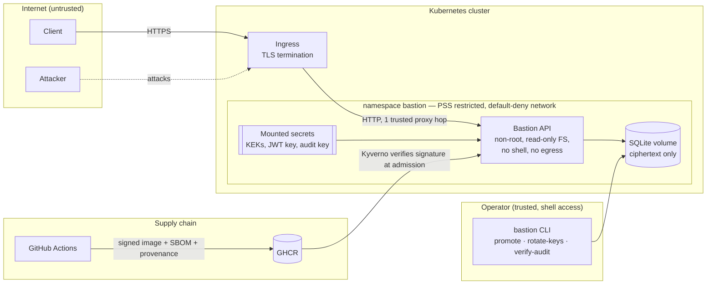

# Threat model

Method: data-flow diagram + STRIDE per element, then abuse cases with the
control and the test that proves it. Reviewed whenever the attack surface
changes (the PR template asks for it).

## 1. Scope and assets

| Asset | Why it matters | Where it lives |
|---|---|---|
| Note contents | Users' private data — the core confidentiality promise | `notes.ciphertext` (AES-256-GCM) |
| Credentials | Account takeover | `users.password_hash` (scrypt) |
| Refresh tokens | Long-lived session (7 days) | `refresh_tokens.token_hash` (SHA-256 only); in browsers, an HttpOnly `__Host-` cookie |
| Key ring (KEKs) | Decrypts every note | Secret store → mounted file, never in the DB |
| JWT signing key | Forge any identity, including admin | Secret store → mounted file |
| Audit HMAC key | Forge or hide audit history | Secret store → mounted file |
| Audit trail | Detection, forensics, accountability | `audit_log` (append-only, HMAC chain) |
| Learning progress | Learners' record; future scoreboard and certificates depend on its integrity | `lesson_progress` (scoped by `user_id`) |
| Learning content | What learners are taught; a tampered lesson could mislead or carry malicious links | `content/` in git, shipped read-only in the signed image |
| Build pipeline | Ship a backdoored image to production | GitHub Actions, GHCR |

## 2. Data flow and trust boundaries

Trust boundaries crossed by data:

1. **Internet → ingress**: everything is untrusted; TLS required (HSTS preload).
2. **Ingress → API**: only `X-Forwarded-For` from exactly one hop is trusted (`TRUST_PROXY=1`).
3. **API → database**: the DB is treated as *potentially readable by an attacker* (backup leak, volume snapshot): it only ever holds ciphertext and hashes.
4. **Operator → system**: privileged actions (grant admin, rotate keys) need host access; they are not reachable over HTTP at all.
5. **CI → cluster**: an image only runs if its Sigstore signature matches this repository's workflow identity.

## 3. STRIDE

| Threat | Element | Attack | Mitigation | Evidence |
|---|---|---|---|---|
| **S**poofing | Login | Credential stuffing, brute force | Per-IP rate limit (10 / 15 min), progressive account lockout, breached-password blocklist | `authentication.test.ts` › brute-force protection |
| **S**poofing | Access token | `alg: none`, algorithm confusion, forged/modified token, cross-service replay | Algorithm allow-list, `iss`/`aud`/`typ` checks, mandatory `exp`, claims re-validated | `tokens.test.ts` |
| **S**poofing | Refresh token | Stolen token replayed | Single-use rotation + reuse detection → whole family revoked + access tokens invalidated (RFC 9700 §4.14) | `authentication.test.ts` › reuse |
| **T**ampering | Stored note | Attacker with DB write access edits or swaps ciphertexts | AES-GCM authentication, AAD binds ciphertext to note id *and* owner id | `envelope.test.ts`, `authorization.test.ts` › data at rest |
| **T**ampering | Audit trail | Erase evidence after an intrusion | DB triggers block UPDATE/DELETE; HMAC chain detects edits even if triggers are dropped; `verify` pinpoints the first broken entry | `config-and-audit.test.ts` |
| **T**ampering | Container image | Backdoored image pushed to the registry | Keyless cosign signature, SLSA provenance, admission policy rejects unsigned images | `container.yml`, `deploy/policies/` |
| **T**ampering | Request body | Mass assignment (`"role":"admin"`), prototype pollution | Strict schemas reject unknown keys | `authorization.test.ts`, `input-and-transport.test.ts` |
| **R**epudiation | Any sensitive action | "It wasn't me" | Tamper-evident audit log: who, what, target, IP, outcome | `auditActions()` assertions across tests |
| **I**nformation disclosure | Notes | IDOR / BOLA — guessing other users' note ids | Owner scoping inside every SQL query; foreign and missing notes return the same 404; probing is logged | `authorization.test.ts` › IDOR |
| **T**ampering | Learning progress | Unlocking modules or completing lessons without doing them (edited front-end, replayed or forged requests) | Prerequisites and quizzes enforced server-side; answers never sent to the client; strict body schema (no client-supplied `completedAt`); completion idempotent | `learning.test.ts` |
| **T**ampering | Learning content | Malicious lesson (phishing link, script in Markdown) | Content is code: reviewed in PRs, validated at startup (strict schema, `https:` links only, slug ids), no write endpoint; clients must render Markdown without trusting HTML | `curriculum.test.ts` |
| **I**nformation disclosure | Learning progress | One learner reading or altering another's progress | Every query scoped by `user_id` from the verified token; no route takes a user id | `learning.test.ts` › isolation |
| **S**poofing / **I**nformation disclosure | Browser session | XSS steals the session | Refresh token only in an HttpOnly `__Host-` cookie; access token in memory, never in web storage (ESLint ban); UI built without HTML strings (ESLint ban); CSP `script-src 'self'` + Trusted Types with no policy, so HTML sinks throw | `web.test.ts`, `markdown.test.ts`, ADR 0007 |
| **T**ampering | Browser session | CSRF on cookie routes (refresh, logout, login) | `SameSite=Strict`, JSON-only bodies (forms cannot send JSON; cross-origin JSON needs a preflight nobody passes, no CORS configured), explicit `Origin` check | `web.test.ts` › CSRF |
| **T**ampering | Lesson rendering | Script or dangerous link in Markdown content | Parser produces a tree, never HTML; raw HTML stays text; only `https:` and `#/` links survive | `markdown.test.ts` |
| **I**nformation disclosure | Accounts | User enumeration via login messages or timing | Identical 401 for unknown user / bad password / locked; dummy scrypt hash for unknown users | `authentication.test.ts` › enumeration |
| **I**nformation disclosure | Database dump | Backup or snapshot leaks | Envelope encryption: KEKs never stored with data; refresh tokens stored as hashes | `authorization.test.ts` › raw dump |
| **I**nformation disclosure | Errors & logs | Stack traces, SQL, secrets in logs | Central error handler with generic messages; logger-level redaction of secrets | `input-and-transport.test.ts` |
| **I**nformation disclosure | Secrets in env | `/proc/<pid>/environ`, crash dumps | Secrets mounted as read-only files (`*_FILE`), mode 0400 | `config-and-audit.test.ts` |
| **D**enial of service | API | Request floods | Global + per-route rate limits | `authentication.test.ts` › rate limit |
| **D**enial of service / brute force | Quizzes | Guessing answers by enumeration | Per-account rate limit on submissions (30 / 15 min), every question must be answered, failures audited | `learning.test.ts` › rate limit |
| **D**enial of service | Password hashing | Huge passwords, parallel logins exhausting RAM | Length capped before hashing; scrypt concurrency bounded by libuv pool (4 × 128 MiB); memory limit sized for it | `input-and-transport.test.ts` |
| **D**enial of service | HTTP server | Slow-loris, giant bodies | Header/request timeouts, 100 kB body limit | `server.ts`, tests |
| **E**levation of privilege | Content loader | Path traversal through a lesson id (`../../`) | Ids restricted to `[a-z0-9-]`, checked at startup and on every route; unknown ids 404 without touching the disk (content is loaded once at boot) | `curriculum.test.ts`, `learning.test.ts` |
| **E**levation of privilege | Static files | Path traversal or dotfile read through the web server | `express.static` with a fixed root, `dotfiles: 'deny'`, no directory index for `/js`; pages served with their own CSP only on files actually served | `web.test.ts` |
| **E**levation of privilege | Admin API | Regular user calls admin routes | Role check server-side, role read from DB on every request (instant demotion); attempts audited | `authorization.test.ts` › function-level |
| **E**levation of privilege | Container | RCE → host / cluster takeover | Distroless (no shell), non-root, read-only rootfs, all capabilities dropped, seccomp, no SA token, no egress | `deployment.yaml`, smoke test in `container.yml` |
| **E**levation of privilege | CI | Malicious dependency or action | `npm ci --ignore-scripts`, `npm audit signatures`, SHA-pinned actions, least-privilege tokens, harden-runner | `.github/workflows/` |

## 4. Abuse cases worth highlighting

**Race conditions (TOCTOU).** Two concurrent refreshes with the same token, or eight
concurrent wrong passwords, are classic ways to bypass single-use tokens and
lockouts. The refresh token is *claimed* with a conditional `UPDATE … WHERE
revoked_at IS NULL` before any `await`, and failed logins use an atomic
`UPDATE … RETURNING` instead of read-modify-write. Both are covered by tests
that fire the requests in parallel.

**Ciphertext relocation.** An attacker with write access to the database (but
not the keys) copies Alice's encrypted note into a row owned by Mallory. Without
AAD, decryption would succeed and serve Alice's data to Mallory. With the owner
id in the AAD, GCM authentication fails and the API returns a generic 500 and
logs a tampering alert.

**Audit cover-up.** An intruder deletes the log lines describing their actions.
The append-only triggers stop naive attempts; dropping the triggers is detected
by the HMAC chain, and the attacker cannot recompute the chain without the
audit key, which lives outside the database.

## 5. Accepted risks

| Risk | Why accepted | Revisit when |
|---|---|---|
| Registration reveals whether an e-mail is taken (409) | No e-mail channel to send "if this address is free, check your inbox". Mitigated by the auth rate limit. | An e-mail verification flow is added |
| Account lockout can be triggered by an attacker (targeted DoS) | Trade-off against online brute force; lockout is temporary (15 min, progressive, capped at 24 h). | Adding MFA or CAPTCHA-on-risk |
| Rate limiting is in-memory, per replica | Single replica by design (SQLite). | Moving to PostgreSQL + several replicas → Redis store |
| Quiz answers are readable in the public repository | Content is open source by design and the platform runs locally; the quiz checks learning, it is not an exam. Integrity-sensitive scoring (v4) will use per-user HMAC flags that cannot be read from the repo. | A scoreboard or certificates are introduced |
| Failed quiz responses say which questions are wrong | Pedagogical feedback beats secrecy here; enumeration is slowed by the per-account rate limit. | Same as above |
| JWT signed with a symmetric key (HS256) | One service both issues and verifies tokens; no third party needs to verify them. | Another service must verify tokens → EdDSA + JWKS |
| No MFA | Out of scope for v2. | v3 roadmap (WebAuthn) |
| Unfixed OS CVEs in the base images (mostly glibc, libstdc++, zlib; medium/low) | No upstream patch exists. Distroless removes the shell and tools most exploits need, the container runs non-root on a read-only FS with no egress, and Trivy only raises alerts for fixable CVEs (full list in the SBOM). | A fix is published: the digest-pinned base image is bumped by Dependabot and Trivy flags it |
| Single-maintainer project: PRs are not reviewed by a second person (Scorecard *Code-Review*) | Every change still goes through a PR with 11 required CI checks (ruleset `protect-main`). | A second maintainer joins |

## 6. Out of scope

TLS termination and WAF (ingress responsibility), host and node hardening,
physical security, and the client application.
